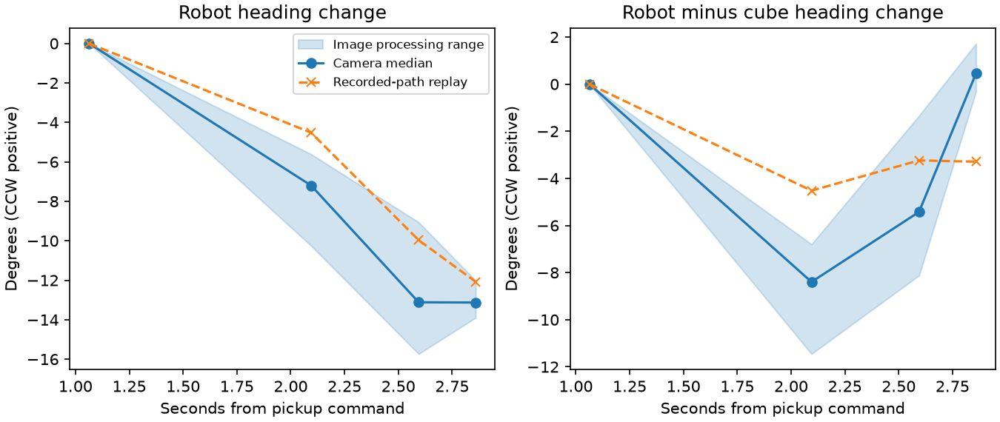
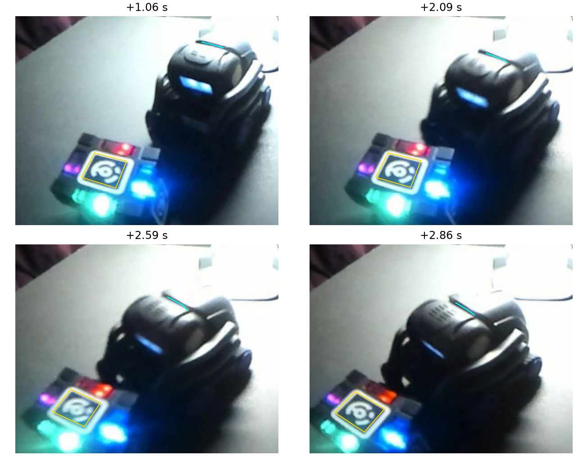

# Does the robot approach the cube at the recorded heading?

By +2.86 s, the transverse shell seam had turned 12.0–13.9° clockwise from the +1.06 s exposure. SDK chassis yaw changed 12.1° clockwise. The top glyph had turned 13.5–13.8° clockwise, while the simulated cube turned 8.8°. The robot's **change of heading relative to the cube** was therefore between −0.3° and +1.7° in the video (CCW positive), compared with −3.3° in the replay. The relative-heading discrepancy at that exposure comes mainly from the cube turning too little. The starting absolute approach angle is not recovered by this comparison.

At +2.09 s the seam suggested 5.6–10.3° clockwise against 4.5° from SDK odometry. At +2.59 s the optical range widened to 9.1–15.7°, which includes the SDK estimate. These are sparse camera observations with processing sensitivity, not continuous ground truth.

We applied the minimum, median and maximum optical shell-minus-SDK change at each exposure to the prescribed chassis yaw. Corrections interpolate between exposures, start at zero and hold the last offset after +2.86 s. Each replay retains SDK chassis translation and pitch, the measured wrist path and a free 50 g cube. Corrections alter the fork and rail trajectories together. Two starting sightings and 0.5/1 ms steps give 12 corrected runs and four baseline runs on this pickup. Corrected planar travel was 30.4–31.5 mm versus 27.2 mm observed. All were level at +3.38 s, when the physical cube visibly tipped. There is no basis here for changing canonical approach steering.

**Measurement.** The known top-glyph corners are rescaled from the 960-pixel-wide crop to the 640-pixel video. The image trace uses the darkness-weighted center of the straight part of the transverse seam behind the head. Each four-frame comparison uses one fixed perspective transform, fitted to one of five stationary glyph observations. We varied the seam trace window (4–6 pixels each side) and trimmed either zero or three pixels from each end. The resulting 30 estimates per exposure share the same footage. Rectification assumes a locally planar scene and a transverse seam direction parallel to the cube top. Shell curvature, pitch, lens distortion, motion blur and camera/SDK receipt timing can bias the result beyond that range.

[Measured headings and sensitivities](approach-heading.csv) · [Replay outcomes](approach-heading-replay.csv) · [Image analysis](approach-heading.py) · [Replay script](approach-heading-replay.py) · [Rim clearance](pickup-undercut.md). Run the image analysis with OpenCV, NumPy and Matplotlib. Run the replay script with the printed fork fixture and repo path as in the [fork pitch study](fork-load-limit.md).
