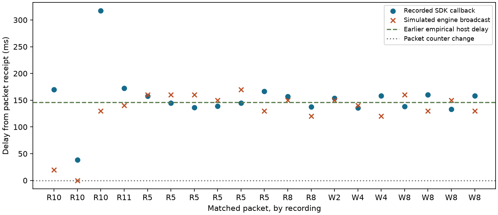

# Cube tap publication on the physical engine clock

A change in the cube’s transmitted tap counter supplies a candidate. The enabled physical engine groups candidates starting at the first intake tick, waits 75 ms and publishes the newest payload on the first engine update strictly past the deadline. The nominal update interval is 60 ms. The payload keeps the original body-state timestamp. The simulator now advances this grouping clock even between cube packets. The browser HUD shows the broadcast count and last publication time. Raw listener events remain available for radio comparisons. [Physical grouping implementation](https://github.com/os-vector/wire-os-victor/blob/3cec4844d24c4719b5b3892e4979494bcd260424/engine/components/blockTapFilterComponent.cpp) · [Engine period](https://github.com/os-vector/wire-os-victor/blob/3cec4844d24c4719b5b3892e4979494bcd260424/robot/include/anki/cozmo/shared/cozmoEngineConfig.h)

The [source packet matches](sdk-tap-transfer.csv) identify counter changes using the raw BLE packets, and associate physical callbacks by their SDK payload timestamp. The replay uses robot uptime for the clock and host-time differences for scoring. It assumes packet intake before publication on a coincident tick and engine phase zero relative to robot uptime. No phase was fitted. All 14 held-out wheelstand and control recordings contributed to the original [coverage check](sdk-tap-coverage.csv); seven had changes. Their 21 packet changes produced 20 recorded callbacks. The model emitted 19 broadcasts, all matched. The extra physical callback was in R10. The source timing rule is independent of these runs.

Median absolute error over the 19 common callbacks was 153.8 ms for immediate packet delivery and 23.6 ms for modeled engine publication. The earlier empirical 145.906 ms delay gave 11.6 ms on those same callbacks. A fixed delay can predict host receipt but does not model grouping. Engine publication, packet-log receipt and SDK callback receipt are different clock boundaries. The radio contents were observed, so this experiment scores the delivery stage only. It does not validate collision generation or reconstruction of missing high-rate acceleration samples.

Shifting the unknown engine origin by 0, 10, 20, 30, 40 and 50 ms gave 19–21 broadcasts and 18–20 matches. A shared timestamped engine trace would resolve phase and distinguish grouping from transport loss. [Per-packet scores](broadcast-transfer.csv) · [Replay and phase sensitivity](broadcast_transfer.py)
