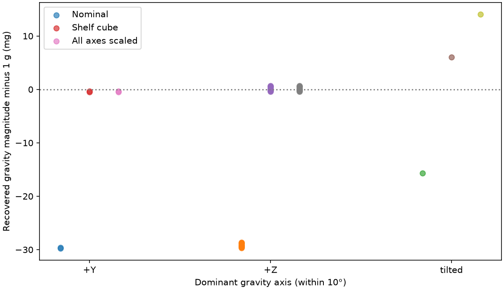

# Shelf cube accelerometer transfer across resting faces

The canonical shelf cube applies a gain of 0.970709 on Y and Z and unity on X. We checked the later roll, wheelstand, dock and spin recordings against those frozen values. This analysis measures how close the recovered acceleration magnitude is to 1 g. It does not establish the cube's attitude from an external reference.

| Dominant gravity direction | Quiet one-second windows | Median absolute magnitude error, nominal | Canonical shelf cube | Same gain on all axes |
|---|---:|---:|---:|---:|
| +Z | 748 | 29.17 mg | 0.37 mg | 0.37 mg |
| +Y | 61 | 29.74 mg | 0.48 mg | 0.48 mg |
| Tilted during R5 carry | 5 | 15.65 mg | 6.04 mg | 14.06 mg |

The table weights each qualifying second equally. The figure gives one point per capture, trial and orientation, so long runs do not dominate the visual comparison. The +Y observations are from the post-roll R8 recording and R9, already used in the original transfer check. Later spin and wheelstand recordings broaden the +Z coverage. None of the quiet windows approached ±X or a negative Y/Z face. The screen requires at least 45 samples spread over 0.75 seconds, vector RMS scatter at most 12 mg and mean acceleration between 0.9 and 1.1 g. Low variation does not guarantee rest during a carry.

## Does the tilted carry establish an X gain?

With Y/Z fixed, the three pre-reverse tilted windows in R5 give an X gain of 1.02318 if their mean specific force is assumed to be exactly 1 g. That reduces the magnitude error in the two post-reverse windows from 6.03 to 0.13 mg. Both intervals share a robot, grasp and similar attitude.

The independent tilted pickup has only 0.032 g on X, compared with 0.518 g in the fit. Its residual changes from 7.34 to 7.32 mg. This pose has too little X sensitivity to test the fitted gain. The canonical model retains unity X gain. A quiet placement on an X face would give roughly twice the X projection of the R5 carry; opposing faces would also distinguish an offset from a gain.

[Qualifying windows](face-coverage.csv) · [X gain fit and independent test](face-x-transfer.csv) · [Scoring script](face_coverage.py) · [Original R8 adjacent-face observation](../unit3-wheelstand/R8/README.md)
