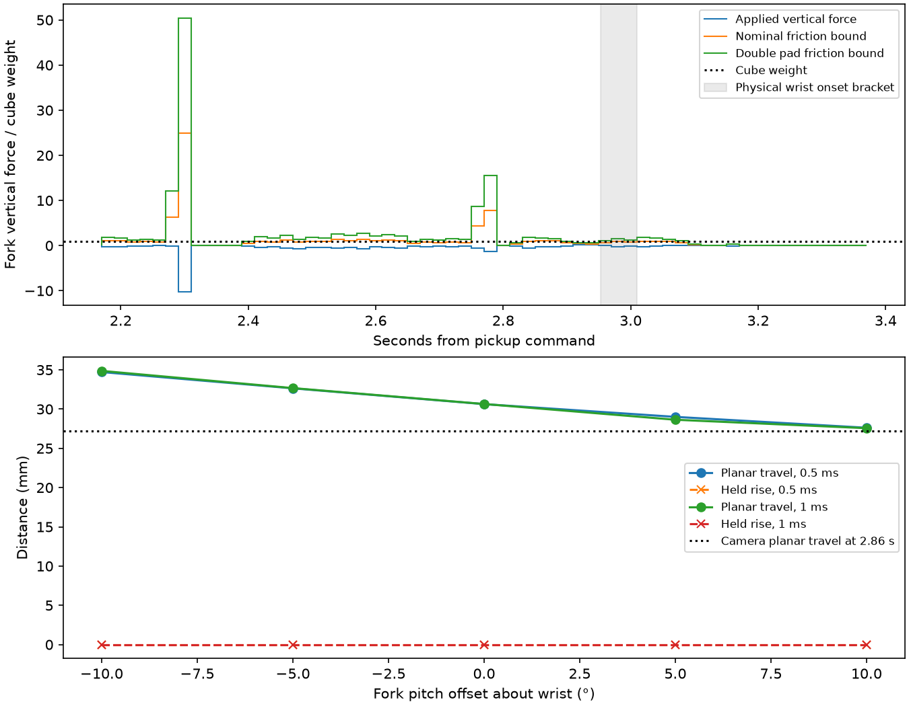

# Why does the simulated cube slide and stay down?

The physical camera measured 27.2 mm of planar travel by 2.859 s, and the video shows a successful lift. In the free-cube replay, a +10° pitch offset about the wrist brought travel at that instant from 30.6 mm to 27.6 mm at both solver steps. All ten runs still left the cube on the shelf. The greatest transient center rise was 0.30 mm, and the median rise during 6.5–8.31 s was effectively zero. Matching one planar observation does not establish the installed fork pitch. The physical fork had a damaged tooth and its exact contact surface was unmeasured. [Physical video](pickup.mp4) · [Physical timing and planar measurements](motion-brackets.md)

Over 3.010–3.360 s, the baseline fork's mean vertical contact force was slightly downward (2.4% of the 50 g cube's weight). The last loaded fork contact occurred at 3.164 s. Giving every contact its most favorable upward friction direction would support at most 22% of the weight averaged over that interval, or 37% with double rubber friction. These bounds fix the measured **simulation** normal impulses, ignore torque balance and omit direct rail and shelf forces. Changing friction in a dynamic replay could change the normal loads. A sustained lift requires resolving how the real fork keeps purchase as the wrist rises.

## Reproduce

Use the printed-fork XML fixture and rail-export dependencies from the [printed-fork contact replay](../unit3-printed-fork-contact/). Run `python fork-rake.py /path/to/fork.xml /path/to/repo` with MuJoCo 4.0.1, SciPy and NumPy, then `python fork-load-limit.py` with Matplotlib and NumPy. Inputs include the last sighting, recorded chassis pitch and wrist trajectory. The five pitch offsets rotate the fork about its wrist at every step, with prescribed rails. Baseline vertical impulse includes normal and friction components from fork–cube contacts. [Pitch runs](fork-rake.csv) · [Interval bounds](fork-load-limit.csv) · [Per-contact impulses](pickup-patch.csv)
