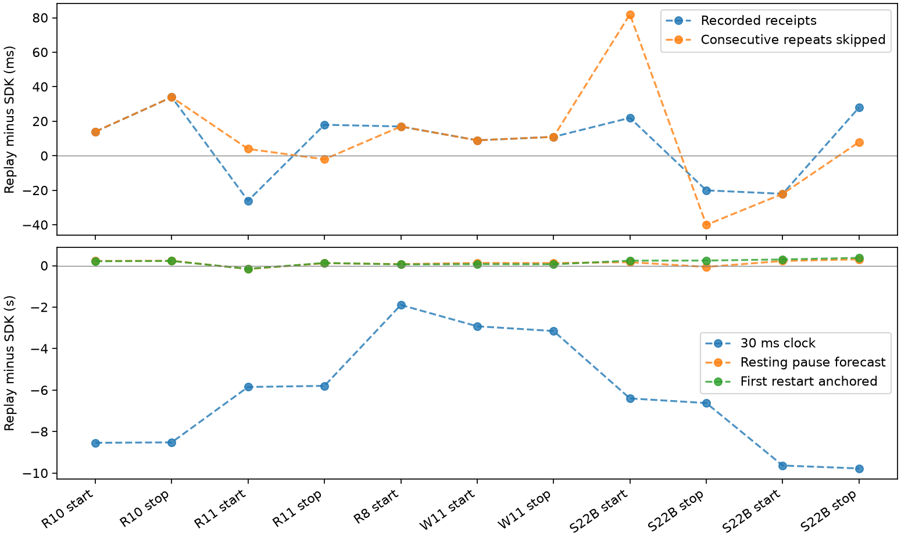

# Do receiver gaps change apparent cube motion?

Replaying 25,156 physical acceleration reports from 18 nonempty captures produced 51 raw listener events. Skipping the 338 reports whose tap count and all nine acceleration words exactly matched the preceding accelerometer report preserved each event type's count. It moved six of the 15 start/stop transitions to a different packet. These repeats are defined on the decoded acceleration stream; other radio notification types are unavailable in these files.

For the five runs with recorded SDK movement callbacks, we paired all 11 transitions in order and checked their directions. All four additional raw transitions came from R5, which recorded no movement broadcasts during manipulation. The raw listener and the SDK broadcast are separate stages.

| Replay clock or packet treatment | Mean absolute error vs SDK | Largest absolute error |
|---|---:|---:|
| Recorded uptime, all packets | 20 ms | 34 ms |
| Recorded uptime, skip exact repeats | 22 ms | 82 ms |
| Nominal 30 ms per recorded packet | 6,280 ms | 9,772 ms |
| Frozen resting pause forecast | 168 ms | 306 ms |
| Same forecast anchored at first observed restart | 191 ms | 379 ms |

The nominal and forecast rows predict **elapsed time from the first received packet**, keeping the recorded acceleration words and their order. The nominal error therefore measures accumulated drift if a replay compresses receiver gaps. It does not measure the motor's contact timing or a six-second delay in the motion detector. The forecast uses ordinary and long interval means and the mean packet spacing between pauses from the separate resting capture. No parameters were fitted on these wheelstand or roll recordings. The anchored variant uses one observed restart per test run.

The measured gaps matter to a timed replay. Removing repeated reports is a separate choice: it improved the R11 start by 22 ms in absolute error, but worsened the first S22B roll start by 60 ms. For physical playback, preserve the observed packet sequence and robot uptime. The resting forecast is useful when only indices exist; its errors are large enough to misplace a particular fork contact.

[SDK comparisons](gap-listener-sdk.csv) · [All listener events](gap-listener-events.csv) · [Coverage and movement-score differences](gap-listener-runs.csv). Reproduce with `node gap-listeners.mjs` and `python gap_listener_scores.py` in this directory.
