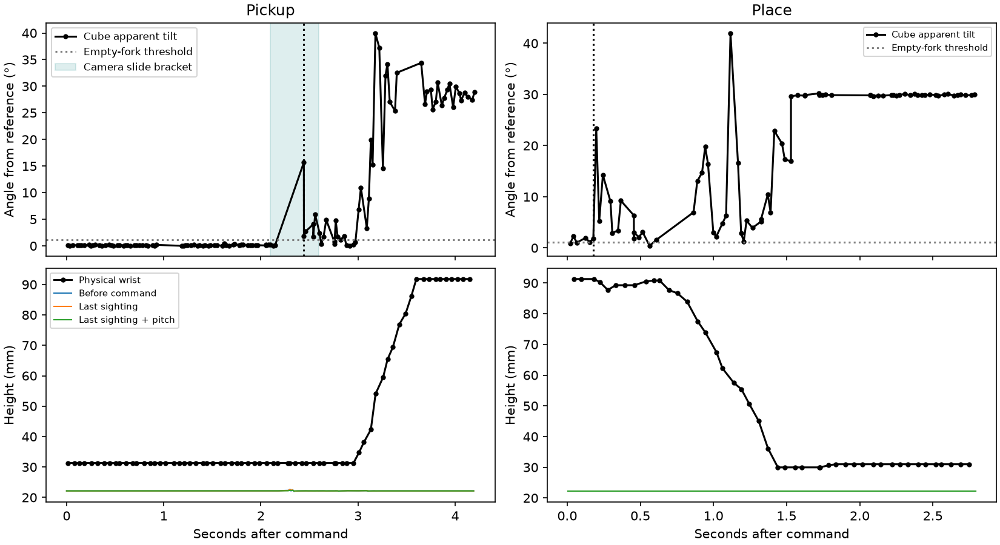

# When does the cube first respond during pickup?

The cube responds during the rolling approach, before the lift rises. The last packet before the detected change arrived 2.146 s after the pickup command. The first qualifying packet arrived at 2.442 s. At the nearest SDK report the wheels were moving at 70 and 45 mm/s and the wrist was still at 31.32 mm. The first persistent wrist change beyond 2 mm was bracketed by receipts at 2.953–3.010 s.

Independent overhead glyph positions bracket the first observed 2 mm of planar motion between 2.095 and 2.594 s. All three free-cube replays start sliding inside this bracket (2.23–2.25 s) and inside the cube packet bracket. None raises the cube center by 2 mm during the pickup window, although the physical video shows a successful lift. Agreement on initial sliding therefore gives a way to reject grip changes that ruin the approach. The unresolved part is engagement as the wrist begins rising. [Physical pickup video](pickup.mp4) · [Camera measurements](shelf-slide.csv) · [Simulation trajectories](free-pickup.csv)

## Detection and controls

The signal is the angle between the mean XYZ specific force in each three-slot packet and a local reference. Translation and rotation both affect it. The threshold was the 99th percentile (1.168°) from 12 docked lift strokes with a visible fork–cube gap, each relative to its own pre-command median vector. A detection requires two consecutive above-threshold packets no more than 100 ms apart. There were zero detections on the seven timing-valid off-dock control strokes with the cube beside the robot. The controls do not bound false positives during wheel motion. The independent camera evidence establishes that the cube slid. Receipt brackets include transport gaps and do not give an interrupt timestamp, a first-contact time or a lift-off measurement.

For placement, using the 0.7 s immediately before the command as the reference gives a cube response at 0.153–0.179 s and a wrist change beyond 2 mm at 0.224–0.278 s. The preceding loaded turn matters. Using the earlier settled carry orientation instead puts the cube above threshold in the first available packet. The shelf-contact time remains unresolved.

Run `python motion-brackets.py` here with NumPy and Matplotlib. The input comprises D1/D2 stroke logs, the physical pickup packets and SDK poses, overhead marker positions and three published free-cube model trajectories. The lower plot overlays physical wrist height and simulated cube-center height, which have different origins on their respective bodies.
