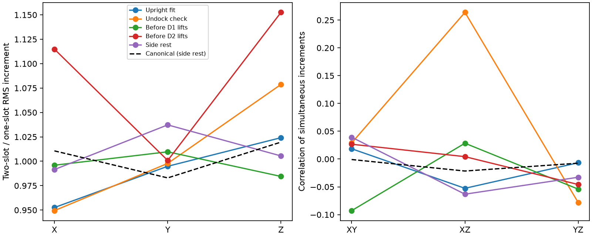

# Does the shelf cube reproduce the timing of accelerometer noise?

The side-rest recording gives two-slot to one-slot RMS increment ratios of **0.99, 1.04 and 1.01** on X, Y and Z. The frozen simulator gives 1.01, 0.98 and 1.02. A ratio near one means that doubling the separation inside a packet adds little to the typical change in the reading. This statistic alone cannot identify the chip filter.

For each axis, the numerator uses the last minus the first sample of every three-slot packet. The denominator pools the two adjacent differences. The cross-axis statistic is Pearson correlation between simultaneous adjacent differences. Both metrics avoid assumptions about the timing between Bluetooth packet receipts. Each simulated condition uses the canonical cube data path and four 20-second noise realizations, with gravity set to reproduce the physical mean under the configured gains. The plot shows the side-rest simulation, and the table includes a simulation for every condition.

| Recording | Packets | XZ increment correlation | Canonical cross-axis correlation RMS error | With correlation fitted on upright rest |
|---|---:|---:|---:|---:|
| Upright rest, fit | 643 | −0.053 | 0.022 | 0 |
| Undock check | 253 | +0.264 | 0.169 | 0.187 |
| Before D1 lifts | 218 | +0.028 | 0.065 | 0.084 |
| Before D2 lifts | 149 | +0.004 | 0.030 | 0.040 |
| R8 side rest | 278 | −0.063 | 0.036 | 0.020 |

A fixed correlation matrix estimated from upright rest improves the side-rest comparison but worsens all three other checks. The undock-check recording contains a short burst: its four largest within-packet vector increments are in four consecutive notifications, indices 103–106, about 3.64–3.72 seconds after the first receipt. Removing the six highest-increment packets reduces XZ correlation from +0.264 to +0.149. This sensitivity analysis does not establish the source of the disturbance. The undock-check clock predates the separately logged pickup experiment.

The largest two-slot ratio occurs on D2 Z (1.15), and the extra variation is absent in side rest. The paired differences in a packet share the middle reading. Packet pairs and adjacent slots should not be counted as independent repetitions. We retain the existing stationary noise model. Simulating a universal correlation from a transient capture would degrade independent sensor traces.

[Per-axis measurements and predictions](noise-increments.csv) · [Undock-check sensitivity](noise-increment-sensitivity.csv) · [Reproduce](noise_increments.py)
