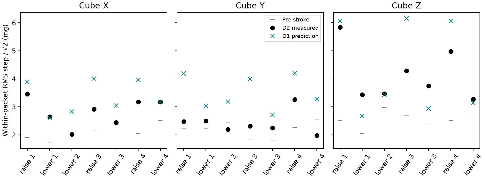
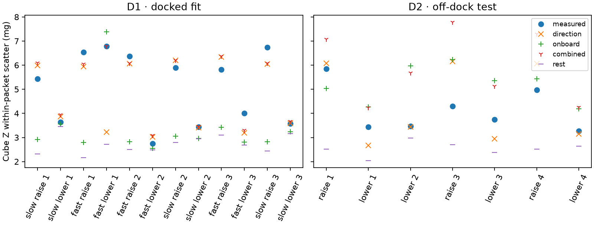
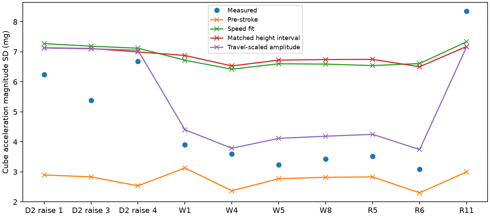

# Does the stationary cube packet model transfer?

Each BLE packet contains three XYZ slots. We divided successive slot differences by the per-axis RMS differences in the 643-packet resting capture. The score is the larger of the two resulting vector lengths. This eliminates the gravity offset and avoids assumptions about interpacket timing. It also removes information about slow motion.

With the current Vector 2.0 cube parameters frozen, eight simulation seeds produced 5,328 packets. The simulated median and 95th percentile were 1.87 and 3.03. Held-out pre-lift windows gave medians of 1.86 and 1.84 and 95th percentiles of 2.91 and 3.15. Both held-out 95th percentiles are within 5% of the simulated value. The 99th percentiles differed by more than 5% in both sessions. Those estimates depend on just a few packets.

The resting 99th-percentile threshold of 3.61 was exceeded in 39/5,328 simulated packets (0.73%), 0/218 D1 packets and 3/149 D2 packets (0.82% pooled). The undock-check recording crossed it in 31/253 packets (12.25%). That run included a physical undock attempt on the shelf. A high packet excursion alone cannot identify fork contact. The per-axis two-slot to one-slot RMS ratios were 0.98–1.01 at D1 and 1.00–1.15 at D2. These observations apply to this cube, surface and packet format.

[All scores](packet-noise-transfer.csv) · [Reproduce](packet_noise_transfer.py) · [Original stationary fit and physical pickup](README.md)

## Does lift vibration transfer by cube axis?

We measured successive XYZ differences inside each radio packet in the encoder-defined 10–90% stroke interval and in the 0.7 s quiet window before the command. Twelve docked D1 strokes supplied a median increase in variance for each direction and axis. Adding that variance to the pre-stroke reading predicted the seven timing-valid D2 strokes beside the cube. Each axis and stroke had equal weight. No D2 vibration samples entered the estimates.

Overall mean absolute error improved from 0.94 mg using pre-stroke scatter alone to 0.78 mg. For raises, Z error fell from 2.46 to 1.06 mg, while Y error increased from 0.57 to 1.45 mg. For lowers, Z error fell from 0.97 to 0.43 mg and Y rose from 0.39 to 0.82 mg. The cube's quiet gravity vector lay within 2° of +Z in both sessions. Rotation about gravity, mechanical coupling to the shelf and the source of vibration remain unresolved. D1's measured gain on all three axes would overstate the reproducibility of lateral vibration at D2. This is an empirical candidate for shelf vibration during full strokes and has not been enabled in the simulator.

[Per-stroke measurements and predictions](lift-packet-transfer.csv) · [Replay](lift_packet_transfer.py) · [Physical D1 control](../unit3-wheelstand/D1/) · [Physical D2 repeat](../unit3-wheelstand/D2/)

## Does the robot's own accelerometer predict cube vibration?

We compared the variance of the robot head IMU's acceleration magnitude during each stroke with its pre-command variance. Magnitude avoids rotating the head axes into the shelf frame. We used the positive excess to predict the cube's within-packet Z variance with a single nonnegative gain trained on the 12 D1 strokes. Each D2 scoring window had only 9–10 robot samples, so this tests stroke-level amplitude at SDK cadence.

| Mean absolute error in cube Z scatter | D1 fit | D2 transfer |
|---|---:|---:|
| Pre-stroke baseline | 2.35 mg | 1.61 mg |
| Median by lift direction | 0.66 mg | 0.70 mg |
| Onboard acceleration gain | 1.82 mg | 1.30 mg |
| Direction means plus onboard gain | 0.37 mg | 1.78 mg |
| Direction means alone | 0.80 mg | 0.75 mg |

The combined model fit D1 more closely but transferred poorly when P2Y8 was off the dock. D1 used slow and fast strokes, while D2 used an intermediate commanded duration. These data leave dock coupling, location, speed and acceleration bandwidth confounded. The robot IMU at this cadence does not justify a shared gain for predicting vertical cube vibration in both settings. [Per-stroke inputs and errors](onboard-vibration.csv) · [Analysis](onboard_vibration.py)

## Can lift speed or travel explain the partial raises?

We used only the six full D1 raises to estimate vibration above the pre-stroke baseline. On six native partial raises, a linear speed fit to excess variance gave 3.12 mg mean absolute error. Scoring only the D1 packet samples from the same 10–90% height interval above the starting pose gave 3.22 mg. The original full-stroke estimate gave 3.61 mg. In particular, R6 rose at 52.3 mm/s, close to the slow D1 raises at 49–50 mm/s, yet its cube magnitude SD was 3.09 mg versus 6.69–6.87 mg on D1.

Scaling the added RMS vibration amplitude in proportion to total lift travel reduced partial-raise error to 0.62 mg, versus 0.76 mg using the pre-stroke baseline alone. This assumed proportionality has no exponent fitted on the partial raises. It still overpredicted all six. Across all ten evaluation raises (three valid D2, six partial, one full native), none of those travel-scaled predictions was within 5% of the measured SD. The lower portion of a commanded full stroke already vibrates more than a whole native undock raise. Stroke length, the motor profile and mechanical setup remain confounded. Keep the proportional rule offline.

[Per-stroke predictions](lift-reach-transfer.csv) · [Reproduce](lift_reach_transfer.py)
