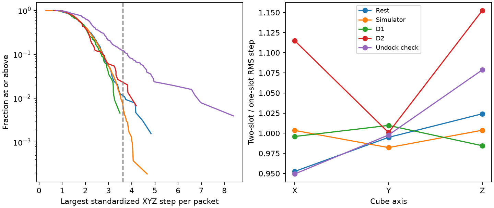

# Does the stationary cube packet model transfer?

Each BLE packet contains three XYZ slots. We divided successive slot differences by the per-axis RMS differences in the 643-packet resting capture. The score is the larger of the two resulting vector lengths. This eliminates the gravity offset and avoids assumptions about interpacket timing. It also removes information about slow motion.

With the current Vector 2.0 cube parameters frozen, eight simulation seeds produced 5,328 packets. The simulated median and 95th percentile were 1.87 and 3.03. Held-out pre-lift windows gave medians of 1.86 and 1.84 and 95th percentiles of 2.91 and 3.15. Both held-out 95th percentiles are within 5% of the simulated value. The 99th percentiles differed by more than 5% in both sessions. Those estimates depend on just a few packets.

The resting 99th-percentile threshold of 3.61 was exceeded in 39/5,328 simulated packets (0.73%), 0/218 D1 packets and 3/149 D2 packets (0.82% pooled). The undock-check recording crossed it in 31/253 packets (12.25%). That run included a physical undock attempt on the shelf. A high packet excursion alone cannot identify fork contact. The per-axis two-slot to one-slot RMS ratios were 0.98–1.01 at D1 and 1.00–1.15 at D2. These observations apply to this cube, surface and packet format.

[All scores](packet-noise-transfer.csv) · [Reproduce](packet_noise_transfer.py) · [Original stationary fit and physical pickup](README.md)
