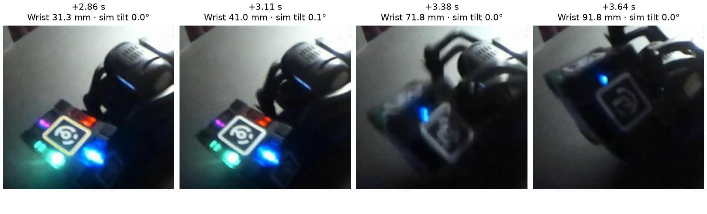

# The cube tips after the wrist has already started rising

Between +2.86 and +3.11 s the wrist rose from 31.3 to 41.0 mm, while the top glyph translated only 0.96–0.97 mm in its initial plane. The corresponding free-cube replay moved 1.51 mm in the shelf plane. By +3.38 s the physical cube had visibly tipped and the wrist reached 71.8 mm. The simulated cube was level at the same instant. Its last loaded fork contact occurred at +3.164 s, inside the 270 ms gap between the two physical exposures. The recording therefore bounds the divergence to a useful portion of the raise, but cannot order simulated contact loss relative to physical tooth engagement. The contact surface is hidden behind the cube.

The travel estimate tracks 40 corners of the top glyph between two distinct overhead exposures. A perspective transform maps the first outline to a nominal 23 mm square. The table varies the optical-flow window and requires a forward/backward consistency error below half a pixel. The range describes estimator sensitivity. Changes in cube height or tilt also move the projected glyph, so this is apparent planar travel. Distances exclude the later tilted frames. Wrist height and simulated tilt are interpolated at the displayed camera receipt times. The replay uses the last sighting and recorded chassis pitch. The video duplicates exposures for playback.

[Physical video](pickup.mp4) · [Tracking measurements](pickup-entry.csv) · [Analysis script](pickup-entry.py) · [Fork force through this interval](fork-load-limit.md)
