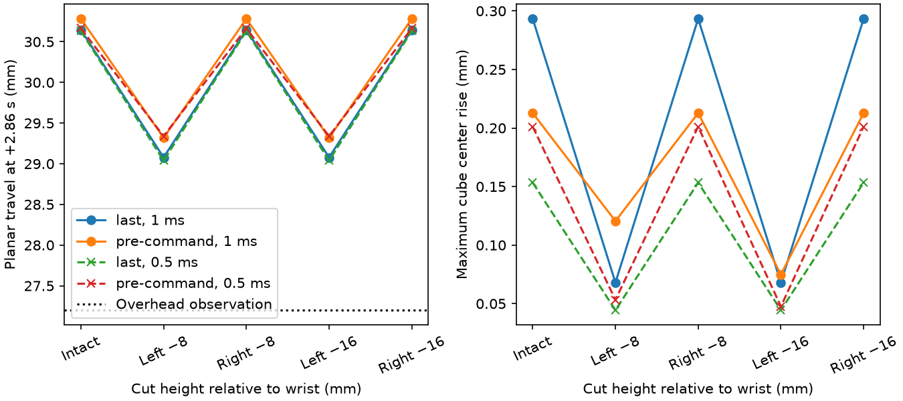

# Does a missing tooth let the cube tip during pickup?

The physical cube visibly tipped between +3.11 and +3.38 s. In all 20 free-cube replays the cube was level at +3.38 s. The largest transient center rise anywhere in the replay was 0.30 mm, and none sustained a lift. The four hypothetical cuts were defined for a separate push experiment before this pickup comparison. This tests their transfer to pickup without fitting them to it. [Physical frames and wrist heights](pickup-entry.md) · [Original cut geometry and push results](../unit3-printed-fork-contact/#could-a-missing-fork-tooth-explain-the-sideways-sweep)

The camera gave 27.2 mm of planar travel at +2.86 s. The intact replay gave 30.6–30.8 mm. Cutting the left side reduced travel to 29.0–29.3 mm. Cutting the right side reproduced intact travel to the displayed precision. The early slide therefore distinguishes the sides in this simulation, but it cannot identify the actual fracture. A pitch change also improved early travel in the [fork pitch sweep](fork-load-limit.md).

Each cut removes upper collision material on one side above a plane 8 or 16 mm below the wrist. The crossbar remains. Runs use the pre-command or last pre-contact sighting from the same physical recording, the recorded chassis pitch and wrist path, a free 50 g cube and two solver steps (0.5 and 1 ms). The 20 replays represent sensitivity within one physical pickup. The operator later identified a missing tooth; its side, shape and date of fracture are unknown. These rigid planar cuts do not represent a fracture lip or flex under load.

[Full results](pickup-tooth.csv) · [Replay](pickup-tooth.py). Use the registered XML fixture documented in the [fork-load comparison](fork-load-limit.md) and run `python pickup-tooth.py /path/to/fork.xml /path/to/repo` with MuJoCo 4.0.1, SciPy, NumPy and Matplotlib.
