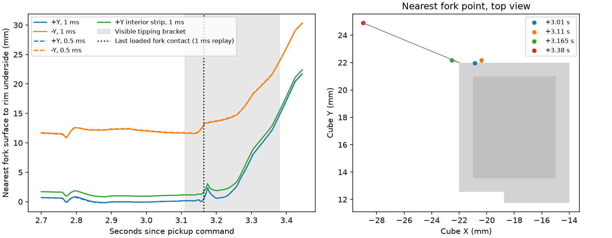

# Where the printed fork passes the cube rim

In the free-cube replay the fork grazes the outer edge of one opening as the wrist rises. At +3.01 s the signed clearance to the +Y underside was −0.05 mm, at the extreme side edge (cube Y = +22 mm). The nearest surface remained 0.95 mm from a strip inset 1 mm into that ledge. By +3.11 s the fork was 0.17 mm outside the edge and 1.17 mm from the inset strip. The opposite underside was over 11 mm away at both times. Small negative signed distances indicate overlap in the soft-contact simulation and are insufficient to demonstrate load-bearing engagement.

By +3.38 s the nearest underside was 14.72 mm away. The nearest fork point lay 12.63 mm above it. The [physical video](pickup-entry.md) shows the cube tipped by then, though the actual contact surface is hidden. The [contact-force replay](fork-load-limit.md) independently places the last loaded contact on any fork surface at +3.164 s.

## Would a lateral correction recover engagement?

We shifted the fork at its mount by −2, −1, 0, +1 and +2 mm in the robot's lateral axis before the approach. The free cube could react throughout. Runs used both recorded starting sightings and two solver steps. All 20 cases stayed level at +3.38 s. The largest center rise was 0.34 mm and none sustained a lift. The submillimeter clearance in the unmodified trajectory therefore does not identify a mounting correction. These two sighting estimates come from the same physical pickup. [Sensitivity results](pickup-lateral.csv) · [Replay](pickup-lateral.py)

## Geometry and reproducibility

The probe covers the two openings on the cube's −X face. It takes the outermost 8 mm in depth of the actual exposed underside at cube height +8.814 mm by differencing the solid box cross-sections immediately above and below. The darker rectangle is the common interior across that depth, trimmed 1 mm at each boundary. Distances refer only to this upper ledge on the approach face. Rubber corner sidewalls, lower lugs and rail contacts are outside that definition.

Massless 2 µm-thick query boxes have collision masks disabled. Every 5 ms the analysis takes the minimum MuJoCo signed distance over all printed fork convex pieces. Connector components are in cube coordinates, from rim toward fork. Both 0.5 and 1 ms solver runs reproduced the uninstrumented summary metrics within 0.000001 absolute tolerance. The displayed times use the replay clock. The physical images use camera receipt time.

[Clearance and closest-point coordinates](pickup-undercut.csv) · [Analysis](pickup-undercut.py). Run both scripts with the same arguments and environment as the [fork pitch study](fork-load-limit.md).
