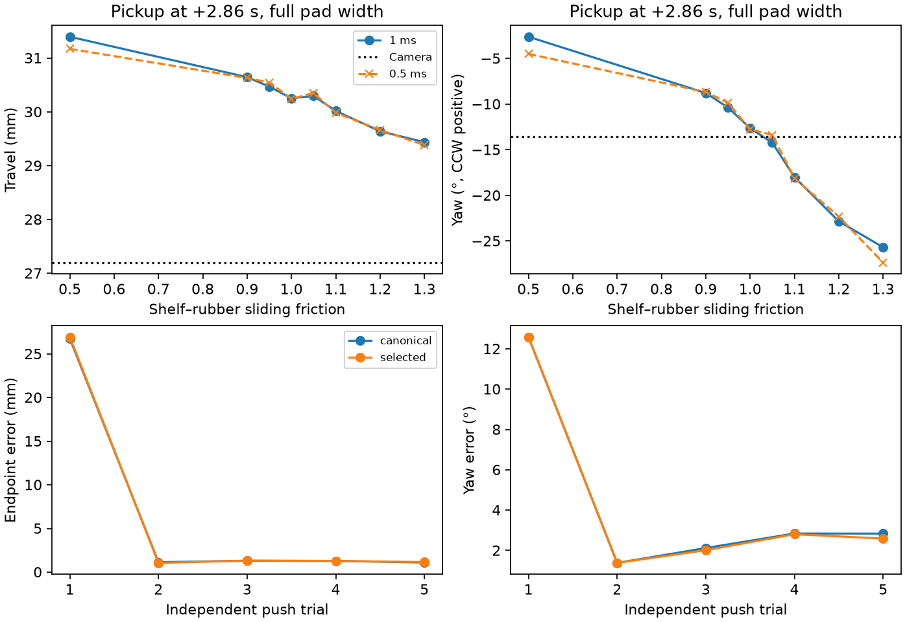

# Shelf friction changes cube yaw, but matching yaw still misses the pickup

At +2.86 s the camera measured 27.2 mm of travel and 13.6° clockwise rotation. With full-width rubber pads and shelf sliding friction 0.9, the free cube moved 30.6 mm and turned 8.7–8.8°. Increasing shelf friction to 1.05 produced 13.4–14.2° of rotation at that exposure. It still moved 30.3 mm and stayed on the shelf during the subsequent physical lift. At the earlier +2.59 s exposure it had already rotated 11.5–12.3°, against 7.6° measured. Fitting the last yaw observation hides the earlier timing error. [Physical heading overlay](approach-heading.md)

Using only +2.59 s for selection, the best grid point retained the full pad width and raised friction to 0.95. Selection minimized the worst, across 0.5 and 1 ms steps, of the Euclidean norm of yaw and travel errors divided by their respective measured magnitudes. That point predicted 9.9–10.4° at +2.86 s. On five independent physical pushes, it improved endpoint distance error on two and yaw error on three. The largest endpoint failure stayed near 27 mm; the model also missed most of that push's 13.8° rotation. The remaining four endpoint changes were below 0.1 mm. These data do not support changing the shelf coefficient.

The model applies opposing yaw moments through the fork and shelf. Between +2.595 and +2.860 s at coefficient 0.9, the 1 ms replay delivered +693 and −692 µN·m·s from the shelf and fork, respectively, with zero rail impulse. The residual was +0.92 µN·m·s. Halving the step yielded +667 and −666. Integrated contact moments agreed with the independently computed change in simulated angular momentum within 0.02 µN·m·s in every reported interval. In the earlier interval some component signs changed with step size. Net angular impulse describes a change in angular velocity; the angular displacement also depends on the velocity history. The component impulses are solver estimates, not physical force measurements.

**Setup.** Collision masks give the shelf separate copies of the cube surfaces. The fork retains its original rubber and plastic geometry and friction. The centered rubber footprint varies in two horizontal dimensions (full, half, or one eighth of pad width); its underside height stays fixed. Only the shelf interacts with those resized pads. The unmodified split control reproduces the unsplit predictions. The narrowest footprint at 0.9 predicted 9.4° with a 1 ms step and 29.0° at 0.5 ms, so it cannot identify the actual contact area. No tested variant achieved sustained lift.

[Pickup grid](shelf-corner-replay.csv) · [Independent push errors](shelf-corner-transfer.csv) · [Angular impulse](shelf-corner-torque.csv). Run shelf-corner-replay.py, shelf-corner-transfer.py and shelf-corner-torque.py in that order, each with the registered 58-piece printed fork XML and repo root as arguments. The transfer uses the [five measured push trajectories](../unit3-printed-fork-contact/) with driven wrist, articulated rails, and the fixture's 0.5 ms timestep. The grid and impulse analysis use both timesteps.
