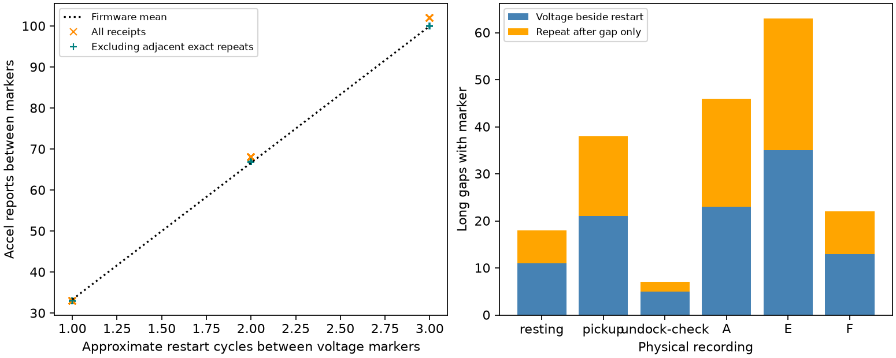

# Cube receiver pauses line up with the battery-report cycle

In the resting recording, every accelerometer receipt gap over 150 ms ended with one of two signatures. Either a voltage notification was immediately before or after the first returning accelerometer notification, or the very next notification repeated that entire 20-byte accelerometer payload. Applying the same adjacent-record rule to five other recordings accounted for **176 of 178 gaps**. Of those, 97 had the voltage marker and 79 had the repeat. None had both. There were three exact adjacent repeats elsewhere in those five logs. A duplicate is defined by byte identity in consecutive log entries, not by an identical single acceleration axis.

We ran the unmodified 2018-08-14T17:40 cube application image for 1,300 ticks in the canonical Thumb VM. It emitted voltage at ticks 1, 101, 201 and so on, with 33, 33, 34 accelerometer reports in successive intervals. The stock source takes the ADC samples synchronously before servicing the accelerometer on the same tick. The VM verifies the application sequence under its emulated ADC; its tick driver cannot measure how long a physical ADC conversion or BLE transaction takes. [Stock tick order](https://github.com/os-vector/wire-os-victor/blob/3cec4844d24c4719b5b3892e4979494bcd260424/robot/cube_firmware/app/main.c) · [Battery sampling](https://github.com/os-vector/wire-os-victor/blob/3cec4844d24c4719b5b3892e4979494bcd260424/robot/cube_firmware/app/adc.c)

Using the earlier resting fit of 1.22746 s per restart to assign a cycle count between voltage receipts, all **104 of 104** intervals across the six recordings contained a number of acceleration reports within the firmware's integer bounds after excluding immediate identical repeats. This is a count consistency check. It cannot prove which component repeated a payload or establish that every physical chip sample was retained. The voltage-cadence association gives a concrete trigger to instrument at the ADC call, BLE send, and robot receipt before attributing the delay to any one of them.

[Per-run classification](voltage-restarts.csv) · [Firmware tick counts](voltage-tick.csv). Run `voltage_restarts.py` with NumPy and Matplotlib, and `node voltage_tick.mjs /path/to/cube.plain.bin`. Tested image SHA-256 is `c53e7f1edae6bb034cd18782d01b8fb01ec4e1200b68187931060be59db02bee`.
