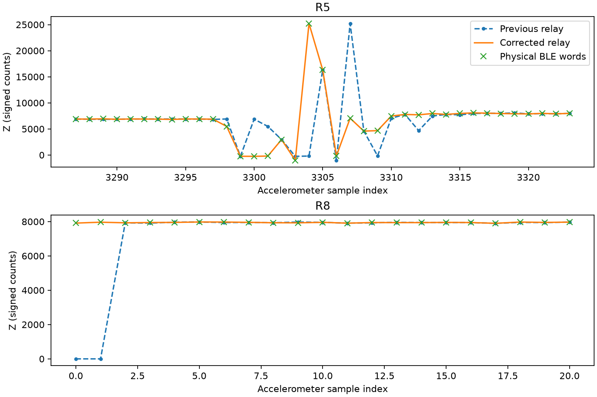

# WireOS cube acceleration relay

The firmware emits one BLE report containing three ordered accelerometer samples. The previous browser body relay read the firmware slot array on every application tick. On the first two ticks of a new report that array still contained the preceding report. The corrected relay forwards three v1 frames together when a complete report arrives. WireOS's simCubeClient buffers three frames to construct its cube message. Advertisements keep their existing cadence.

| Physical capture | Samples | Incorrect XYZ samples before | Incorrect XYZ samples after |
|---|---:|---:|---:|
| R5 | 7,029 | 4,622 | 0 |
| R8 | 957 | 630 | 0 |

The largest single-axis word error was 25,420 counts in R5 and 7,965 in R8. The second recording was replayed with the same fix. No fitted parameters. These figures cover the three signed acceleration words. They do not score BLE transport timing, gravity orientation against an external camera, or simulated contact forces.

The replay supplies archived payloads to CubeSensor at a report boundary, polls WireBody every application tick, and decodes its outbound frames. It exercises the firmware packet decoder and browser relay. The live network and WireOS process are outside this test. Up-axis initialization in the stock listener seeds the low-pass state on the first sample and establishes the first dominant axis silently. This change preserves which samples reach that listener.

Reproduce the former relay with the script in this directory against commit 77887b6 and the fixed relay against this revision. Use the same recordings in both. From the repository root run `node evidence/unit3-cube-accelerometer/wire-report-replay.mjs before` and then `node evidence/unit3-cube-accelerometer/wire-report-replay.mjs after` with the corresponding web sources, followed by `python evidence/unit3-cube-accelerometer/wire-report-plot.py`.
