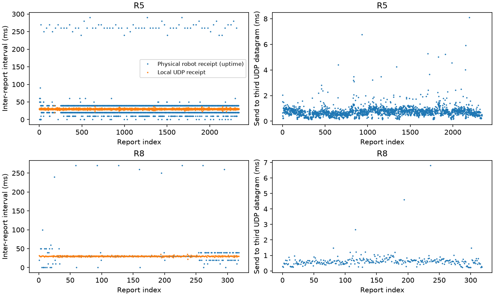

# Cube report timing over the WireOS body relay

A Node WebSocket client sent the R5 and R8 accelerometer words through Vite's real HMR connection, the canonical wireRelay plugin and the local UDP stack. A receiver at the WireOS cube port timestamped and decoded each datagram. Reports were paced at the simulator's nominal 30 ms, with three ordered v1 acceleration frames sent together. Latencies use one monotonic process clock from immediately before frame serialization to receipt of the third UDP datagram.

All 2,662 reports arrived with every XYZ word in order. R5 and R8 had respective 99th-percentile local delivery latencies of 2.25 ms and 1.48 ms. Neither loopback run had an inter-report gap over 150 ms. The physical receiver recorded 69 and 9 such gaps. R5 took 84.95 s physically versus 70.26 s locally; R8 took 11.46 s versus 9.54 s. Local transport therefore reproduced the payloads but did not account for the extra elapsed time on this setup.

The physical intervals use robot uptime at BLE receipt. These traces contain recurring pauses even though their median report interval is 30 ms. The loopback experiment tests whether this local delivery path alone produces comparable gaps. It does not run the native engine, exercise the physical radio, or measure browser rendering under load. Node's send scheduler and receiver share an event loop. The before-send clock excludes scheduling delays, which are included in the inter-report intervals.

[Per-run scores](wire-udp-scores.csv) · [Per-report measurements](wire-udp.csv). To repeat, use an idle localhost with the cube port free and the normal web dependencies installed. Run `node web/tools/measure-cube-relay.mjs evidence/unit3-cube-accelerometer/wire-udp.csv` from the checkout root, then `python evidence/unit3-cube-accelerometer/wire_udp_plot.py`. This is a timing measurement whose numerical results vary with system load.
