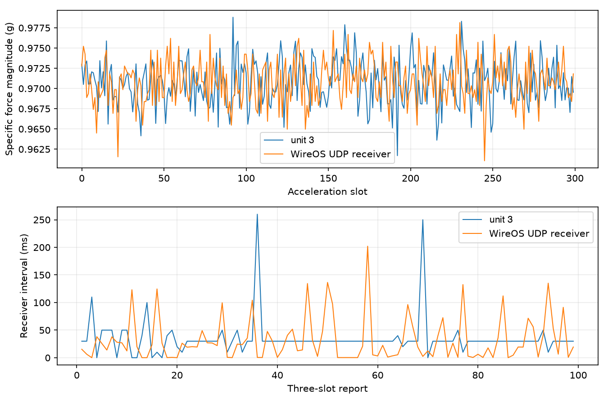

# Cube acceleration delivered to WireOS

The browser now sends one calibrated signed chip-axis sample per cube tick. The upstream simulated cube client groups three consecutive datagrams into one report and counts tap pulses. Previously it received ideal MuJoCo specific force every 5 ms, producing a nominal 15 ms three-slot report. The cube sensor runs at 10 ms per slot, giving 30 ms per report in simulation time. In the Unit 3 profile, the native path now carries the same gain, bandwidth, noise, and two low bits as the shelf cube sensor.

A Linux UDP receiver captured 300 acceleration datagrams from a headless browser running the shelf scene with the Unit 3 cube profile. The plot pairs those with the first 300 archived physical slots at rest by sample index. The magnitude median measured 0.97083 g at the UDP receiver and 0.97098 g on unit 3. Standard deviations were 2.75 and 2.84 mg. Every axis word in both captures had remainder one modulo four. This is a delivery check on an existing resting calibration. It does not evaluate grip or landing accuracy.

Wall-clock delivery remains uneven. For 100 three-slot groups, median receiver spacing was 19.4 ms in this browser session versus 30.0 ms on the physical robot. First to last group spanned 3.14 versus 3.45 s. The real receiver had two intervals above 150 ms and the simulated receiver had one. The upstream UDP packet has no source timestamp. Browser, relay, network and Linux scheduling all enter its receipt intervals, while the physical trace includes BLE transport. This comparison cannot assign the delays to one stage.

[Received datagrams](received.csv) · [Physical capture](../resting.csv) · [Plot script](compare.py) · [Upstream cube receive loop](https://github.com/os-vector/wire-os-victor/blob/3cec4844d24c4719b5b3892e4979494bcd260424/cubeBleClient/simCubeClient/simCubeClient.cpp)
