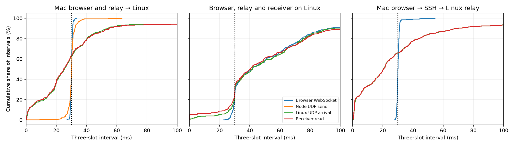

# Cube acceleration delivered to WireOS

The browser now sends one calibrated signed chip-axis sample per cube tick. The upstream simulated cube client groups three consecutive datagrams into one report and counts tap pulses. Previously it received ideal MuJoCo specific force every 5 ms, producing a nominal 15 ms three-slot report. The cube sensor runs at 10 ms per slot, giving 30 ms per report in simulation time. In the Unit 3 profile, the native path now carries the same gain, bandwidth, noise, and two low bits as the shelf cube sensor.

A Linux UDP receiver captured 300 acceleration datagrams from a headless browser running the shelf scene with the Unit 3 cube profile. The plot pairs those with the first 300 archived physical slots at rest by sample index. The magnitude median measured 0.97083 g at the UDP receiver and 0.97098 g on unit 3. Standard deviations were 2.75 and 2.84 mg. Every axis word in both captures had remainder one modulo four. This is a delivery check on an existing resting calibration. It does not evaluate grip or landing accuracy.

Wall-clock delivery remains uneven. For 100 three-slot groups, median receiver spacing was 19.4 ms in this browser session versus 30.0 ms on the physical robot. First to last group spanned 3.14 versus 3.45 s. The real receiver had two intervals above 150 ms and the simulated receiver had one. The upstream UDP packet has no source timestamp. Browser, relay, network and Linux scheduling all enter its receipt intervals, while the physical trace includes BLE transport. This comparison cannot assign the delays to one stage.

[Received datagrams](received.csv) · [Physical capture](../resting.csv) · [Plot script](compare.py) · [Upstream cube receive loop](https://github.com/os-vector/wire-os-victor/blob/3cec4844d24c4719b5b3892e4979494bcd260424/cubeBleClient/simCubeClient/simCubeClient.cpp)

## Where the transport timing changes

We captured the complete 40-byte v1 payload at browser WebSocket send, Node UDP send and Linux receive, verified byte-for-byte ordering, and recorded both the Linux kernel socket timestamp (SO_TIMESTAMPNS) and application read time. Each file indexes slots at the source. Stage times are seconds relative to that stage's first slot. This permits interval comparisons across hosts without assuming synchronized clocks. Per-stage intervals use every third source slot, requiring all six slots in adjacent groups to be present. Lost slots can shift the upstream client's three-slot grouping until reconnection.

| Path | Missing source slots | Browser median | Linux kernel median | Kernel 5th–95th percentile |
|---|---:|---:|---:|---:|
| Mac browser and relay, cross-host UDP | 4 of 1,204 | 30.01 ms | 25.11 ms | 0.64–105.77 ms |
| Browser, relay and receiver on Linux | 0 of 1,200 | 41.40 ms | 41.70 ms | 19.25–148.57 ms |
| Mac browser, SSH-forwarded WebSocket, Linux relay and receiver | 0 of 1,200 | 30.00 ms | 20.14 ms | 0.74–110.97 ms |

On the cross-host UDP run the relay median was 30.02 ms and its 95th percentile was 33.71 ms. The much larger spread was already present at kernel arrival. Slot pairs 208–209 and 892–893 (zero-based) never appeared at the receiver within the capture. On the SSH run the large spread appeared by the relay, upstream of the local UDP hop. Keeping everything on Linux preserved packet order but that host ran the rendered browser slowly while also building WireOS. Relocating the relay preserved all payloads in one trial but did not recover real-time delivery. The earlier 19.4 ms receiver median does not warrant changing the 10 ms source slot clock.

These are single runs on each route. The Linux receiver was an instrumented socket peer, not the running behavior engine. Browser timing uses DevTools Network.webSocketFrameSent, the Node relay timestamp is immediately before dgram.send, and the receiver uses recvmsg. The Mac ran headless Chromium with software rendering in all Mac runs. All three used the same Unit 3 shelf configuration. Reproduce the summaries with `python stage_times.py`. [Cross-host UDP timestamps](remote-stage-times.csv) · [Linux-local timestamps](local-stage-times.csv) · [SSH-forwarded timestamps](tunnel-stage-times.csv)
