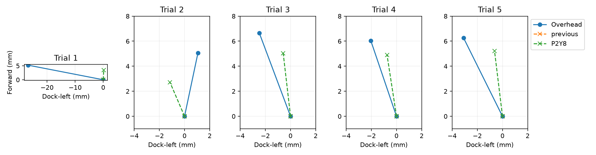
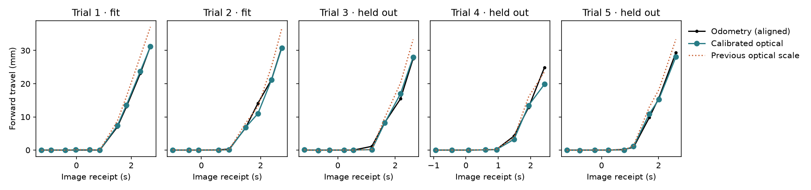
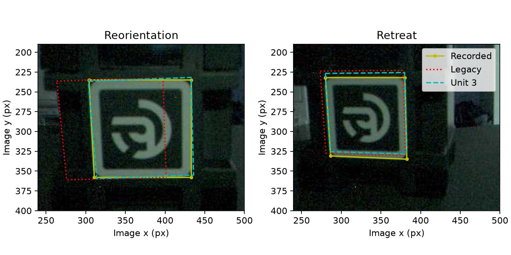
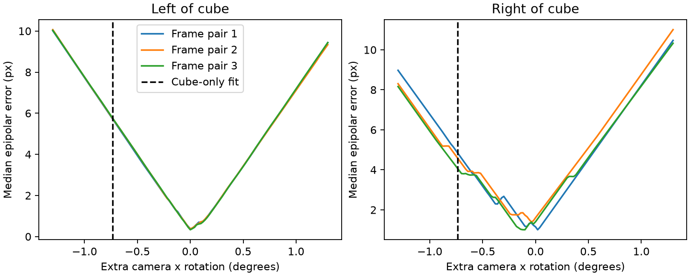
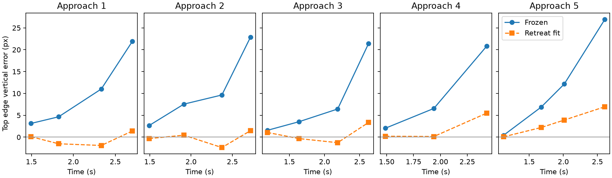
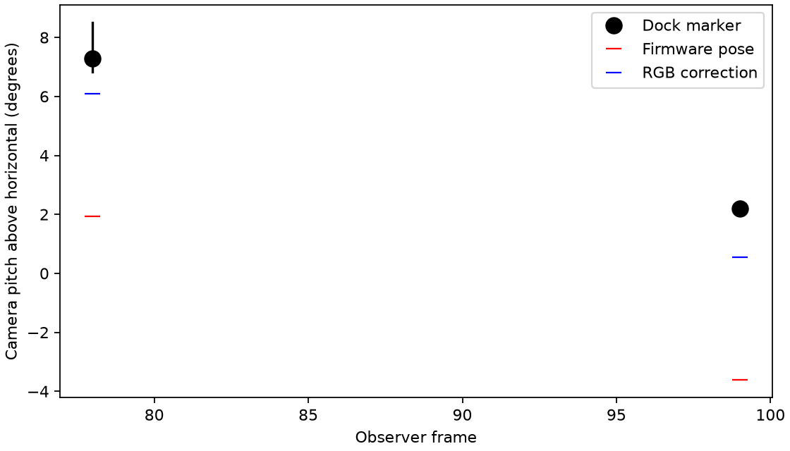

# unit 3 camera scale and first contact

GetCameraConfig on the same unit 3 that made the recordings returned focal lengths of 406.314453 and 405.335419 pixels and a principal point of (404.559357, 295.485). Its reported field of view is 89.102623° by 73.0123444°. The captured JPEGs are 800 × 600. The earlier cube depth estimate used a focal length of 537 pixels and a centered principal point. Substituting the robot-reported values moved the initial cube center 22.6–23.8 mm closer across five approaches. This used no final cube positions or overhead-camera data.

| Trial | Physical travel (mm) | Onboard + odometry 2D error (mm) | Simulated travel (mm) | Simulation 2D error (mm) |
|---|---:|---:|---:|---:|
| 1 | 27.23 | 3.65 | 3.48 | 26.98 |
| 2 | 5.16 | 0.36 | 2.96 | 3.22 |
| 3 | 7.09 | 0.52 | 5.06 | 2.49 |
| 4 | 6.37 | 0.17 | 4.96 | 1.71 |
| 5 | 7.00 | 0.56 | 5.25 | 2.68 |

All five simulated forks now contact the cube. The earlier RGB pose had five misses. Physics, printed-marker dimensions and measured fork path were held fixed. The simulation still underpredicts lateral travel, especially trial 1 where the physical cube swept 26.72 mm to the right during the lift. The nominal fork, ideal level wrist, pinhole approximation and missing arm/chassis contacts still limit attribution. In the independent 18 mm retreat with a stationary cube, camera-plus-odometry apparent travel fell from 4.42 mm to 0.94 mm with both versions using the same head-dependent mount transform. Overhead measured 0.06 mm.

## Independent scale check

The fork progressively obscures the lower marker corners. Optical flow on features along the upper printed edge tracked the apparent width during approach. Per-frame coordinates and capture and host-receipt timestamps are in edges.csv. The overhead track stayed within 1 mm of its starting position through the 2.75 s window. Fitting an effective width-to-travel scale and relative host clock alignment on trials 1–2 gave 10,380 pixel·mm and 0.232 s. Held-out trials 3–5 had travel RMS errors of 0.94, 3.00 and 0.89 mm, versus 2.79, 5.11 and 2.59 mm with the original scale and receipt timing. These sparse moving samples couple timing, perspective and scale. The fitted scale is a diagnostic. The contact results use unit 3's independently reported camera parameters and Anki's nominal 23 mm marker. [Anki block definition](https://github.com/kercre123/victor/blob/669ec7499a7084640b57706a7937884a6568be50/engine/BlockDefinitions.h#L3-L12)

## Reproduction

From this directory run `python scale.py`, `python contact.py 10379.5644` and `python endpoints.py` with the dependencies listed in the contact replay. The first argument to contact.py sets the optical scale for two sensitivity checks. The unit 3 result always reads the checked-in camera profile. The Python Vector 2 model now builds the head camera at this stream resolution and vertical field of view. The web optics exporter can construct the matching off-axis camera block from the Vector 2 parameters. The default web scene still selects Vector 1. The calibration RPC exposed no distortion coefficients. These measurements cover the shelf and this individual robot.

## Predicting recorded pixels after robot motion

The initial onboard outline gives a six-degree-of-freedom pose for a 23 mm square. Hold its four corners fixed in world coordinates, move the simulated camera using the recorded chassis odometry and head angle, and project into the final image. Only the initial view enters the pose solve. The yellow outline is the settled median of the four measured printed edges extrapolated to their intersections. The background images are the nearest recorded JPEGs to the final sample, 0.17 and 0.25 seconds later respectively. Both are cropped from the native 800 × 600 stream.

| Motion | Legacy 537 px camera | Unit 3 factory camera |
|---|---:|---:|
| 16.8° reorientation between pushes | 35.91 px | 3.29 px |
| 18 mm retreat after final push | 8.22 px | 5.90 px |
| Three settled intervals, individually | 0.20–0.33 px | 0.14–0.38 px |

Errors are RMS Euclidean distances between corresponding image corners. During retreat the factory camera predicts every x coordinate to within 0.43 px, while every y coordinate lands 5.27–6.47 px high. The overhead camera measured 0.06 mm of horizontal cube travel during that retreat. The head encoder reported the same angle at both endpoints. Chassis pitch was absent from this recording. The residual could reflect body attitude, camera geometry or marker pose estimation. These two moving pairs come from a single robot and recording. No parameter was fitted to their final views.

Run `python reprojection.py` here to regenerate the overlay and per-corner CSV.

### Did the camera pitch during the retreat?

A camera pitch change rotates the entire scene. We tested that prediction on three pairs of settled JPEGs bracketing the same retreat. We tracked texture outside the cube on both sides, discarding tracks with a forward–backward discrepancy above 0.5 px. The metric is distance from the observed endpoint to the epipolar line predicted by calibrated camera motion. This allows each feature to have its own unknown depth. It measures one component of image error and differs from the four-corner RMS above.

Fitting pitch to the cube corners gives −0.74° of additional camera-coordinate x rotation. Applying that to the held-out left background increases median error from 0.33–0.38 px to 5.73–5.77 px across the three pairs (132–137 tracks each). On the right it increases from 1.15–1.61 px to 4.06–4.84 px (19–24 tracks each). A single extra pitch rotation large enough to explain the cube is inconsistent with both regions under the recorded odometry.

A camera-height change also affects projected corners, with a larger effect on nearby objects. The cube alone favors a 1.21 mm rise. Separate background fits give −3.71 mm on the left and +0.76 mm on the right. These disagree, so this retreat supplies no reliable height correction. A change in translation direction remains confounded with camera mount angle and odometry. We kept the physical parameters frozen. The three pairs check feature tracking repeatability within one maneuver.

Run `python retreat_attitude.py` to reproduce the plot and fits from the published image coordinates. The optional `--extract` argument accepts the original onboard JPEG directory.

### Does a fixed camera angle transfer to forward motion?

A constant upward offset of 4.15° relative to the simulated SDK camera, applied at both endpoints, reduced the retreat four-corner RMS from 5.90 to 0.70 pixels. It also reduced the independently scored reorientation RMS from 3.29 to 1.56 pixels. Unlike a change of pitch *during* the maneuver, this adjusts the direction of translation in camera coordinates.

With that angle frozen, the two upper marker corners were projected through each approach and compared with their tracked image coordinates before contact. The overhead cube displacement was under 1 mm in this window. The timing offset was inherited from the earlier width comparison on approaches 1–2. Approaches 3–5 were held out from both the angle and timing fits.

| Approach | Vertical RMS before → after (px) | 2D RMS before → after (px) |
|---|---:|---:|
| 1 | 12.59 → 1.42 | 13.11 → 4.41 |
| 2 | 13.04 → 1.44 | 14.07 → 5.83 |
| 3 | 11.36 → 1.91 | 11.90 → 4.41 |
| 4 | 12.66 → 3.27 | 14.81 → 9.03 |
| 5 | 15.18 → 4.14 | 15.70 → 6.41 |

The Vector 2 web RGB view now uses the correction. Native SDK pose projections retain the firmware geometry. All five moves used one unit 3 head setting near −12.2° on one shelf. This is an effective viewing angle: an encoder zero error, a mounting offset, and chassis attitude can contribute. Its transfer to other head settings and units is unmeasured. Run `python mount_transfer.py` to reproduce.

### Dock glyph check at two additional head angles

A read-only observer collected 108 onboard JPEGs during another lane's W17 trial. Each JPEG was joined to a robot state by image timestamp. The published data contain the timestamps, encoder readings, body pitch, and the measured dock-marker corners. Six sharp images showed the upright charger marker near the image center. We fitted the four straight sides of its outer border at several brightness thresholds and solved the perspective pose of the firmware's 46 mm square. Its downward axis gives camera pitch under the assumption that the marker tower is vertical. The black range shows threshold sensitivity only.

Only frames 78 and 99 had less than 0.25° head-encoder range across the current and two preceding sampled states. At a +4.42° head angle, the marker gave +7.29° optical pitch (threshold range +6.83° to +8.50°). The corrected RGB view predicts +6.08°, and the firmware geometry predicts +1.93°, including the reported +1.51° body pitch. At a −0.50° head angle the marker gave +2.20° (+1.99° to +2.44°), compared with +0.54° corrected and −3.61° firmware. The retreat correction improved both independent comparisons without refitting. Body pitch and marker orientation also contribute uncertainty. The two views come from one dock and one sequence.

The rejected moving states illustrate a timing hazard. From frame 78 to 79 the matched encoder changes 17.70°, while the physical marker pitch changes about 0.33°. Frames 99 and 100 show a similar discrepancy. An SDK state carrying the latest image timestamp can describe head motion after exposure. This observer kept the last state seen for each stamp. The mismatch cannot assign a latency to the sensor or encoder individually.

Run `python dock_angle.py` for the six-frame measurements and the two settled predictions. The archived coordinate data suffice to regenerate the figure.
