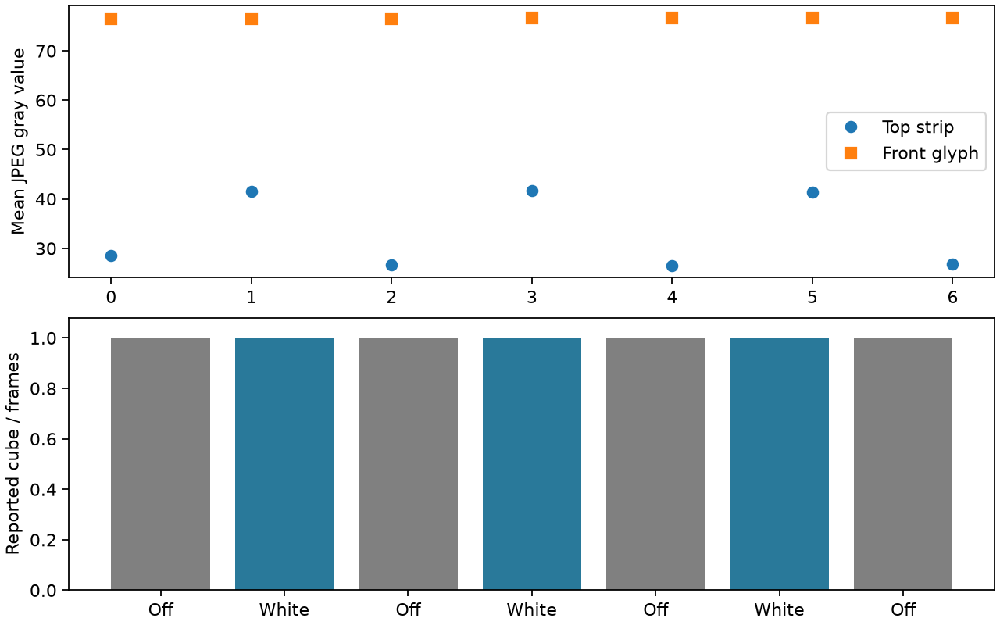

# Cube white LEDs as seen by docked unit 3

With the head at −8° and the cube stationary, we alternated the cube's white LEDs off and on across seven three-second blocks. We discarded the first second of each block for optical scoring. The camera returned 44 frames in total, with four scored frames per block. The cube sent 581 accelerometer packets (1,743 XYZ samples). No wheel or cube motion was commanded. At handback the cube LEDs were off, the cube was disconnected, and unit 3 was charging at 4.06 V with quiet enabled.

In the three white blocks, mean JPEG grayscale over the cube's upper strip was 41.4–41.6 on a 0–255 scale. The four dark blocks were 26.5–28.5. The front glyph region stayed at 76.6–76.7. The SDK reported the cube at the exact timestamp of all 28 scored images. This placement therefore measures how the light appears but supplies no detection advantage. The accelerometer's mean vertical component ranged from 970.1 to 971.0 mg across settled blocks. Ambient illumination and camera autoexposure were uncontrolled.

The repo contains the SDK image/report timestamps, light command times, raw cube packet payloads, and per-frame luminance. Run `python summarize.py` to regenerate the plot, or add `--images DIRECTORY` to remeasure the fixed pixel regions on the original JPEGs.
