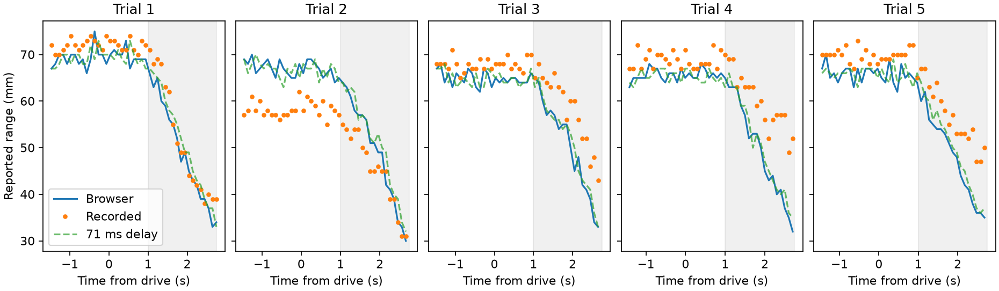
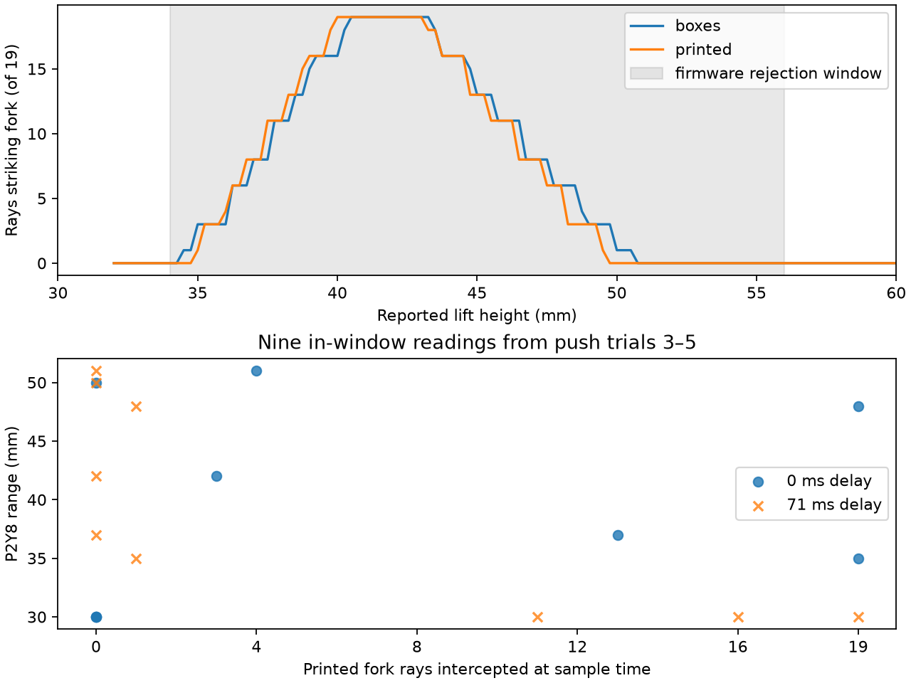

# Can the shelf replay predict the distance that unit 3 reports?

The 19-ray production proximity model observes the simulated free cube and shelf in each printed-fork replay. Each replay starts from the camera-derived cube location and overhead-derived yaw and follows the measured chassis and lift trajectory. The chassis is assumed level. The stateful sensor runs at the configured state period with a fixed noise seed per trial. Each SDK row is compared with the most recent simulated sample. There is no time alignment fitted to the range data.

| Trial | Paired SDK rows | Both report a target | Mean absolute range error on those rows | Found flag agreement |
|---|---:|---:|---:|---:|
| 1 | 130 | 125 | 13.54 mm | 100% |
| 2 | 133 | 126 | 6.50 mm | 97.7% |
| 3 | 126 | 121 | 8.73 mm | 100% |
| 4 | 129 | 124 | 11.15 mm | 98.4% |
| 5 | 128 | 123 | 9.59 mm | 98.4% |

The last three runs have 368 paired positive readings. The model reads short by 9.80 mm on average. As a diagnostic, the median physical minus simulated range in the first two runs is +2 mm. Adding that fixed offset on the last three lowers mean absolute error from 9.83 to 7.94 mm, with 31.5% within 5% of measured distance. Adjacent SDK samples are correlated. These are repeat trials in one session and the upper sensor flag agreement alone does not establish cube fidelity. The physical endpoints include cube motion the replay misses, so this does not isolate sensor calibration, initial placement, or material response. No global range bias was applied.

Run score.py with the repository path and the printed-fork fixture XML built as described in [the fork comparison](../unit3-printed-fork-contact/). [Per-sample data](samples.csv)

## Range change before fork contact

Each curve starts from that trial's median recorded range before the drive command. This removes initial distance error and tests *change* in range, a narrower question than predicting absolute range. The reference predicts a one-for-one reduction with forward odometry, bounded at the sensor's 30 mm reporting floor. The scored interval is 1–2.75 seconds after the approach command. Across those approaches the maximum observed overhead displacement from the starting position was 0.76 mm or less. Overhead frames are sparse, so this bounds sampled movement only.

We fitted lag alone, travel gain alone, or both on trials 1–2 and froze them for trials 3–5. Mean absolute error over 51 held-out rows was 6.92 mm with the one-for-one model, 5.71 mm with the 71 ms lag alone, 6.16 mm with gain alone, and 5.84 mm with both. Only 19 of 51 lag-corrected values fell within 5% of the measured distance. Different starting offsets and later fork contact cannot explain that residual. The fitted lag is relative to SDK odometry and includes transport and reporting effects.

As a separate check, apparent motion from the widening camera glyph used the previously published scale and image timing fit. At the eleven available held-out moving frame times, the mean optical travel exceeded the lag-aligned decrease in range by 4.33, 3.22 and 2.26 mm in trials 3, 4 and 5 respectively. Odometry gave the same sign in each trial. Oblique faces and partial illumination by the range beam remain plausible contributors. The sample cannot identify either. The diagnostic lag has not been applied globally.

[All held-out errors](approach-scores.csv) · [Frame-by-frame optical cross-check](approach-optical.csv) · [Reproduction script](approach.py)

## Would a closer starting cube explain the apparent fork reach?

The 2 mm offset comes from fitting fork reach to push displacement on trials 2–3. As a separate hypothesis, we moved the cube 2 mm toward the robot along its starting heading and kept the wrist and sensor fixed. We compared the 19-ray model against the first 1.5 s of actual range reports before the drive command. Both placements used identical sensor noise seeds, timestamps and initial cube orientation. All 15 samples per trial reported a target in both replays.

Moving the cube closer reduced the range error in trial 2 alone. On trials 4–5, which were excluded from reach selection, mean absolute range error increased from 3.50 to 5.47 mm. The previous fork reach result therefore has little independent support as a **uniform cube-depth correction** on this shelf. This test cannot establish the true wrist offset: absolute ToF bias, face orientation, the camera pose and printed-fork registration still enter the comparison. The bars in the figure show the middle half of repeated readings at each starting pose; they describe within-trial variability.

[Per-trial range statistics](initial-depth.csv) · [Mechanical comparison of both changes](../unit3-printed-fork-contact/depth-check.csv). Reproduce with `python initial_depth.py ../.. /tmp/unit3-fork.xml` using the registered fixture.

On trials 4–5, extending the wrist gave pre-lift displacement errors of 1.32 and 0.10 mm. Moving the cube closer gave 1.32 and 0.07 mm. Push displacement alone barely distinguishes the hypotheses. The independent range check favors keeping the camera placement on those trials.

## Vector 2 browser replay before cube contact

The browser's Vector 2 free-cube scene starts each replay from the cube center
estimated from the onboard glyph and its heading from the overhead camera. We
move the cube relative to the level chassis according to recorded odometry,
hold its orientation fixed in shelf coordinates, and supply the measured lift
height. The browser casts its 19 rays and samples at its configured 60 ms
state period. Each physical receipt is paired with the latest simulated
report. Neither real range nor an offset fitted to range sets the starting
position. These are registered poses with the stock simulated scene background.
They omit any shelf motion between overhead frames, chassis pitch, and
occluders unique to the recording.

On trials 3–5, the mean absolute range error before driving was **3.22 mm**
(45 readings). From 1 to 2.75 seconds into the approach it reached **9.00 mm**
(51 readings); all 51 browser ranges were at or below the measured distance.
Both sides reported a target throughout those windows. Only 3 of 51 moving
readings were within 5% of measured range. Applying the 71 ms delay previously
estimated on trials 1–2 reduced moving error to **7.88 mm**, with 7 of 51
within 5%. This shift is a diagnostic on the reporting time axis. The remaining
error and trial 2's opposite bias make a global range correction premature.

[Paired readings](browser-range.csv). Run `python browser_range.py` with the
web dependencies installed. No sensor or contact parameters are fitted.

### Isolating camera placement from approach travel

A second reconstruction uses the two visible ends of the glyph's 23 mm upper
edge. At each image it solves for positive depths along the two calibrated
camera rays, using the edge direction from the initial overhead heading and
instantaneous SDK chassis yaw. The midpoint, measured head angle, camera mount
and 22 mm face-to-center offset give a fresh robot-relative cube center. Wheel
translation and measured range do not enter this optical position estimate.
An anchored version adds a constant XY translation per trial to match the
earlier four-corner registration at rest. All three alternatives use the same
browser ray fan, lift height and simulated noise draws at each image. Real
range is interpolated at the previously estimated 71 ms range delay; the image
clock uses the previously fitted 236 ms capture alignment.

| Pose input | Mean absolute error, moving trials 3–5 | Mean signed error |
|---|---:|---:|
| Initial four corners plus odometry | 7.30 mm | −7.09 mm |
| Upper edge at each frame, anchored at rest | 5.94 mm | −5.36 mm |
| Upper edge at each frame, absolute position | 3.83 mm | −0.82 mm |

The same 11 held-out images enter each column comparison. Updating travel
alone recovered part of the short reading. Changing the initial registration
as well recovered more. Absolute edge placement also over-read the moving
ranges in trials 1 and 2, with mean errors of +6.09 and +9.06 mm. The
comparison cannot identify a universal placement offset or a sensor bias.
The two endpoints constrain position conditional on the overhead yaw and level
chassis. The images are sparse and the available calibration assumes pinhole
optics. No production coefficients changed.

[Frame scores](edge-range.csv). Reproduce with `python edge_range.py`.

## Docked range timing on the shelf

The shelf scene now samples forward range on the body controller clock. The published controller checks tread power on both sides. On a stationary charger it schedules an acquisition every 200 body ticks (1.024 s). Off the charger at rest it uses 12 ticks (61.44 ms), and driven treads use 6 ticks (30.72 ms). Head and lift power alone leave the slow cadence active. [Range scheduler](https://github.com/kercre123/victor/blob/669ec7499a7084640b57706a7937884a6568be50/robot/syscon/src/opto.cpp#L78-L89) · [Tread power determination](https://github.com/kercre123/victor/blob/669ec7499a7084640b57706a7937884a6568be50/robot/syscon/src/motors.cpp#L145-L150)

In seven recorded sessions, we anchored phase at the second of two docked stationary range/quality changes spaced 0.8–1.2 s apart. Over the following three changes per run, the body-clock prediction gave 19.6 ms mean absolute arrival error, compared with 48.8 ms for a rounded one-second clock. Twenty of 21 observed timing brackets included the body-clock prediction. These are SDK receipt times. Absolute acquisition latency remains unknown. The physical comparison validates the slow cadence. A separate browser regression exercises head and lift power on the simulated dock, followed by right tread power.

[Timing overlay](dock-clock.png) · [All 21 forecasts](dock-clock.csv) · [Reproduce from the recordings](dock_clock.py)

## What changes while Vector rolls off the charging contacts?

Seven recorded departures have consecutive SDK states with nonzero wheel speed while the charger flag is still set. Over those intervals (149–421 ms), the range/quality pair changed 2–7 times per departure. A 1.024 s acquisition interval permits at most one change within each window at the recorded times, regardless of phase. A 30.72 ms driven interval permits all observed counts. This supports switching cadence before the charger flag clears. Batching and unknown acquisition phase limit timing inference from SDK receipt times. Run K's brief loss of the flag with both wheel speeds zero was a different event and is excluded.

Position behaves differently. The supervisor suppresses planar odometry increments while electrically docked to prevent drift when treads slip. In six separate physical pickup sessions A–F, SDK XY held exactly constant through the last continuously docked rolling interval. Integrated mean wheel speed indicated 5.37–7.57 mm of wheel travel over those samples. The first off-contact report displaced XY by only 0.13–1.78 mm. All six stayed in the same pose origin across release. In F the charger flag briefly cleared earlier, so each session is referenced to its first rolling sample within its final on-contact interval. Integrated wheel travel is not an external measurement of chassis displacement. [Supervisor localization](https://github.com/kercre123/victor/blob/669ec7499a7084640b57706a7937884a6568be50/robot/supervisor/src/localization.cpp#L442-L452)

The simulator now excludes on-contact translation from SDK XY and resumes reporting incremental travel after release. A browser regression drives the simulated shelf robot off the dock and checks that the chassis moves, fresh range samples arrive, SDK XY holds, and leaving the contacts preserves the accumulated offset. Ground-truth chassis pose remains available from the physics model. This validates the reporting rule; the physical contact-release distance still needs an independent optical measurement.

[Range overlay](departure-clock.png) · [Range scores](departure-clock.csv) · [Wheel and SDK position overlays](departure-pose.png) · [Pose scores](departure-pose.csv). Reproduce with departure_clock.py and departure_pose.py in this directory.

## How far does the robot visibly travel before the dock releases?

We recovered the native See3CAM captures for pickup sessions A–F. In A and C, one capture timestamp falls between the final SDK on-contact report and the first off-contact report. The two fork-tip patches give **10.25 mm forward in A** (8.02–12.72 mm across projection assumptions and tips) and **8.09 mm in C** (6.22–10.19 mm). In both sessions the reference frame precedes the first continuously rolling docked sample. The other four sessions have no camera timestamp inside the release bracket. Interpolating to the middle of each bracket gives 7.14–10.93 mm across all six. Those estimates depend on motion between frames. In E the reference frame already follows the first rolling report.

We corrected the native crops using the fitted See3CAM division lens and subtracted the apparent translation of two stationary fasteners. Both fork tips are visible and the reported lift height is constant across each accepted segment. A 46 mm upright dock glyph and dock lip locate the camera separately for the observed mount positions. We projected each tip at starting heights of 33 and 43 mm with descent slopes of zero and 0.17. The range across these choices is a sensitivity check. The fork is a chassis proxy: pitch, compliance, initial seating depth and the sensor-to-camera clock offset all affect this comparison. Frame times are host capture-request midpoints; the exposure time and SDK report latency are unknown.

The canonical browser physics, starting docked at 33.4 mm lift and −9.5° head, releases after **14.01–14.28 mm** of forward chassis travel across commands of 25, 40 and 60 mm/s (last on through first off). Its chassis origin drops 2.44–2.45 mm and pitch changes −0.81°. That is longer than either in-bracket optical estimate. These observations constrain total travel from the initial seating to electrical release. They do not isolate pad length from initial pose or establish the correct replacement dimension.

[Optical displacement and simulated release](release-optics.png) · [Tracked landmarks](release-landmarks.png) · [Session scores](release-optics.csv) · [Per-frame scores](release-frames.csv) · [Sim runs](release-replay.csv). Run release_replay.mjs with Node and the web dependencies, then release_optics.py with NumPy, OpenCV and Matplotlib. The timestamped rectified grayscale crops used by the analysis are in release-optics.zip.

## When the printed fork crosses the range beam

In a quarter-millimetre sweep, at least one of the 19 browser rays struck the printed fork between 35 and 49.5 mm of lift height. The three collision boxes gave 34.5 to 50.5 mm. The firmware flags a wider 34–56 mm band. The geometric sweep measures line of sight with the wrist level and counts each ray equally.

During the nine in-band samples on held-out push trials 3–5, unit 3 reported the 30 mm sensor floor three times. At the reported encoder time, the printed fork intercepted **zero rays** for all three floor readings. Using lift height interpolated **71 ms earlier**, those same readings intercepted 19, 11 and 16 rays. Each of the six longer-range readings intercepted at most one ray. The delay was taken from the earlier approach analysis on trials 1–2.

A majority-of-rays rule classified 3/9 floor versus longer readings at zero delay and 9/9 at 71 ms. Including the adjacent SDK sample before and after each in-band sample gives 14/21 and 17/21, respectively. Trials 1–2 together gave 9/15 and 7/15 on that expanded window. The earlier lift height explains a timing pattern on three pushes. It does not yet predict continuous range or transfer across all five trials. A cube close to the fork can also return the minimum distance. The recorded lift is sampled roughly every 100 ms, so the 71 ms alignment depends on interpolation.

Generate the local printed scenes as described in the web README, then run `node fork_beam.mjs > fork-beam.csv` and `python fork_beam.py` from this directory. The physical observations come from samples.csv. No production sensor settings changed.

### Independent dock-motion check

Seven other unit 3 recordings (G, J, K, L, M, O and Q) contain lift height, range, signal quality and charger status. We selected SDK rows with dock contact, both reported wheel speeds zero, and lift between 34 and 56 mm. The dedicated docked actuator timing logs omit range. These seven recordings include dock departure or arrival behavior; the object in the beam is unlabelled.

The unchanged majority-of-19-rays rule classified **125/182** minimum-distance versus longer reports at the recorded lift height and **142/182** at the lift height 71 ms earlier. Six recordings improved; J tied. At 71 ms the rule missed 10 of 75 minimum readings and predicted 30 additional minimum readings. Run K (return to dock) was the weakest, with every one of its five minimum readings missed. This is a test of the 30 mm reporting floor only.

In 96/182 rows the reported distance and signal quality had both been constant for at least 250 ms. Restricting the score to the 57 rows where either field actually changed gives **43/57** at zero delay and **49/57** at 71 ms. An unchanged pair can reflect either a repeated report or a fresh equal measurement. SDK arrival time does not identify which. These observations support testing report cadence separately from optical geometry.

[Per-run confusion counts](dock-beam.csv). Run `python dock_beam.py` to recreate the comparison from the archived JSONL and fork-beam.csv.

**Encoder validity changes the interpretation of this result.** The published firmware assigns status bit 0x00400000 to an invalid lift encoder. All 19 selected rows of K and all 28 of J carry that bit. All 135 selected rows from the other five runs clear it. Restricting the comparison to these 135 improves the score from 99/135 at zero delay to 113/135 at 71 ms. K provides evidence about ranging cadence, but its reported wrist height cannot validate fork geometry. [Firmware status definitions](https://github.com/kercre123/victor/blob/669ec7499a7084640b57706a7937884a6568be50/robot/clad/src/clad/types/robotStatusAndActions.clad)

In K the last rapid range/quality change occurred at 78.546 s. The next four changes arrived 997, 1023, 1038 and 1003 ms apart. The published body controller schedules a new front range measurement every 200 body ticks while docked with tread drive inactive, every 12 ticks while off dock with tread drive inactive, or every six ticks with tread drive active. At 5 ms per tick these correspond to 1000, 60 and 30 ms. Tread drive uses motor power, which can differ from measured wheel speed at zero. The one-second sequence agrees with docked slow ranging. The SDK trace lacks the raw acquisition counter and motor power needed to reconstruct every transition. [Body range scheduler](https://github.com/kercre123/victor/blob/669ec7499a7084640b57706a7937884a6568be50/robot/syscon/src/opto.cpp#L76-L100) · [Tread drive determination](https://github.com/kercre123/victor/blob/669ec7499a7084640b57706a7937884a6568be50/robot/syscon/src/motors.cpp#L145-L151)

### The body timer predicts a 1.024 s dock period

The 5 ms body tick used above was rounded. The public syscon uses a 48 MHz clock and schedules each main loop from an 80-sample microphone frame, with decimation 96 and clock division by 2 × 16. That gives **5.12 ms per body tick**. The front range scheduler's 200, 12 and 6 tick settings therefore correspond to **1024, 61.44 and 30.72 ms**. This derivation concerns the published body timer; engine and SDK reporting have separate clocks. [Timer setup](https://github.com/kercre123/victor/blob/669ec7499a7084640b57706a7937884a6568be50/robot/syscon/src/timer.h#L13-L22) · [Audio frame size](https://github.com/kercre123/victor/blob/669ec7499a7084640b57706a7937884a6568be50/robot/syscon/schema/messages.h#L227) · [System clock](https://github.com/kercre123/victor/blob/669ec7499a7084640b57706a7937884a6568be50/robot/syscon/common/hardware.h#L20)

In each of G, J, K, L, M, O and Q, the first two observed range/quality changes 0.8–1.2 s apart during continuous dock contact with zero wheel speeds established the slow regime and its phase. Each subsequent 3.25 s window contained three pair changes. We predicted all 21 times from the second anchor without further synchronization or fitting. Mean absolute arrival error was **48.8 ms at 1.000 s** and **19.6 ms at 1.024 s**. Each pair change occurred sometime between the preceding SDK row and the first changed row, subject to transport latency. Allowing that interval at both anchor and forecast placed **20/21** changes within the audio-derived clock bounds versus **13/21** at the nominal period. The largest residual at 1.024 s was 78.7 ms. Selection conditions on an already-observed slow interval; entry into that mode, distance accuracy and the two faster periods remain untested by this forecast.

[Per-update timing and bounds](dock-clock.csv). Reproduce with `python dock_clock.py`.

### Can the existing off-dock recordings distinguish 30.72 from 61.44 ms?

The native braking CSV preserves the body frame counter but omits the proximity acquisition counter. The firmware increments the latter on a rising ready-status bit and transmits it separately. The archived pickup SDK events expose range and quality. They omit that counter too. [Firmware fields](https://github.com/kercre123/victor/blob/669ec7499a7084640b57706a7937884a6568be50/robot/syscon/src/opto.cpp#L102-L118)

We split seven recordings into disjoint windows of 17 consecutive off-dock SDK reports with both measured wheels stopped or at least one wheel at 30 mm/s or faster. Windows exclude receipt gaps above 200 ms and changes of speed class. For each candidate period we maximized the number of observable changes over all acquisition phases at the host receipt times. An unchanged pair can span multiple acquisitions. Wheel speed is an imperfect proxy for drive power.

During motion, 35/87 windows exceeded the 61.44 ms ceiling; **13/87 also exceeded the 30.72 ms ceiling**. At rest the counts were 52/206 and 20/206. Packet batching is visible on an independent robot clock. In one stationary run G window, 14 range/quality changes arrived in 236 ms while the latest camera frame timestamp advanced 957 ms. In a moving G window, all 16 pairs changed in 634 ms of host time while the camera timestamp also advanced 957 ms. Camera timestamps constrain transport behavior but their ages relative to range acquisitions are unknown. The SDK receipt stream cannot independently establish the fast acquisition period. A discriminating measurement would log the body frame index, proximity sampleCount and tread drive power on the same clock.

[Window-level counts and both clocks](fast-clock.csv). Reproduce with `python fast_clock.py`.

### When does Unit 3 report contact on the way back?

[Camera, SDK and canonical MuJoCo returns](return-optics.png) · [Camera landmarks and simulated wheel profiles](return-landmarks.png) · [Trial scores](return-scores.csv) · [Starting-depth estimates](seating-depth.csv)

Five sessions contain a sustained electrical return (SDK status bit 4096). The first on-report came 55.17, 29.93, 17.94, 30.97 and 52.11 seconds after the dock command in A–E. The preceding off-report was only 34–94 ms earlier. In A the two wheels still read −15/−19 mm/s, and in E they read −18/−22 mm/s. Both read zero in B, C and D. F contains an isolated on-report during departure and ends off the charger. It is excluded from return scoring.

Each plot uses forward-positive mm and aligns on its own first on-contact sample. SDK XY is projected along the reported heading at contact. One origin spans each window. Between the final off-report and the first on-report the SDK pose jumped forward by 8.02, 11.40, 0.18, 6.28 and 7.44 mm (A–E), despite the preceding reverse wheel speeds. The camera trace approaches the dock continuously at its available frame rate. Treat the sampled SDK step as a change in reported pose; the images cannot resolve the motion within a single report interval. The canonical simulated SDK omits a comparable forward step. SDK displacement along that heading changed by at most 0–1.18 mm during the next second. Camera points track the two raised fork tips against fixed fasteners, requiring correlation ≥0.80 and ≤0.11 mm encoder variation. The shaded camera range spans two tip heights (45 and 55 mm), two ramp slopes (0 and 0.17) and the two tips. Each candidate trace is independently zeroed by interpolation at the first on-report. The camera frames bracketing this report are 233–270 ms apart. Their timestamps are camera-request midpoints. Estimated additional backing after the report was 0.16–1.95 mm across sessions. Submillimetre travel is unresolved at this cadence.

The MuJoCo curves use the unmodified Vector 2 shelf XML and browser runtime from bfd532c. Drive forward 55 mm from the canonical docked start, brake, reverse at 25/35/45 mm/s, command zero at the first 5 ms tick with electrical contact, settle for 1 s, then drive forward at 35 mm/s. These are straight final approaches at representative speeds. They omit the recorded search and alignment phases. Simulated chassis travel between first contact and rest was 2.12/3.16/4.29 mm. The first off-contact sample of the following departure occurred after 2.24/3.38/4.68 mm. The canonical preset departure at the previously measured lower lift takes 14.01–14.28 mm. The return replay uses a raised lift for the full cycle, including the outward control leg, which also takes about 14 mm from the preset. Electrical geometry is shared throughout.

**Does the starting pose account for the gap?** The preset starts with its chassis origin 29.9 mm inward from the lip. The simulated release boundary is near 16 mm. Using that boundary with the observed 7.1–10.9 mm departure travel requires starts near 23–27 mm inward. To cross-check independently, the red marks in the landmark sheet locate the lower visible tread edges in a frame roughly one second before departure. We projected nominal front tread sections (axle at body x=0, z=14.5 mm, lateral centers ±23.95 mm) through the calibrated dock camera. Cyan shows the preset and orange the depth required by the measured departure. Both projections end above the observed edges. The nominal image fit gives 14.3–15.4 mm. Scoring each side separately and varying radius by 1 mm, pitch from 0.10 to 0.18 rad, height by 2 mm and picks by 2 px gives 6.9–23.4 mm across the six sessions. These are sensitivity limits for that projection. The profiles also miss laterally, and yaw, tread shadows and camera calibration can bias absolute depth.

A shallower start shortens the simulated departure in the right direction. Neither the default start nor a stop immediately on simulated contact reproduces the recorded departure travel. The fixed-dock silhouette check does not independently confirm the specific depth required to close the gap. This comparison leaves the absolute contact boundary and initial seating unresolved. No pad or start-pose parameter was fitted.

To reproduce, install the canonical web dependencies, run `node return_replay.mjs > return-replay.csv` in this directory, then run `python return_optics.py` with NumPy, OpenCV and Matplotlib. The [rectified native crops](return-optics.zip), [camera values](return-frames.csv) and [5 ms simulation states](return-replay.csv) accompany the original SDK inputs under unit3-physical-repeats.
