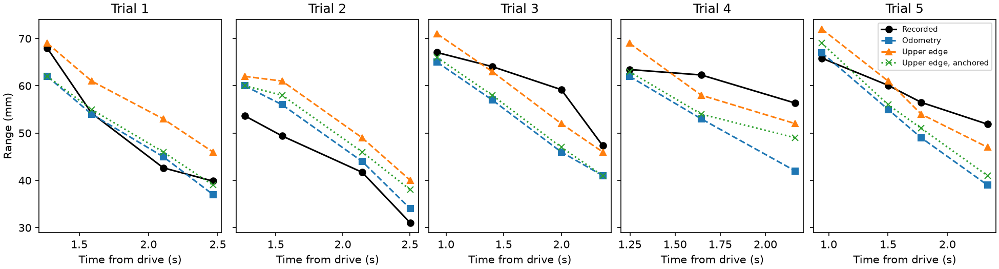

# Can the shelf replay predict the distance that unit 3 reports?

The 19-ray production proximity model observes the simulated free cube and shelf in each printed-fork replay. Each replay starts from the camera-derived cube location and overhead-derived yaw and follows the measured chassis and lift trajectory. The chassis is assumed level. The stateful sensor runs at the configured state period with a fixed noise seed per trial. Each SDK row is compared with the most recent simulated sample. There is no time alignment fitted to the range data.

| Trial | Paired SDK rows | Both report a target | Mean absolute range error on those rows | Found flag agreement |
|---|---:|---:|---:|---:|
| 1 | 130 | 125 | 13.54 mm | 100% |
| 2 | 133 | 126 | 6.50 mm | 97.7% |
| 3 | 126 | 121 | 8.73 mm | 100% |
| 4 | 129 | 124 | 11.15 mm | 98.4% |
| 5 | 128 | 123 | 9.59 mm | 98.4% |

The last three runs have 368 paired positive readings. The model reads short by 9.80 mm on average. As a diagnostic, the median physical minus simulated range in the first two runs is +2 mm. Adding that fixed offset on the last three lowers mean absolute error from 9.83 to 7.94 mm, with 31.5% within 5% of measured distance. Adjacent SDK samples are correlated. These are repeat trials in one session and the upper sensor flag agreement alone does not establish cube fidelity. The physical endpoints include cube motion the replay misses, so this does not isolate sensor calibration, initial placement, or material response. No global range bias was applied.

Run score.py with the repository path and the printed-fork fixture XML built as described in [the fork comparison](../unit3-printed-fork-contact/). [Per-sample data](samples.csv)

## Range change before fork contact

Each curve starts from that trial's median recorded range before the drive command. This removes initial distance error and tests *change* in range, a narrower question than predicting absolute range. The reference predicts a one-for-one reduction with forward odometry, bounded at the sensor's 30 mm reporting floor. The scored interval is 1–2.75 seconds after the approach command. Across those approaches the maximum observed overhead displacement from the starting position was 0.76 mm or less. Overhead frames are sparse, so this bounds sampled movement only.

We fitted lag alone, travel gain alone, or both on trials 1–2 and froze them for trials 3–5. Mean absolute error over 51 held-out rows was 6.92 mm with the one-for-one model, 5.71 mm with the 71 ms lag alone, 6.16 mm with gain alone, and 5.84 mm with both. Only 19 of 51 lag-corrected values fell within 5% of the measured distance. Different starting offsets and later fork contact cannot explain that residual. The fitted lag is relative to SDK odometry and includes transport and reporting effects.

As a separate check, apparent motion from the widening camera glyph used the previously published scale and image timing fit. At the eleven available held-out moving frame times, the mean optical travel exceeded the lag-aligned decrease in range by 4.33, 3.22 and 2.26 mm in trials 3, 4 and 5 respectively. Odometry gave the same sign in each trial. Oblique faces and partial illumination by the range beam remain plausible contributors. The sample cannot identify either. The diagnostic lag has not been applied globally.

[All held-out errors](approach-scores.csv) · [Frame-by-frame optical cross-check](approach-optical.csv) · [Reproduction script](approach.py)

## Would a closer starting cube explain the apparent fork reach?

The 2 mm offset comes from fitting fork reach to push displacement on trials 2–3. As a separate hypothesis, we moved the cube 2 mm toward the robot along its starting heading and kept the wrist and sensor fixed. We compared the 19-ray model against the first 1.5 s of actual range reports before the drive command. Both placements used identical sensor noise seeds, timestamps and initial cube orientation. All 15 samples per trial reported a target in both replays.

Moving the cube closer reduced the range error in trial 2 alone. On trials 4–5, which were excluded from reach selection, mean absolute range error increased from 3.50 to 5.47 mm. The previous fork reach result therefore has little independent support as a **uniform cube-depth correction** on this shelf. This test cannot establish the true wrist offset: absolute ToF bias, face orientation, the camera pose and printed-fork registration still enter the comparison. The bars in the figure show the middle half of repeated readings at each starting pose; they describe within-trial variability.

[Per-trial range statistics](initial-depth.csv) · [Mechanical comparison of both changes](../unit3-printed-fork-contact/depth-check.csv). Reproduce with `python initial_depth.py ../.. /tmp/unit3-fork.xml` using the registered fixture.

On trials 4–5, extending the wrist gave pre-lift displacement errors of 1.32 and 0.10 mm. Moving the cube closer gave 1.32 and 0.07 mm. Push displacement alone barely distinguishes the hypotheses. The independent range check favors keeping the camera placement on those trials.

## Vector 2 browser replay before cube contact

The browser's Vector 2 free-cube scene starts each replay from the cube center
estimated from the onboard glyph and its heading from the overhead camera. We
move the cube relative to the level chassis according to recorded odometry,
hold its orientation fixed in shelf coordinates, and supply the measured lift
height. The browser casts its 19 rays and samples at its configured 60 ms
state period. Each physical receipt is paired with the latest simulated
report. Neither real range nor an offset fitted to range sets the starting
position. These are registered poses with the stock simulated scene background.
They omit any shelf motion between overhead frames, chassis pitch, and
occluders unique to the recording.

On trials 3–5, the mean absolute range error before driving was **3.22 mm**
(45 readings). From 1 to 2.75 seconds into the approach it reached **9.00 mm**
(51 readings); all 51 browser ranges were at or below the measured distance.
Both sides reported a target throughout those windows. Only 3 of 51 moving
readings were within 5% of measured range. Applying the 71 ms delay previously
estimated on trials 1–2 reduced moving error to **7.88 mm**, with 7 of 51
within 5%. This shift is a diagnostic on the reporting time axis. The remaining
error and trial 2's opposite bias make a global range correction premature.

[Paired readings](browser-range.csv). Run `python browser_range.py` with the
web dependencies installed. No sensor or contact parameters are fitted.

### Isolating camera placement from approach travel

A second reconstruction uses the two visible ends of the glyph's 23 mm upper
edge. At each image it solves for positive depths along the two calibrated
camera rays, using the edge direction from the initial overhead heading and
instantaneous SDK chassis yaw. The midpoint, measured head angle, camera mount
and 22 mm face-to-center offset give a fresh robot-relative cube center. Wheel
translation and measured range do not enter this optical position estimate.
An anchored version adds a constant XY translation per trial to match the
earlier four-corner registration at rest. All three alternatives use the same
browser ray fan, lift height and simulated noise draws at each image. Real
range is interpolated at the previously estimated 71 ms range delay; the image
clock uses the previously fitted 236 ms capture alignment.

| Pose input | Mean absolute error, moving trials 3–5 | Mean signed error |
|---|---:|---:|
| Initial four corners plus odometry | 7.30 mm | −7.09 mm |
| Upper edge at each frame, anchored at rest | 5.94 mm | −5.36 mm |
| Upper edge at each frame, absolute position | 3.83 mm | −0.82 mm |

The same 11 held-out images enter each column comparison. Updating travel
alone recovered part of the short reading. Changing the initial registration
as well recovered more. Absolute edge placement also over-read the moving
ranges in trials 1 and 2, with mean errors of +6.09 and +9.06 mm. The
comparison cannot identify a universal placement offset or a sensor bias.
The two endpoints constrain position conditional on the overhead yaw and level
chassis. The images are sparse and the available calibration assumes pinhole
optics. No production coefficients changed.

[Frame scores](edge-range.csv). Reproduce with `python edge_range.py`.
