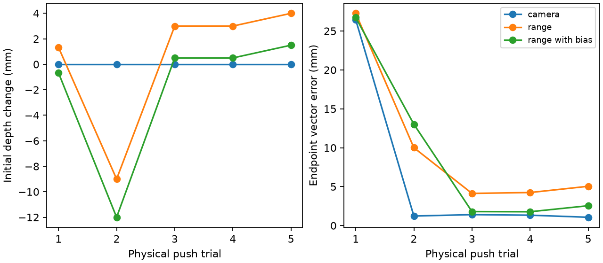
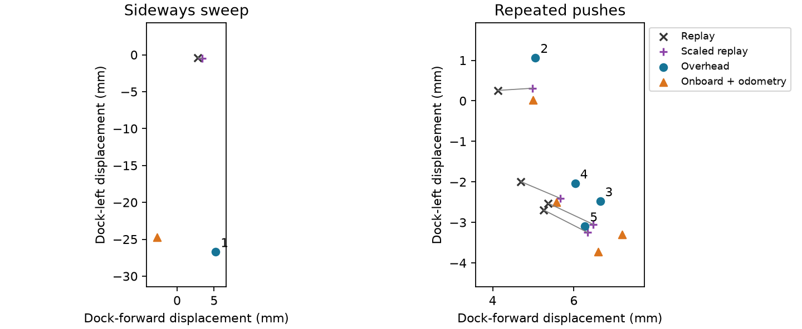

# Does proximity improve the initial cube pose for shelf pushes?

The calibrated camera placement gave smaller endpoint errors than either proximity adjustment on all five pushes. We retained the measured initial overhead cube heading, the 58-piece printed fork and the recorded robot trajectory. Each trial's initial ToF median residual was converted to longitudinal distance using the archived two-point response to a 2 mm shift. The second variant first subtracted the median range residual on the other four trials. Both assume range error comes from cube depth. The larger corrections extrapolate the local response. Cube motion after the approach was used only for scoring.

Trial 2 was the clearest discriminator. Its initial range was 58 mm against 67 mm predicted. Moving the cube 9 mm closer made simulated fork contact at 2.72 s. The first of two successive overhead samples showing at least 2 mm of displacement was at 4.35 s. At those same sample times, the camera placement predicted a 4.35 s motion onset and the range correction predicted 3.04 s. Endpoint vector error rose from 1.23 to 10.01 mm. Removing the bias estimated on the other four trials made the correction larger and increased error to 13.02 mm. The optical threshold measures visible displacement after contact and cannot time the first touch.

All 15 simulations had fork contact. On trial 1, all three still missed the 26.72 mm lateral sweep. A contact flag alone gives little information about the resulting grip. The physical results favor retaining the calibrated RGB depth on these five trials. They do not identify the cause of trial 2's short ToF reading.

[Results by trial](range-contact-transfer.csv) · [Starting range measurements](initial-depth.csv) · [Physical endpoints](../unit3-paired-cube-push/comparison.csv). Run range_contact_transfer.py with the repository root and the registered printed-fork XML as in the [fixture replay](../unit3-printed-fork-contact/README.md).

## Does replay underpredict travel along the right direction?

The camera-initialized replay crossed the 2 mm motion threshold on all five moving trials. This series contains no stationary negative control. We also tested its settled displacement vector. A least-squares multiplier fitted to the overhead endpoints of pushes 2 and 3 gave 1.207. We froze that multiplier for pushes 4 and 5 and checked the onboard camera plus odometry separately.

| Trial | Overhead error, original → scaled (mm) | Onboard error, original → scaled (mm) |
|---|---:|---:|
| 4 | 1.34 → 0.52 | 1.01 → 0.13 |
| 5 | 1.07 → 0.21 | 1.72 → 0.69 |
| 1, sideways sweep | 26.43 → 26.30 | 24.92 → 24.97 |

For the two held-out ordinary pushes, the residual after scaling is comparable to the 0.65 and 0.71 mm disagreements between the physical displacement vectors. The sweep remains roughly 25 mm off in both views. It needs a different contact trajectory during lift. The multiplier diagnoses an endpoint pattern on one surface with one printed fork. It does not identify friction, grip, fork compliance or an appropriate simulator coefficient.

[Per-view errors](endpoint-gain.csv) · [Reproduce the comparison](endpoint_gain.py)
