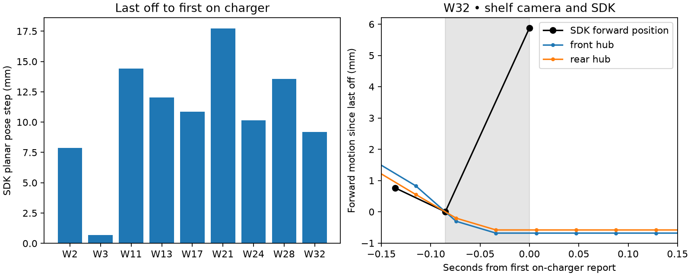

# Does the position jump recur when the charger flag turns on?

Nine additional recorded returns from the same physical Vector 2.0 contain consecutive off-to-on SDK reports. Eight had a planar pose step between 7.9 and 17.7 mm. W3 had a 0.7 mm step. The median was 10.8 mm. The interval between the bracketing reports ranged from 40 to 87 ms. All nine retained the same pose origin across the transition.

In W32, the 9.2 mm planar step included 5.9 mm **forward** along the last off-charger heading. Over the same 85 ms, the side camera showed approximately 0.7 mm **backward** at the front hub and 0.6 mm backward at the rear. Both patches tracked with normalized correlation above 0.87 in the bracket, and the fixed dock patch stayed within the same pixel. W32 independently supports the W34 interpretation that SDK localization contributes to the position step. A single constant correction would miss the spread of observed steps. The physical chassis trajectory and SDK-reported pose should be scored separately at docking.

[Pose samples](pose.csv) are SDK receipt times relative to the first on-charger report. [Camera measurements](camera.csv) use the corrected side view, camera PTS mapped to UTC with the host clock samples, front and rear hub patches, and a stationary dock patch. Forward displacement uses 48 mm per 127 horizontal pixels and linear interpolation at the two SDK receipts. Optical scale, perspective and cross-host synchronization limit precision, especially at submillimeter displacements. Only W32 has been camera-checked in this series. W34 is a separate [paired return and departure](../unit3-w34-return/README.md). W33 ended its captured SDK sequence without an off-to-on edge. The chart can be regenerated with python plot.py in this directory.
