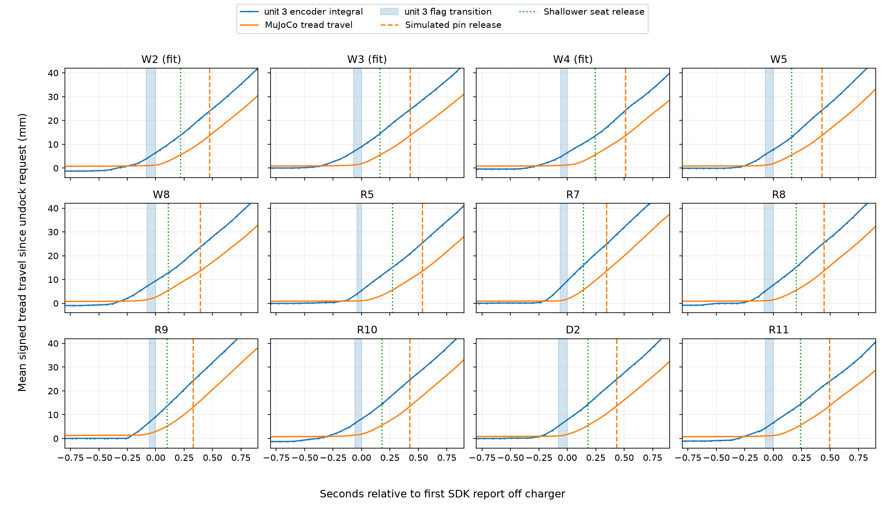

# unit 3 shelf dock contact release

Unit 3 cleared its charger flag earlier than the nominal MuJoCo dock in every moving departure. The physical reference is the interval between the last SDK report with status bit 0x1000 set and the first subsequent report with it clear for the rest of the undock command. Integrating the average of both reported wheel speeds with the trapezoid rule gives tread travel at both ends of that interval. This estimates wheel travel. It does not measure chassis translation or the instant of electrical disconnection.

Each replay begins settled on the shelf dock, with head and lift at their recorded starting poses. The browser takes recorded wheel speeds as motor setpoints and head and lift reports as posture targets. The simulated wheel loop introduces its own response delay. The blue shading brackets the observed SDK transition. Orange dashes mark nominal simulated release. Green dots mark release after shifting the initial seat toward the lip, settling again, and replaying the same inputs. The orange travel curve belongs to the nominal replay.

Using W2, W3 and W4, we estimated the seat shift as the median nominal excess wheel travel to release relative to the midpoint of each physical observation interval. We applied this **7.94 mm** shift to nine other moving departures without refitting. All recordings are from unit 3 on the same shelf.

| Held-out result (9 moving departures) | Nominal seat | Shallower seat |
|---|---:|---:|
| Mean absolute error relative to midpoint of observed tread-travel interval | 6.69 mm | 1.54 mm |
| Predicted tread travel inside observed interval | 0/9 | 3/9 |
| Mean simulated delay after first SDK report off charger | 424 ms | 175 ms |
| Mean simulated settled chassis pitch | −7.84° | −8.28° |

Mean initial SDK pitch was −4.32° across those nine departures. It is a firmware estimate from a head-mounted IMU. A shallower seat improves release travel but moves predicted pitch farther from that estimate. The pads' electrical reach, dock shape, starting depth, and slip can all influence this comparison. The candidate remains an experiment; the production dock retains its nominal seat.

Reproduce with Node and the web simulator dependencies installed, then run `python score.py` with NumPy and Matplotlib. The trial list refers to the archived state and action logs under [unit3-wheelstand](../unit3-wheelstand/). [Per-trial results](release.csv)

## R11 had an intermittent dropout before its actual departure

The original See3CAM recordings cover the undock as well as the later cube attempt. The aligned clip shows the fork and head dropping while the robot is seated. Between 3.646 and 3.832 s, lift height went from 58.8 to 30.6 mm. The first off-charger report arrived at 3.832 s with both wheels reporting zero speed. Five off/on cycles followed the initial seated period before a sustained release at 8.342 s, when wheel speeds reached 32 and 31 mm/s. Both physical events are visible in the flag trace. [Corrected two-camera video](r11-undock.mp4) · [Synchronized optical and SDK traces](r11-contact.png)

We tracked front and rear rim patches against a stationary dock patch in each view. Comparing median positions at 2.7–3.3 and 3.9–4.3 s, both cameras show a small shift toward the lip (0.04 and 0.29 image pixels) and a nose-up change in the projected hub axis (0.12° and 0.33°). These are subpixel estimates in two oblique views, with no metric pose calibration. They give little support for a several-millimetre drive-off at the first dropout. Neither camera sees the underside pads. The footage establishes the coincidence with fork descent but cannot determine whether chassis rocking unloaded a pin or the electrical contact was intermittent for another reason.

For the later sustained release, physical integrated wheel travel was 4.42–6.63 mm. The frozen shallower-seat prediction of 5.55 mm falls in that interval, although it clears 238 ms after the first sustained off report. The nominal model clears at 13.61 mm. The table above now includes this twelfth departure, keeping the same three calibration trials. The earlier comparison stopped at the first flag loss in each recording and omitted R11 from moving-departure scoring.

Run `python r11_contact.py` against the committed corrected video to reproduce the optical comparison with OpenCV, Matplotlib and NumPy. The optical CSV stores image-axis displacements, with positive x right and positive y down. The plot reverses signs as required for the opposed views. [Rim tracks](r11-optical.csv)
