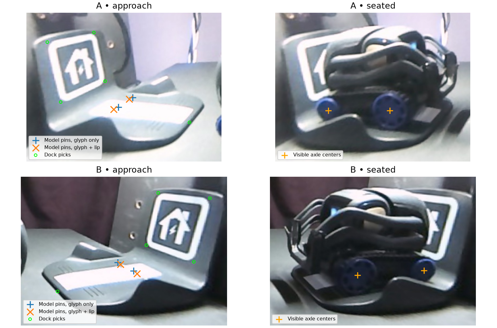

# W34 seated axle in the opposed dock views

The exposed dock and the subsequently seated robot are visible from both sides in W34. The pin centers cannot be identified confidently against the bright deck in either corrected view. Crosses on the deck are the projections of the canonical pin sites. They should not be used as physical measurements.

We picked the four outside corners of the white dock glyph in each approach frame, estimated its pose using the established 46 mm square, and back-projected rays through the seated hub centers. A second fit added a hand-picked midpoint of the ramp lip. Both fits use the corrected shelf view's 465 px focal length and its 499.5, 185.5 px principal point. The cameras remained in place between the selected frames. The hub-face plane was assumed parallel to the dock axis at ±30 mm from its centerline. The CSV also gives ±27 and ±33 mm as a sensitivity check, which includes uncertainty in transverse chassis position. The nominal 48 mm hub spacing was reserved as a check.

| Camera and anchors | Seated front axle inward from lip | Recovered hub spacing | Lip reprojection residual |
|---|---:|---:|---:|
| A, glyph | 28.1 mm | 45.9 mm | 21.3 px |
| B, glyph | 26.6 mm | 47.4 mm | 20.1 px |
| A, glyph and lip | 21.1 mm | 49.1 mm | 2.0 px |
| B, glyph and lip | 21.5 mm | 49.2 mm | 2.3 px |

Adding the lip moves the inferred front axle outward by 7.0 and 5.1 mm respectively. The lip residual in that fit is in-sample. The two cameras agree within 1.5 mm in either fit, but using the same registration assumptions gives both a shared source of error. Changing the hub-face plane by ±3 mm moves the inferred depth by roughly ±2 mm. The lip midpoint comes from the visible outline of a curved edge and is particularly sensitive to the viewing angle.

For comparison, in the [W35 seating sweep](../seat-offset-sweep/README.md) the default chassis starts 29.9 mm inward and the shifted chassis 23.9 mm inward. Using the nominal visual front axle at chassis x=0 and z=14.5 mm and the simulated settled pitch gives front axle depths of approximately 27.9 and 21.9 mm. The glyph-only registration favors the first and the lip-assisted registration favors the second. Registration sensitivity is large enough to span the full 6 mm change. The existing footage supports measuring relative travel more precisely than absolute electrical contact geometry.

Run python check.py in this directory to reproduce the plot and [measurements](registration.csv) from the four corrected crops. The pixel coordinates in the script refer to the full corrected views. W34 approach frames were approximately 4.55 s before the first on-charger report and seated frames approximately 0.15 s after it. The pictures of the deck and the pictures of the hubs are from distinct times. Head and lift position do not enter the axle calculation.
