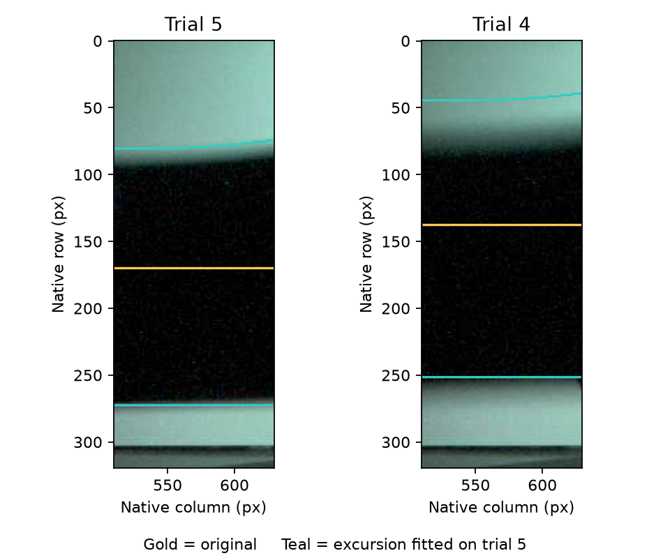
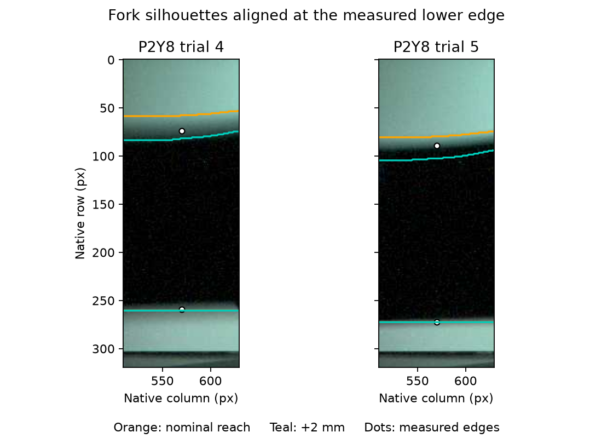
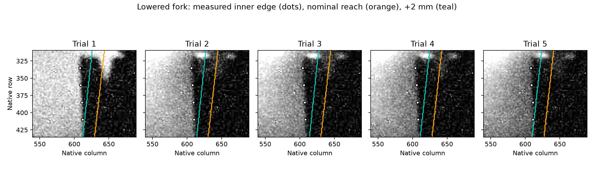
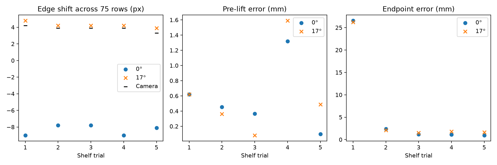

# Where the raised fork appears in unit 3's camera

The physical fork's lower edge is at native image row 272 in trial 5 and 259 in trial 4. The original printed-fork replay projects it at rows 169 and 137. Trial 5's head and lift telemetry were constant for the preceding 400 ms. Trial 4 uses telemetry 230 ms before frame receipt; its lift changed by 1.97 mm across that window. The crop covers native columns 510–629. Edge measurements use the median intensity profile across columns 550–590. The SDK camera intrinsics, firmware neck transform, level wrist and registered forks7.stl define the projection. The exact installed fork STL is unconfirmed.

## Two independent checks

1. Fitting lift excursion above 32 mm using trial 5's lower edge gives a multiplier of 0.8533. That predicts row 251 on trial 4 (8 px error); the upper edge still visibly misses. When replayed with the same change, trial 1's cube travel error goes from 26.43 to 26.49 mm and its peak tilt from 2.29° to 2.21°. The four remaining endpoint errors all change by less than 0.04 mm. The camera fit supplies no evidence for changing the physical lift gain.
2. Independently, the orientation of the *stationary upright cube* constrains camera pitch relative to the shelf. Knowing the 23 mm glyph size, we solved its pose in ten settled views. In the original transform the glyph center is only 15.47–16.18 mm above the shelf. Using four picks from trials 1–2 gives a +5.16° pitch correction and a −0.52 mm camera height correction, assuming a centered glyph on a level, 44 mm cube. With both corrections frozen, the six picks in trials 3–5 yield 21.36–21.73 mm against 22 mm nominal. The same camera correction predicts the raised fork edge at rows 165 and 196 in trials 4 and 5, leaving errors of 94 and 76 px respectively.

The effective camera correction covers one head angle and includes chassis pitch relative to the shelf. All observations are from the same session. Distortion, a printed fork with different geometry, wrist pose and the head mount remain confounded. A second head angle or an independent side view with fork and rigid chassis landmarks would help distinguish them. The baseline physics and global camera mount remain unchanged.

Run geometry.py for the crop overlays, shelf.py for the stationary-cube and camera-only checks, and contact.py REPO_PATH REGISTERED_XML for the ten contact simulations. The fixture construction is documented in the adjacent printed-fork study.

## Can the apparent crossbar thickness identify an extra 2 mm of reach?

For each of the two raised-fork crops, we adjusted modeled wrist height until the projected lower edge matched the measured lower edge to one native pixel. We then scored the **upper** edge, which was excluded from that adjustment. This conditions on a visible landmark despite the known lift-height discrepancy. The fitted height is a nuisance parameter. Neither cube travel nor cube depth enters the edge score.

| Camera pose and trial | Upper-edge error at nominal reach | Upper-edge error at +2 mm |
|---|---:|---:|
| Original, trial 4 | 16 px | 8 px |
| Original, trial 5 | 9 px | 14 px |
| Shelf-calibrated, trial 4 | 26 px | 2 px |
| Shelf-calibrated, trial 5 | 20 px | 4 px |

These are absolute errors using the half-intensity crossing. With the camera correction previously fitted to stationary cube views on trials 1–2, both crops favor the extended reach at all three tested intensity thresholds (35%, 50%, 65%). With the original camera pose the preference changes with frame or threshold. Trial 4 was moving near the exposure; trial 5 had a stable recorded pose. Both observations cover the raised fork. Tilt and crossbar thickness of the actual print still trade off against reach, and the fitted wrist heights differ from telemetry. This supports testing the offset for unit 3 but cannot establish the reach of his lowered fork.

Reproduce with `python reach_silhouette.py` alongside the existing SDK mesh and camera assets. [All edge picks and model predictions](reach-silhouette.csv)

## Lowered fork during approach

Eight original 800 × 600 onboard grayscale frames per trial were median-combined over −1.5 to +2.3 seconds relative to the approach command. The right inner edge of the printed fork is visible against the shelf. We projected the two reach settings at the recorded head angle and lift height (30.65–32.68 mm), with no per-frame alignment. The left edge has weaker contrast and competing cube edges. Only the right inner edge was scored.

| Camera pose | Nominal mean absolute horizontal error | With 2 mm extra reach |
|---|---:|---:|
| Shelf-calibrated | 28.65 px | 11.35 px |
| Original | 19.30 px | 5.75 px |

Under shelf-calibrated optics the observed edge moves rightward toward the bottom of each image while the predicted edge moves leftward. Extension brings the edge closer but leaves a shape or orientation discrepancy. The pixels constrain the projected fork opening at working height. They cannot distinguish fore–aft reach from fork width or wrist rotation, and they do not show the depth of the hidden contact surface. All five runs use the same robot, head angle, and shelf.

The native crops start at column 540 and row 310. The PNGs store twice the median intensity to retain half-gray levels. At four rows per trial, the score uses the strongest falling intensity gradient between columns 570 and 660 after Gaussian smoothing and averaging nine rows. Neighboring rows are correlated. Run `python low_reach.py` to reproduce the [edge positions](low/edges.csv) and overlay.

## Testing a constant wrist pitch against cube motion

At fixed +2 mm reach, rotating the STL about the wrist pin can reproduce the *slope* of its right inner edge. We selected pitch from −25° to +25° in one-degree increments using only the change in edge column across four image rows on trials 2–3. The observed change was +3.9 px across 75 rows on both trials. The closest modeled change was +4.2 px at +17° (positive rotates the forward axis downward). On reserved trials 4 and 5, the predictions were +4.2 and +3.9 px against observed +3.9 and +3.3 px.

This rotation puts the edge in the wrong place. Mean absolute horizontal error on trials 4 and 5 increased from 12.25 and 7.50 px to 24.75 and 22.00 px. Applying the same rotation throughout the measured lift trajectory increased their settled displacement errors from 1.11 and 0.95 mm to 1.79 and 1.66 mm. Trial 1 still missed the sideways sweep by 26.19 mm. The frozen camera pose, cube registration, wrist pin, friction and odometry were identical between treatments. These results argue against applying a constant pitch correction to the whole fork. The right edge alone cannot distinguish taper in the printed part from a change in wrist pose.

Run `python wrist_pitch.py ../.. /tmp/unit3-fork.xml` to reproduce the [measurements](wrist-pitch.csv) and plot.
