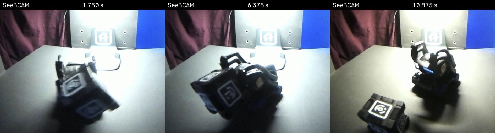
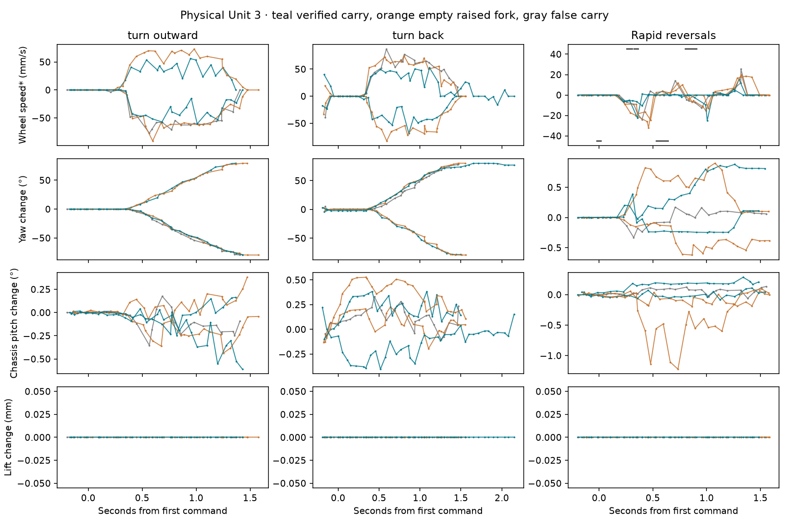
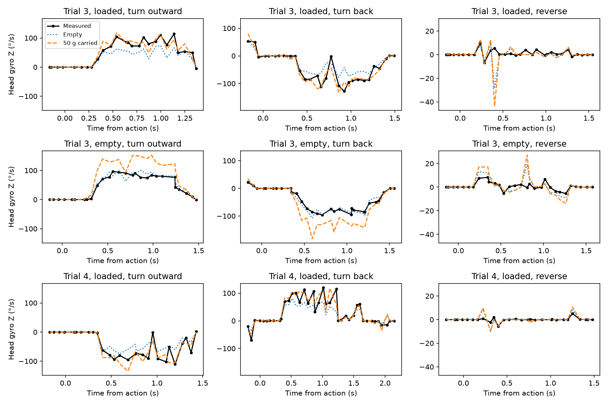

# Physical cube pickup and carry on the shelf

Unit 3 is a Vector 2.0 with a printed lift. After a baseline stock pickup, three further pickups visibly carried the cube during motion. The See3CAM overhead view establishes physical engagement. The robot's own carry flag disagreed with the footage once.

| Maneuver with cube | Measured yaw | SDK pitch range | Largest sampled lift drop |
| --- | --- | --- | --- |
| Initial short wheel pulse and stop | See pulse trace | 1.58° | 4.60 mm |
| Left first, then right | +79.47°, −78.40° | 0.41°, 0.31° | 0 mm |
| Right first, then left | −78.99°, +77.01° | 0.62°, 0.56° | 0 mm |
| Four forward/reverse steps, left-first run | See CSV | 0.19° | 0 mm |
| Four forward/reverse steps, right-first run | See CSV | 0.25° | 0 mm |

The first pulse took the lift from 91.79 to 87.20 mm. The minimum came about 0.66 s after the command, after the all-motors stop returned. The lift recovered to 90.31 mm. The empty comparison used a lowered fork. Load, posture and the stop command therefore remain confounded.

**Trial 3 (left-first) is a successful lift with improper engagement**, identified by the operator in the linked footage. The cube rides askew during the loaded portion. Treat it as a separate grip condition. The exact fork contact points are obscured. Trial 4 is visually confirmed as carried; its seating has not been independently established.

The two longer sequences used opposed 80° commands followed by four alternating wheel-speed steps at 45 mm/s magnitude. Wheels-only stops kept the lift engaged. One sequence included an empty raised-fork control. Empty pitch ranges were 0.49° and 0.42° during the turns and 1.32° during reversals. The loaded reversal ranges were smaller in both sequences. A guard interrupted the second empty control after release. Pitch is the SDK robot pose estimate. Independent cube rocking and motor torque were not measured. Wheel speed shortfall during short reversals includes acceleration and sampling effects.

[Baseline pickup footage](pickup.mp4) · [Short pulses](first-pulses.mp4) · [Short pulse traces](pulses.png) · [Left-first carry and raised-fork control](turn-left-first.mp4) · [Right-first carry](turn-right-first.mp4) · [SDK carry with the cube visibly on the shelf](false-carry.mp4)

The false carry was excluded from loaded comparisons. A separate pickup ended with VISUAL_OBSERVATION_FAILED. The final place action reported BAD_OBJECT although the overhead view showed release. Action success, carry ID, and visual engagement are recorded separately.

The compressed JSONL files contain robot states and action events. rotation.csv and pulses.csv contain per-action measures. The CSV beside each video lists camera timestamps. Videos pair frames by host time at 8 fps. A blank onboard pane indicates missing fresh imagery. The cameras have independent clocks and receipt latency. The raw measurements apply to this robot, fork, cube and shelf.

### Wheel-speed replay with the recorded fork raised

Both variants receive the same interpolated SDK left/right wheel speeds, begin at the recorded head angle and lift height, and keep the axles 48 mm apart with the previously selected 3.75 mm contact inset. Each maneuver includes the motion history starting before the first turn. One variant uses the SDK carry position and the model's assumed 50 g cube rigidly carried by the fork. The other runs empty. No parameter was fitted. SDK samples are aligned by host receipt time. The largest instantaneous wheel-speed input discrepancy during a scored action was 2.07 mm/s.

| Physical condition | Gyro Z RMSE with the matching load, °/s | RMSE with the opposite load, °/s |
| --- | --- | --- |
| Improperly engaged carry, left then right | 14.54, 17.61 | 26.69, 27.34 |
| Empty, left then right | 10.86, 8.77 | 42.69, 39.84 |
| Loaded, right then left | 20.24, 19.14 | 25.42, 24.12 |
| Loaded, rapid reversals after each turn pair | 9.96, 2.77 | 6.93, 2.30 |

The replay uses nominal cube placement even for the improperly engaged carry. Its gyro agreement cannot validate that placement, the pickup contact, or a cleanly seated payload baseline. Across these recordings the matching mass condition tracked gyro Z better on all six turns, including the opposite-order carry, but worse on both loaded reversal sequences. This tests rotational response conditional on real wheel motion and known physical engagement. It does not predict wheel speed, pickup success, relative cube movement or grip loss. Neither cube mass nor timing lag can be inferred independently from these results. The simulated payload is attached throughout, and the initial head angle is held fixed.

[Per-action errors](replay-carry.csv) · [Replay script](replay_carry.py). Run the script in the repository's MuJoCo Python environment.

### Head IMU through rapid reversals

The pitch-rate and fore–aft acceleration comparison keeps trial 3's improper engagement separate from the other carry. Both replay conditions include the preceding turn pair. The model's head IMU filter runs at each physics step. Each trace subtracts its own median in the 0.2 seconds before the first reverse command. Vertical lines show subsequent direction changes. A constant pre-command baseline provides a comparison for how much of the transient the model predicts.

For the improperly engaged carry, the nominal loaded replay's pitch-rate RMSE was 2.15°/s against 2.13°/s for a constant baseline. Head X acceleration RMSE was 511 versus 453 mm/s². On trial 4, the same replay gave 0.53 versus 0.54°/s and 144 versus 161 mm/s². A usable grip model must also explain the cube's motion relative to the fork. Head IMU alone cannot measure it. These short traces have SDK receipt-time and sampling uncertainty.

[Reversal IMU overlays](reversal-imu.png) · [Errors and constant-baseline controls](reversal-imu.csv) · [Replay](replay_reversals.py)
