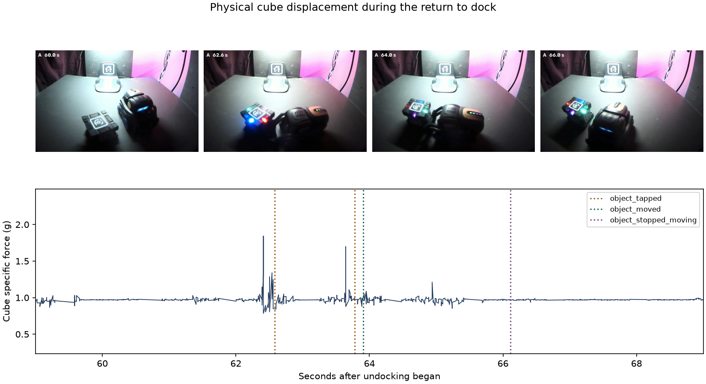
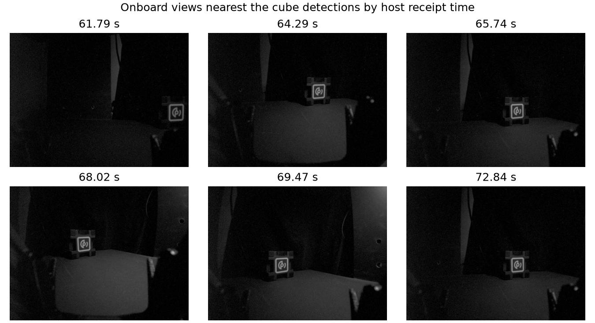
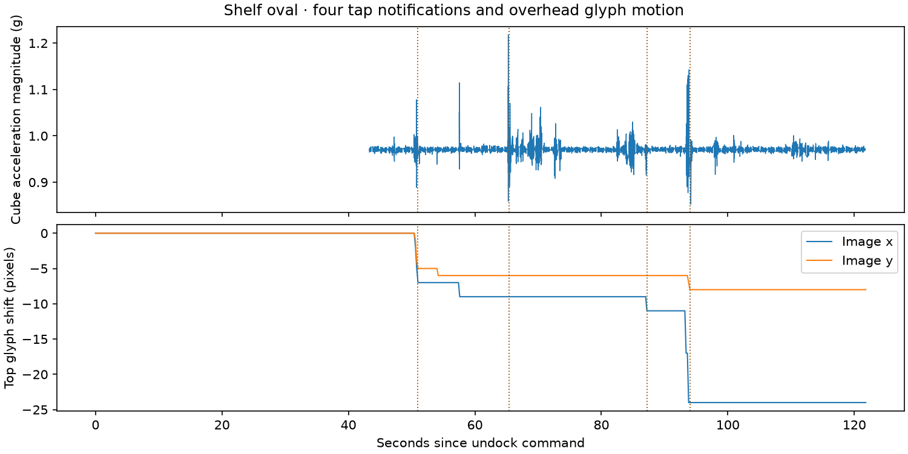

# Four physical shelf recordings with one robot and one cube

Four separate continuous-override sessions used the native undock behavior and returned to the dock. Each directory includes overhead video, action times, SDK object events, wheel speeds, head and lift position, odometry, robot IMU and proximity feedback. Cameras and radio events are aligned by host receipt. The overhead videos are 5 fps resamples; independent raw frames typically arrive more slowly. The onboard capture preserves original JPEG bytes. No changes to simulator parameters were fitted on these runs.

| Session | Robot states | Cube XYZ observations | Physical outcome |
|---|---:|---:|---|
| [A](A/) | 1,906 | 4,737 | Cube was visible during undocking but the pickup search lost it. The robot displaced and rotated the cube during its later docking maneuver. |
| [B](B/) | 1,536 | 0 | Connection request returned without an active cube stream. Returned to dock before the contact sequence. |
| [C](C/) | 862 | 0 | Retreated for a wider field of view and searched optically. No fresh sighting before docking. Radio connection was conditional on a sighting in this run. |
| [D](D/) | 1,946 | 0 | With the cube placed to the side, seven optical sightings during the interior heading sweep, at two commanded head angles. Bluetooth connection request did not produce raw packets. The run was an optical survey. |

### Real contact during the dock return

In A the robot generated four SDK tap events and one moved/stopped pair. The XYZ magnitude peaked at **1.84 g** between 60 and 68 s and **2.39 g** between 88 and 96 s. The early and late optical sightings share an odometry origin and differ by about **86 mm** in the horizontal plane. Camera footage independently shows translation and rotation. This is an incidental contact recording with multiple encounters, not a commanded stroke or an isolated friction measurement. The radio continued to deliver packets after the disconnect request. **None of these four runs reached the pickup command.**

### Seeing the stationary cube from the shelf interior

D preserves [81 native 800 × 600 camera frames](D/native-views.zip) from the sweep, [image timestamps and nearest telemetry](D/native-index.csv), and [the object sightings](D/object-events.csv). The reconstructed cube centers span 0.94 mm along odometry X and 1.28 mm along Y in that one origin. That is repeatability of SDK object localization during this sweep, not independent world-position accuracy. A missing notification on a frame does not prove the cube was invisible.

The robot, range and cube CSV files are compressed with gzip. Cube axes are signed words in nominal units of 8192 counts/g, with three samples sharing each radio receipt timestamp. Empty cube files mark sessions without radio data. Read the robot status word alongside the recorded carry ID when interpreting telemetry. The full-resolution originals and acquisition logs were retained locally.

### Side-lit shelf oval, sessions E and F

[E](E/) adds 6,477 cube XYZ samples and 2,030 robot states. [F](F/) adds 2,232 cube XYZ samples and 3,114 robot states. Both recordings used the physical cube and P2Y8's printed fork. Neither reached a pickup. In E the engine saw the glyph during undocking and lost it before pickup. F connected the cube before undocking. Its second head-angle request never returned, and telemetry subsequently showed wheel motion without a matching drive request from the trial. Exclude this interval from commanded-motion fits. A separate native docking action recovered P2Y8 and charging and active quiet mode were verified.

| E tap time after undock (s) | Peak acceleration magnitude within ±1 s (g) | Overhead glyph shift, x and y (pixels) |
|---:|---:|---:|
| 50.98 | 1.08 | −7, −5 |
| 65.45 | 1.22 | 0, 0 |
| 87.24 | 0.98 | −2, 0 |
| 94.00 | 1.14 | −13, −2 |

Each image shift compares median glyph centers in the two seconds before and after notification. The overlay uses three manually centered orientation templates in one fixed camera view. The 5 fps video can reuse a source frame. Small shifts include template centering and pixel uncertainty. The center moves under cube rotation as well as translation. Acceleration magnitude includes gravity and three samples share a packet receipt time. The four events occurred during aiming or dock return and are not independent, commanded push replicates.

[Overhead close-ups around all four events](E/tap-frames.jpg) · [full E video](E/overhead.mp4) · [onboard E survey](E/onboard-survey.jpg) · [raw optical track](E/glyph-track.csv) · [F robot and cube traces](F/traces.png)

### Held-out cube accelerometer and SDK event checks

Replaying E's captured packets through the frozen listeners recovered all four SDK taps. F had zero predicted and zero observed events during radio coverage. **A exposes a discrepancy**. Its packet counter changed six times while the SDK delivered four tap callbacks. Two of the packet changes followed an earlier change by 146 and 130 ms. The data do not establish whether the engine suppressed events or the SDK observer missed them. The eight taps in the earlier pickup recording gave a median packet-to-SDK host receipt delay of 146 ms. Applying that fixed delay to E gave signed errors of +4, +31, −2 and −12 ms. This transfer tests the reporting path with real packets as input. Generating taps directly from simulated contact is a separate test.

After standoff, the quiet head-look windows in E and F gave physical X/Y/Z within-packet scatter of 1.99/2.34/2.80 and 2.03/2.21/2.80 mg. The frozen simulator gave 2.27/2.34/2.37 mg. It underestimated Z scatter by about 15% in both windows. Both observations use the same cube and shelf orientation. A second orientation would help distinguish an axis effect from vibration. The model parameters are unchanged.

[Sensor and event comparison](oval-sensor-check.png) · [Event times](oval-event-check.csv) · [Held-out tap timing residuals](tap-receipt-transfer.csv) · [Reproduce](oval_sensor_check.py)

### Which tap survived in the two close pairs?

The original SDK payload carries the robot's own message timestamp. In A, both pairs of counter changes were **150 ms apart on robot uptime** (10 ms recorder resolution). The two SDK stamps fall **30 and 19 ms before the second change**, versus **120 and 131 ms after the first**. Across all twelve independently paired taps in pickup and E, stamp-minus-radio offsets range from −25 to +35 ms. The ordinary offset range supports matching A's two callbacks to the later changes. The earlier pickup also includes **two separate callbacks for changes 170 ms apart**. The previously measured 146 ms pod-receipt lag therefore must not be used as a tap suppression rule.

The public [stock packet handler](https://github.com/kercre123/victor/blob/snowboy/engine/components/cubes/cubeAccelComponent.cpp) stamps a counter change with the latest robot message time. The [physical engine filter](https://github.com/kercre123/victor/blob/snowboy/engine/components/blockTapFilterComponent.cpp) starts a group at the first input, then releases its last payload on an engine update after the deadline. The source default is 75 ms. Substituting radio arrival times for engine arrival times and applying a punctual 75 ms timer would split both 150 ms pairs. The engine enqueue/update times and effective setting for these trials were not captured. A missing first callback remains possible. Keep the packet-level simulator behavior and published comparison distinct from an SDK event prediction.

[Device-clock overlay](tap-clocks.png) · [Per-change timing](tap-clocks.csv) · [Original SDK tap stamps](sdk-tap-clocks.csv)

### How far did the cube rotate during E?

The first and last contacts rotated the cube in opposite directions. For each tap, the table compares top-glyph heading in two windows 0.8–1.6 seconds on either side. Positive means counterclockwise viewed from above. One method fits and rectifies the four white edges. The other registers the printed glyph texture after correcting local foreshortening. Both assume the cube settled on the same face.

| Tap time (s) | Peak specific force (g) | Outline yaw (°) | Texture yaw (°) |
|---:|---:|---:|---:|
| 50.98 | 1.08 | +14.1 | +18.0 |
| 65.45 | 1.22 | +1.0 | +1.3 |
| 87.24 | 0.98 | −2.3 | −2.3 |
| 94.00 | 1.14 | −10.4 | −11.1 |

At 75, 79 and 83 seconds, texture registration gave absolute changes below 0.1° in three no-tap comparisons. The outline fit alone gave a spurious-looking 5.9° at 83 seconds as the cube LEDs changed. A fourth no-tap window lacked enough usable segmentations. Treat the exact magnitudes of the smaller tap rotations as provisional. These results supply physical contact-replay targets. They do not identify friction or fork geometry by themselves.

[Before/after outline overlays](E/tap-heading.png) · [Angles and fit sensitivity](E/tap-heading.csv) · [Analysis](oval_rotation.py)

### Replaying the first shelf contact with the free cube

The frozen Vector 2 scene, driven by E's measured robot XY, yaw, wheel speeds, head angle and lift height, predicted a **9.3° counterclockwise rotation** from the original SDK cube sighting. The video estimates were 14.1° and 18.0°. The simulated packet peak was **1.90 g** against **1.08 g** recorded within one second either side of the tap. The nominal replay produced one packet tap in that window, matching the physical packet count.

All nine initializations (−5, 0, +5 mm along each horizontal axis) began clear of robot penetration and struck the cube first with the right side of the simulated fork. Yaw ranged from 0.3° to 12.2°. Three positions started contact roughly 3.6 seconds before the physical tap. The offsets illustrate sensitivity; their range is not a measured localization error bound. The last SDK cube sighting preceded the tap by 44 seconds. The scene uses the default fork collision geometry, while this robot has a printed lift. The replay prescribes a level chassis following SDK odometry at each physics step, leaves the cube free, and uses one sensor noise seed and sampling phase. Robot odometry, actual contact geometry, and sensor phase remain distinct possible contributors. No friction or impact parameter was adjusted.

[Yaw sweep](E/first-contact-replay.png) · [Physical and simulated accelerometer packets](E/first-contact-force.png) · [Per-pose outcomes](E/first-contact-replay.csv) · [Reproduce](oval_replay.py)

### Does the printed fork explain the first contact?

Replacing the three collision boxes with the registered 58-piece forks7 mesh raised the nominal yaw prediction from 9.31° to 10.40° (camera estimates 14.15° and 18.01°). It lowered peak specific force from 1.90 to 1.68 g (recorded 1.08 g), and changed the packet tap count from one to two (recorded one). Across the nine starting cube positions the printed fork produced 3.86–13.05° of yaw and peaks of 1.34–1.99 g. The mesh had previously improved endpoint error on short pushes. This turning contact tests its transfer to a different motion. It helps two nominal metrics, worsens the third, and leaves substantial error. The exact fork file installed on P2Y8 remains unconfirmed.

The comparison retains fork inertia, contact material, prescribed trajectory, cube, and sensor seed and phase. To reproduce, run the default replay, then run it with `--printed-fixture` pointing to the output of [the printed-fork fixture builder](../unit3-printed-fork-contact/build_fixture.py). Only the convex mesh assets are imported into the normal Vector 2 scene.

[Geometry comparison](E/fork-transfer.png) · [Printed-fork accelerometer overlay](E/printed-contact-force.png) · [Results for all placements](E/printed-contact-replay.csv)

### Could the cube's sampling phase explain the peak?

At the nominal SDK cube pose, each fork generated one fixed 1 ms physical trajectory. We passed each trajectory through the existing cube accelerometer, firmware packetizer and tap listener 80 times. Frame phases covered 0–1.5 ms and app tick phases covered 0–9.5 ms, both in 0.5 ms steps, with the same noise seed. Phase zero reproduced both previously published nominal peaks and tap counts. In the two-second physical comparison window the recorder captured 60 packets and a maximum magnitude of 1.078 g.

| Collider | Range of simulated packet peaks | Tap candidates across the 80 phase combinations |
|---|---:|---|
| Three boxes | 1.505–2.301 g | One in 40 combinations, two in 40 |
| Printed fork | 1.489–2.729 g | Two in all 80 |

Sampling phase affects the apparent peak substantially. Even the lowest printed-fork result was 38% above the recorded peak, and the cube's real tap counter incremented once. Host packet receipt had a 280 ms gap starting at 50.950 s; the on-robot monitor had a 260 ms gap between those same two receipts. The recording therefore bounds the delivered peaks, not the continuous physical maximum. Packet loss cannot be inferred from that gap alone. This sweep holds the app and its clock periods fixed; it measures phase sensitivity for this contact only.

[Sampling phase overlay](E/phase-sweep.png) · [All phase combinations](E/phase-sweep.csv). To reproduce, run each version of the first-contact replay with `--export-force` and pass the resulting two NPZ files (boxes first) to `contact_phase.py`.

### Did receipt-time jitter generate the extra simulated tap?

Two successive SDK state messages arrived 108.5 ms and 12.8 ms apart during the first shelf contact. Differentiating their yaw using the latter interval gives about −3.6 rad/s, while the head gyro Z reports about −0.8 rad/s and wheel speeds remain comparable across those samples. Over 149 states spanning 45–54 s, a straight-line fit to arrival time versus sample index gives a 59.99 ms period. Treating those same poses as uniformly sampled reduces the yaw-rate RMS difference from the gyro from 0.76 to 0.28 rad/s during the contact turn and from 0.50 to 0.19 rad/s during the earlier turn. This clock is an estimate from arrivals. The gyro is head-mounted, and its samples are compared by state index.

The printed-fork replay with that cadence retained **both original packet tap candidates at 50.57 and 50.75 s** and added a third at 50.90 s (nominal cube pose, original noise seed and sensor phase). The physical cube reported one counter change. Predicted yaw increased from 10.40° to 11.30° and peak packet magnitude fell from 1.68 to 1.61 g. The physical measurements were 14–18° and 1.08 g recorded. The clock correction removes a spurious angular-speed spike, but that spike alone does not account for the extra tap. No production contact parameters were fitted.

[Chassis gyro, wheel speeds and simulated taps](E/motion-clock.png) · [Cadence-adjusted cube acceleration](E/printed-contact-cadence-force.png) · [All nine starting positions](E/printed-contact-cadence-replay.csv). Reproduce with `oval_replay.py --printed-fixture FIXTURE --cadence`, then `state_timing.py ORIGINAL_PRINTED_FORCE.npz` using the force export from the original receipt-time replay.

### Are the three simulated taps separate impacts?

In the nominal cadence-adjusted printed-fork replay, the same fork hull exerted a positive normal load at every 1 ms step from first touch (50.527 s) through the third app increment (50.899 s). The counter incremented at 50.559, 50.729 and 50.899 s. Over that interval the cube tilted less than 0.13° and its summed floor normal load briefly fell below 1 µN on 43 steps. The simulation produces several vertical acceleration transients during one sustained fork contact. There is no corresponding physical force measurement.

| Physics step (ms) | Cube yaw (°) | Peak packet magnitude (g) | Packet taps |
|---:|---:|---:|---:|
| 1 | 11.30 | 1.61 | 3 |
| 0.5 | 11.37 | 1.84 | 4 |
| 0.25 | 11.22 | 1.62 | 1 |
| 0.125 | 11.18 | 1.66 | 2 |
| 0.0625 | 11.14 | 1.61 | 2 |
| Physical | 14–18 | 1.08 recorded | 1 |

Only the physics integration and prescribed-pose update interval changed. Geometry, material settings, solver time constants, the 1 ms sensor integration interval, firmware clocks and random seed stayed fixed. The first three rows include the original nine cube poses; the finest two use only the nominal pose. Yaw varied by less than 0.24° across the five nominal replays. The coarser steps disagree on tap count, and the one-tap result at 0.25 ms disappears at both finer steps. This limits the conclusions one can draw about real fork impacts from a single simulated counter.

[Contact loads and chip Z](E/contact-load.png) · [Time-step comparison](E/contact-steps.png) · [1 ms load trace](E/contact-load.csv). Generate the trace with `oval_replay.py --cadence --printed-fixture FIXTURE --contact-log E/contact-load.csv`, then run `contact_load.py`. Use `--substeps 2` and `4` for the placement sweep, and `--substeps 8 --nominal-only` and `16 --nominal-only` for the two finest comparisons. Run `contact_steps.py` for the comparison figure.

### Separating rubber-on-shelf contact from fork contact

During the three simulated counter increments (50.527–50.900 s), all solved fork normal load was on the plastic shell and all floor normal load was on rubber corners. We varied only the rubber-to-table contact solver time constant. The explicit 8 ms control reproduced the original nominal peak and tap count at both finer test steps. Friction, fork collision properties and recorded motion stayed fixed.

Increasing the time constant from 8 to 32 ms reduced the packet peak from **1.62–1.66 g to 1.19–1.21 g** across 0.25 and 0.125 ms physics steps. Both steps produced one tap at 32 ms. The physical packet peak was 1.08 g with one counter change. Yaw remained around 11° against the camera's 14–18°. The time constant is a solver parameter; these runs do not measure a rubber material property.

On five separately recorded pushes, trial 1's endpoint error increased from 26.43 to 26.85 mm and its already underestimated tilt fell from 2.29° to 1.36°. Mean endpoint error across trials 2–5 was 1.24 mm at both settings (rounded). These push recordings check motion transfer; they lack matched raw cube acceleration for testing the peak improvement. The 32 ms setting remains experimental.

[Pad–shelf sweep](E/pad-shelf.png) · [Per-setting metrics](E/pad-shelf.csv) · [Five transfer trials](E/pad-transfer.csv). Run `pad_shelf.py FIXTURE` and `pad_transfer.py FIXTURE` using the registered printed-fork fixture.
