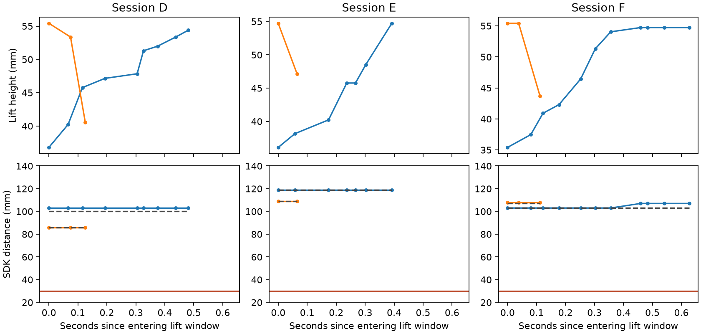

# Fork crossings on the charger

Six docked crossings in held-out shelf sessions D–F yielded 35 SDK reports. In five crossings the distance and signal quality were constant from the first in-window report to the last. In the sixth the range changed once, from 103 to 107 mm. The recorded lift moved despite those repeated returns.

Each colored line is one crossing. The dashed line is the last distance published before entry. The red line is 30 mm, the nominal prediction when sampling the fully occluding fork afresh at every report. The two simple predictors diagnose the timing effect. The hold predictor uses the real entry sample and therefore measures persistence conditional on a known starting distance. It does not independently predict absolute scene range or the acquisition phase.

The stationary crossings came from runs of valid range data with both reported wheels within 1 mm/s of zero, fixed odometry origin and dock flag, gaps at most 200 ms, odometry bounding-box diagonal at most 2 mm and yaw span at most 2°. Each crossing of the nominal 34–56 mm lift window needed an outside-window bracket on both sides, each with at least three reports 0.15–1 s away. The median distances of those brackets had to exceed or equal 45 mm and agree within 20 mm. The SDK on-charger bit is 4096. Wheel speeds and dock indication are observable proxies for motor power and electrical contact. Repeated reports within a crossing are correlated.

The [per-crossing scores](crossings.csv) include the exceptions. In A at 11.17 s the dock flag was set while the reported range fell from 124 to 30 mm and signal changed repeatedly. A stationary wheel-speed report does not rule out commanded tread power. B had no qualifying bracket. Of the two off-dock crossings at F, the earlier one gave repeated ranges near 66 mm while the lift was near 37 mm and reached 30 mm near 40 mm. Fixed background distance and lift height were not varied independently. These observations do not identify partial beam coverage.

The standalone charger scene now uses the existing syscon acquisition clock in Python and the browser. Its 200-tick docked interval is 1.024 s with low tread power. It still acquires during lift movement when a sampling deadline falls due. The SDK lift-visibility flag is evaluated at report time. The plot compares physical data to diagnostic baselines; separate simulator regressions check the actual sample hold and refresh at 1.025 s on the 5 ms integration grid.

Run `python crossings.py` here with NumPy and Matplotlib to regenerate the scores and plot.
