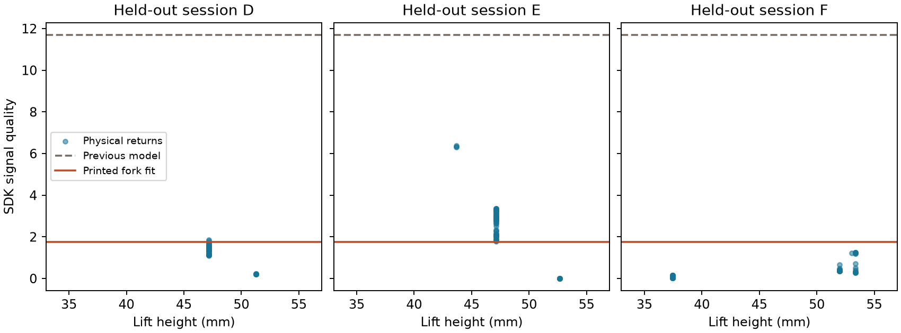

# Proximity return from the printed fork

The physical unit 3 had a printed fork. At stable lift heights inside the simulator’s 34–56 mm occlusion window, the inherited model predicted signal quality 11.7. The median of the three training-session medians was 1.748049. Applying that single value to three separate sessions reduced mean absolute signal error in each.

| Held-out session | Distinct consecutive returns retained | Previous signal MAE | Printed fork signal MAE | Distance MAE (mm) |
|---|---:|---:|---:|---:|
| D | 87 | 10.41 | 0.46 | 1.34 |
| E | 79 | 9.04 | 1.22 | 4.95 |
| F | 89 | 11.30 | 1.34 | 21.44 |

Run `python analyze.py` with NumPy and Matplotlib to regenerate the [scores](scores.csv) and plot from the six adjacent session directories. The analysis interpolates lift height on the shared receipt clock, drops consecutive identical distance/quality pairs, and retains poses within 0.8 mm of the current height at 50 ms intervals from 150 ms before through 50 ms after the return. Consecutive duplicates can also be genuine identical acquisitions. Selection uses lift stability and the model’s window at every recorded distance. The fixed baseline distance is the model’s nominal 15 mm raw fork return clamped to the SDK’s 30 mm minimum.

Session F sampled predominantly higher lift poses around 52 mm. Its median quality was 0.38 and the model still underrepresented distance. A scalar amplitude cannot reproduce partial interception of the beam. These sessions capture one fork and uncontrolled background geometry. The calibrated value applies to the unit 3 profile. The stock profile retains its own physical calibration.
