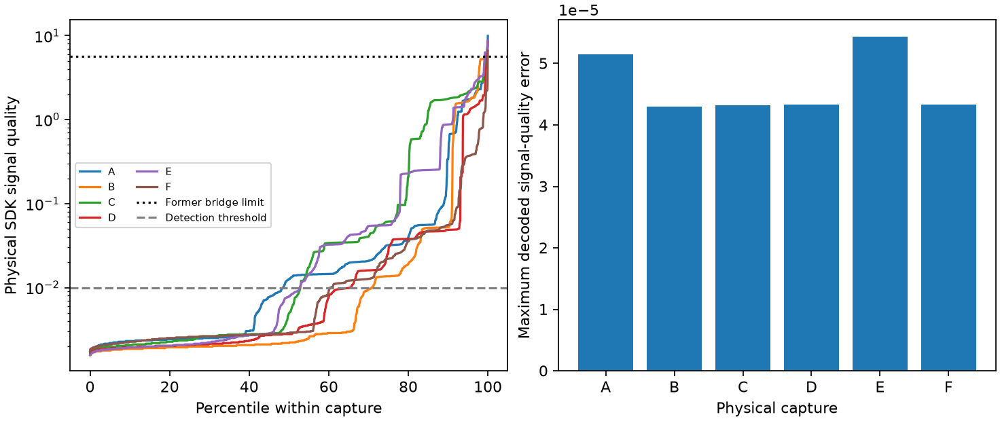

# Proximity words through the firmware interfaces

The optional Spine BodyToHead frame previously supplied only SDK-clamped distance and a constant status. Return signal, effective SPAD count and sample counter were zero. Both firmware interfaces now encode the same held optical sample. The SDK still applies its 30–400 mm reporting limits. The regression uses a near 12 mm sample and a distant 521 mm sample to verify both representations, checks the frame CRC and compares the bridge and Spine bytes on matching ticks.

The bridge previously encoded a fixed 90 effective SPADs. Its 16-bit return-rate field saturated above signal quality 5.689. The new encoding retains 90 where it fits and reduces the denominator for stronger signals, preserving the ratio. The real count of effective SPADs and the separate return rate were not captured. The simulated denominator is a representation choice. It is not a measurement of which photodiodes were active. Both default robot profiles specify a lift-in-beam quality of 11.7, also above the old limit.

We fed the measured SDK distance and signal quality through the new Spine encoder for all 11,394 reports from six unit 3 cube sessions. There were 31 readings above the previous bridge limit, reaching 9.942. The maximum decoded quality error across all six recordings was 0.000055. Every distance word round-tripped and all 4,692 above-threshold and 6,702 other reports retained the same side of the 0.01 threshold. This verifies the wire representation over the observed range. Object detection additionally depends on raw distance, chassis pitch and lift occlusion. The SDK captures cannot establish optical range outside its reporting limits, raw counts, or accuracy of ray-cast distance predictions.

[Per-session measurements](scores.csv) · [Encoder replay](compare.mjs) · [Plot](plot.py). Run the Node script and then the Python plot script from a checkout with the web dependencies, NumPy and Matplotlib.
