# What the printed fork changes in unit 3's five cube trials

Replacing the three collision boxes with 58 convex parts from Dauler's forks7.stl roughly halved the mean endpoint vector error on trials 2–5, from 2.51 to 1.26 mm. Both runs used the same starting cube center from unit 3's calibrated camera, starting heading from the overhead marker, recorded odometry and lift, and moving wrist driven by a stiff weld. No contact parameter was fitted. With onboard heading alone, the mean improved from 2.70 to 2.39 mm and two of those four individual trials worsened. The particular STL installed on unit 3 has not been independently identified.

| Trial | Three boxes, error (mm) | Printed fork, error (mm) |
|---|---:|---:|
| 1 | 27.05 | 26.43 |
| 2 | 2.67 | 1.23 |
| 3 | 2.31 | 1.41 |
| 4 | 2.41 | 1.34 |
| 5 | 2.64 | 1.07 |

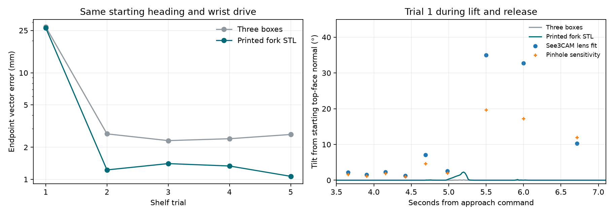

## Trial 1 tipped before it slid

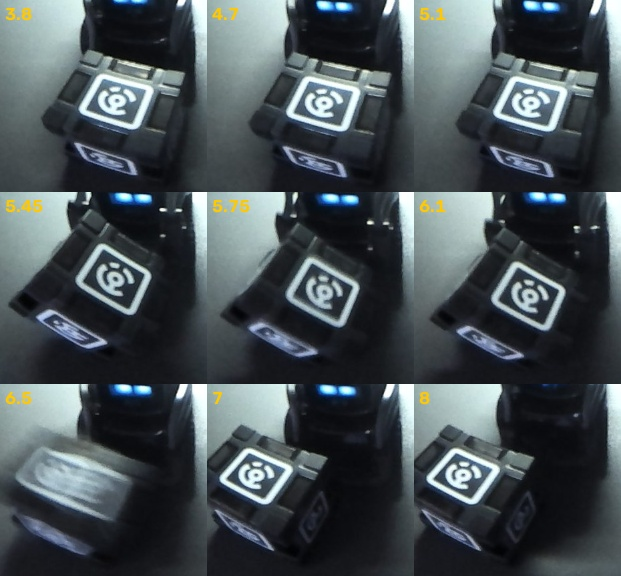

At 5.45 s the cube was visibly tilted against the rising fork. At 6.5 s it was moving rapidly sideways. The top-marker normal changed by about 20° using a simple pinhole and about 35° using the fitted See3CAM lens. The two estimates quantify lens sensitivity, not a confidence interval. Height inferred from these frames is too sensitive to lens and edge errors to score. The other trials have gaps in the marker track at raised lift.

The printed fork tilted the simulated cube only 2.29° in trial 1. Its simulated contact force dropped to zero above 58 mm wrist height while the recorded lift kept rising past 65 mm. Simulated rightward travel was 0.40 mm; the real cube moved 26.72 mm right. The replay first diverges at engagement and retention, before the final slide. No real fork force was measured.

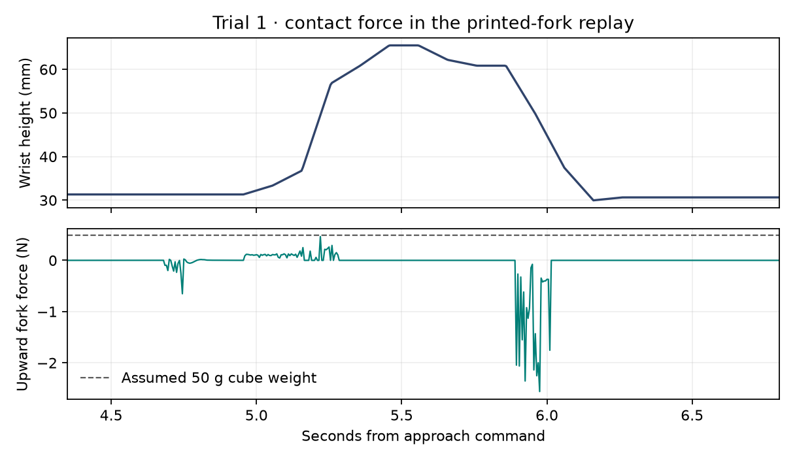

Across 48 initial placement combinations (two headings, fore–aft offsets −6/−3/0/+3 mm, lateral offsets −4/0/+4 mm and wrist height offsets −1.5/0 mm), the largest simulated tilt in trial 1 was 3.28°. Separately multiplying fork-to-cube sliding friction by four gave 3.35° in trial 1 and 10.06° in trial 4. The nominal split-contact control reproduced the original force-law endpoint results with cube-to-shelf friction held fixed. A universal grip increase is unsupported.

## Methods and reproduction

The overhead headings are derived from the rectified top marker at rest and expressed modulo 90° in shelf coordinates. Shelf axes approximate the SDK dock axes. Heading is the only overhead input to that replay. The endpoint never initializes the simulation. The alternative RGB-only replay uses the onboard front marker for both position and heading. In trial 1 those two initial yaw estimates differ by 15.9°. Each fork is tested both on a directly positioned motion-capture body and on a 6 g wrist welded to that target. Neither weld touches the cube. All distances use millimetres and angles use degrees in the CSVs.

The source STL is registered in millimetres using the same transform as the visual model in printparts.js. Binary SHA-256 is `c9dcd46e3c4b2c4b4aa896256109cd0b583a68adec432d615499c9c506dd281a`. CoACD 1.0.14 uses threshold 0.025 and seed 0 to retain the openings in the crossbar. Use your own local copy of the STL. [Dauler's lifting forks](https://www.thingiverse.com/thing:3731746)

From this directory, using MuJoCo 4.0.1, CoACD, NumPy, SciPy, OpenCV and Matplotlib:

```sh
python build_fixture.py /path/to/forks7.stl /tmp/unit3-fork.xml
python evaluate.py ../.. /tmp/unit3-fork.xml
python sensitivity.py ../.. /tmp/unit3-fork.xml
python materials.py ../.. /tmp/unit3-fork.xml
python support.py ../.. /tmp/unit3-fork.xml
python plots.py
python support_plot.py
```

The same collision builder is available through the rescue simulator's `--patient-fork-stl` option. Both patient orientations ran with the new surface, and compiled body mass, center of mass and inertia were identical to the original scene. This experiment scores shelf pushes. Rescue performance has no physical validation here.

## Before the lift rises

The frozen printed-fork replay already underpredicts forward travel in trials 2–5 before the raise. Each green window ends 0.2 s before the recorded lift first rises 1 mm above its initial height. Three See3CAM frames fall in each 0.8 s window. The replay is sampled at those same frame times. The discrepancy between the median displacement vectors is 1.14, 1.88, 2.89 and 1.76 mm in trials 2–5. The maximum apparent displacement in their preceding stationary frames (−1.5 to 0 s) was 0.06–0.09 mm. This measures repeatability near the starting pose. Scale, registration and clock error remain possible.

Trial 1 differs. The pre-raise mismatch was 0.62 mm, within its 0.77 mm stationary excursion, yet the settled endpoint missed by 26.43 mm. Resolving ordinary push onset and resolving trial 1's lift engagement therefore require separate checks. Elevated marker positions in the plot include projection changes and cannot directly measure horizontal cube-center motion.

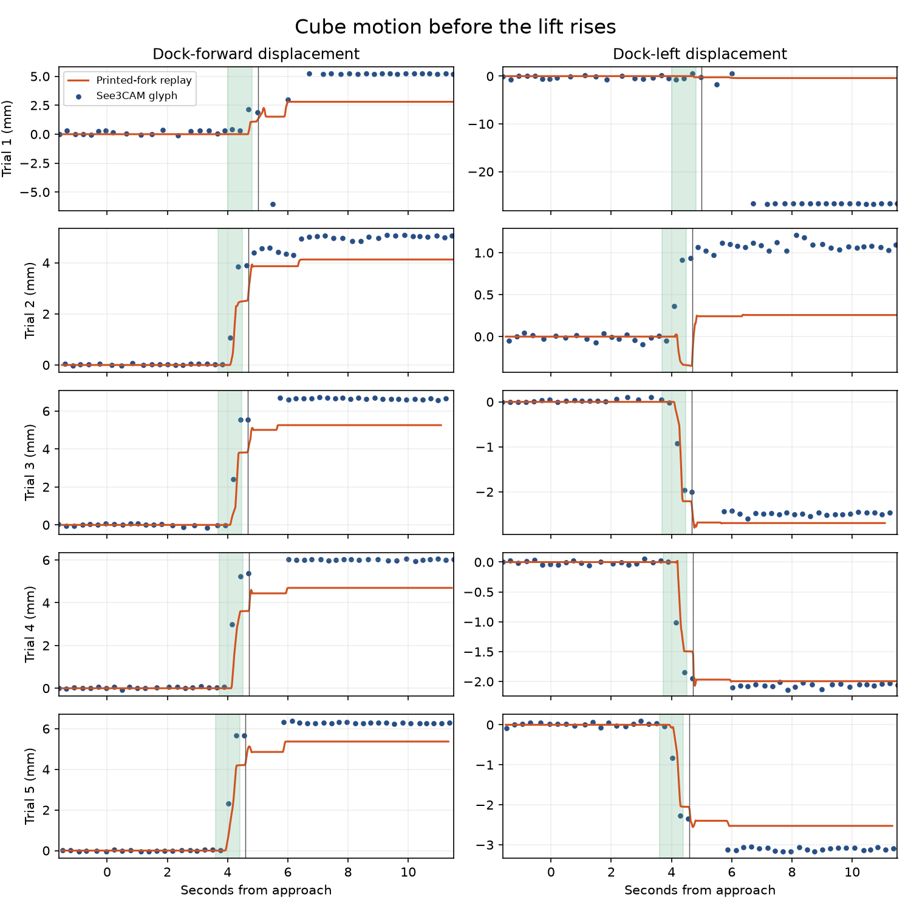

Run `python push_phase.py` with NumPy and Matplotlib to reproduce the overlay and [per-trial values](push-phase.csv) from the frozen trajectories.

## Testing the fork reach on reserved pushes

Moving the modeled wrist 2 mm forward along the robot's instantaneous heading reduced mean pre-raise displacement error on trials 4–5 from 2.32 to 0.71 mm. The two settled endpoint errors also decreased, from 1.34 to 1.11 mm and 1.07 to 0.95 mm. The offset was selected using only the pre-raise error on trials 2–3 over a 0–3 mm grid at 0.5 mm intervals. Initial cube poses, shelf contacts, odometry, wrist height and timing were held fixed.

The improvement depends on phase. Trial 2's settled error increased from 1.23 to 2.37 mm. Trial 1's missed sideways sweep persisted (26.57 mm endpoint error, 2.27° peak simulated tilt). A forward wrist offset could compensate for a depth registration error. These same-session trials do not distinguish the two or establish the physical fork length. The offset is an experimental replay parameter.

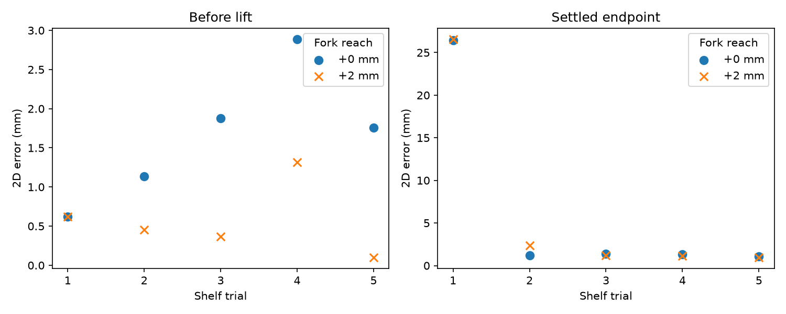

Run `python reach.py ../.. /tmp/unit3-fork.xml` after building the fixture above. The [grid and reserved trials](reach.csv) include peak cube tilt.

## Which side rose during the missed lift?

In the two usable raised-marker frames at 5.50 and 6.00 seconds, the **right edge of the physical top glyph was higher** than its left edge. We solved the four corners of the nominal 23 mm square and measured height differences relative to its own median pre-drive normal. The See3CAM calibration gives 13.13 and 12.40 mm; the pinhole sensitivity check gives 7.69 and 6.70 mm. Apparent lateral height differences stayed within ±0.49 mm in the six pre-drive frames under either projection. Forward-minus-rear differences were only 0.90–1.34 mm in the two raised frames. These are differences across the glyph, not cube-center rise. Left and right follow the dock coordinate system, with image-right pointing toward dock-left in this camera installation.

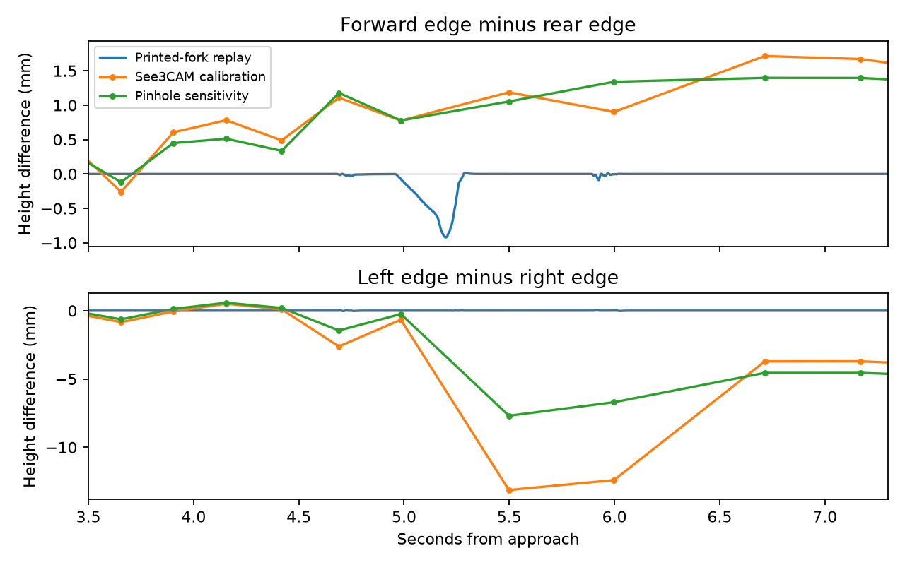

The printed-fork replay produced less than 0.025 mm of lateral height difference throughout 5–6.5 s. During 5–5.5 s its summed positive vertical contact impulse was nearly symmetric (right 0.0151 N·s, left 0.0148 N·s). In the next half second both sides delivered less than 0.000003 N·s. The missing behavior is asymmetric tilt while the real cube remains inclined after simulated support falls away. The sparse images cannot establish the instant of first contact or identify the contacting surface.

Run `python tip_direction.py ../.. /tmp/unit3-fork.xml`. [Signed optical and simulated traces](tip-direction.csv) · [Simulated upward impulses](tip-support.csv)

## Can a slightly rolled fork initiate the one-sided lift?

Across 110 native columns, the lower edge of the raised crossbar slopes upward toward image-right by 3.04 px in trial 4 and 2.69 px in trial 5. A −1.5° wrist roll predicts 3.00 px in both frames using shelf-calibrated optics, nominal reach and height conditioned on the center of the edge. A level wrist predicts zero. This is roll relative to the assumed camera pose; camera roll and print asymmetry also affect that slope. Three edge thresholds and seven roll settings are included in the [crossbar comparison](../unit3-fork-silhouette/crossbar-roll.csv).

With −1.5° held throughout all five replays, the simulated right edge of trial 1's 23 mm glyph stayed within 0.002 mm of level at 5.50 and 6.00 s. The physical edge was higher by 6.70–13.13 mm across those views and lens choices. None of the tested angles from −4° to +4° produced the observed tilt. Trial 1's settled error changed from 26.43 to 26.63 mm at −1.5°. On trials 2–5, endpoint errors changed from 1.23/1.41/1.34/1.07 mm to 0.98/1.43/1.30/1.04 mm. Cube initialization, fork reach, pitch, contact materials and drive remained fixed. A static wrist roll consistent with the pictures still fails to retain one side of the cube.

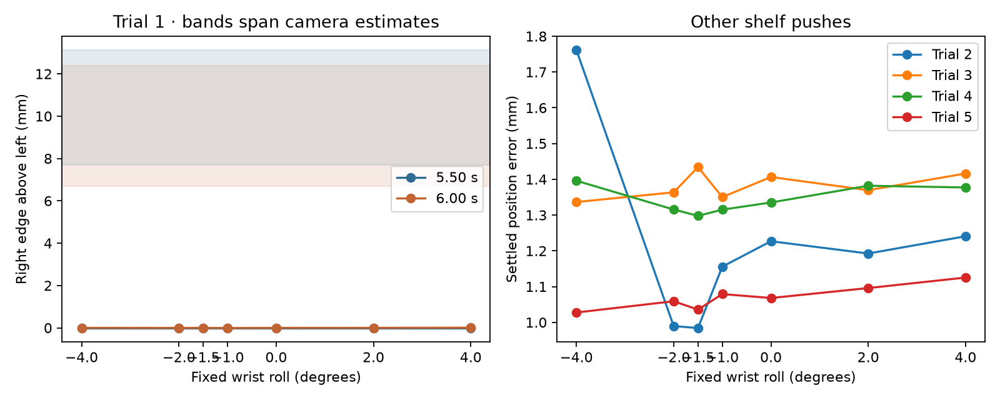

Run `python ../unit3-fork-silhouette/crossbar_roll.py` and `python wrist_roll.py ../.. /tmp/unit3-fork.xml` from this directory. [All 35 replays](wrist-roll.csv)

## The fork separates at peak lift and makes contact again on descent

The earlier positive-impulse comparison counted upward support only. At 5.50 s (65.50 mm lift), there are zero fork contacts and the minimum fork gaps to the right and left rubber corners are 3.26 and 3.27 mm. At 6.00 s the lift has already descended to 44.86 mm: four contacts exert a net **0.37 N downward** force on the cube. The rubber surfaces overlap by 0.01–0.02 mm in the compliant solver. This distinguishes losing upward support from losing all contact. The physical camera still shows the right marker edge higher in both frames.

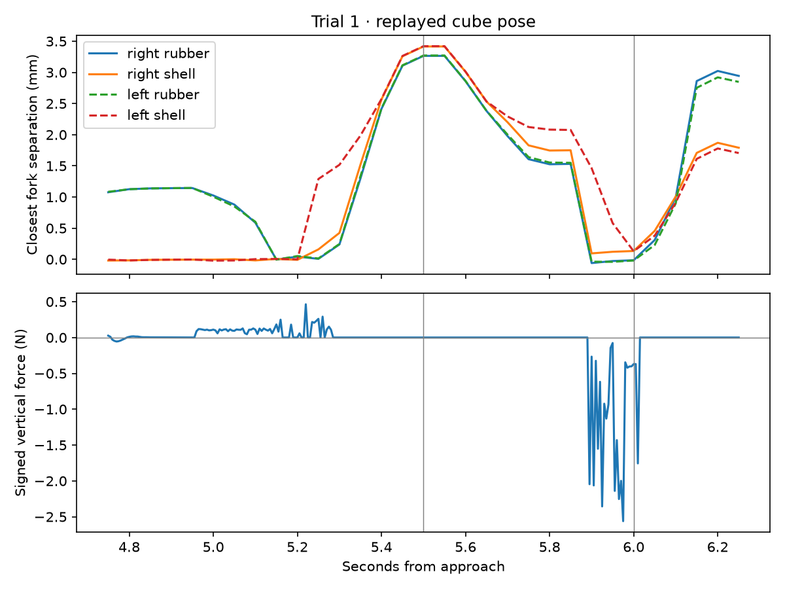

As a geometric sensitivity check we rotated the simulated cube right-edge-up about the midpoint of its left bottom edge at the sampled times. At 5.50 s the minimum gap anywhere on the fork was 3.05 mm for a 20° tilt and 1.97 mm for a 35° tilt. At 6.00 s both tilted poses came within 0.13 mm of the fork. These prescribed snapshots use the replay's horizontal placement and an assumed pivot. They are not reconstructed physical poses or dynamic predictions. A correction that supplies grip only on descent would still miss the earlier lifted frame.

Run `python clearance.py ../.. /tmp/unit3-fork.xml`. The calculation queries signed distances between all 58 fork and 62 cube collision pieces and groups the closest witness points by side and material. [Distances, nearest pieces and witness positions](clearance.csv)

## Adding the observed sideways motion to the clearance check

All four single-camera reconstructions place the cube center **8.6–14.6 mm right of its starting location** in the 5.50 s image. The closest point on the right half of the cube is on a rubber corner in each reconstruction. With the calibrated See3CAM lens and a corner resting on the shelf, the reconstructed rubber and fork overlap by 1.13 mm. With the pinhole sensitivity model and the same shelf constraint they have a 1.37 mm gap. Negative values indicate incompatible rigid geometry at the imposed poses. They do not measure rubber deformation or force. The earlier prescription of a tip about a stationary left edge left a positive gap under both tested angles.

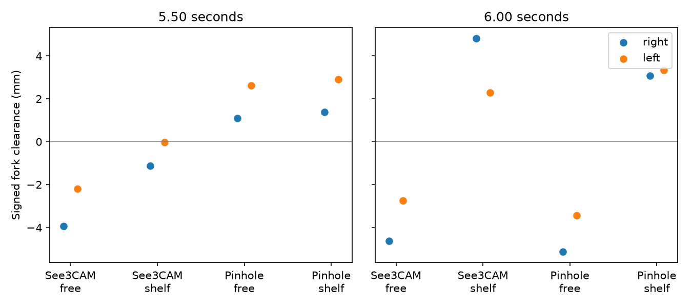

The 23 mm top marker is registered to the simulated initial cube pose using its pre-drive median. The marker center is assumed 22 mm above cube center. Each subsequent frame independently fits orientation and translation to its four observed corners. The shelf variant constrains the lowest corner of a 44.3 mm bounding box to remain on the initial support plane. Paired timestamps differ by at most 2.4 ms on the published time axes; actual cross-device synchronization uncertainty remains. Both fork snapshots use the recorded replay with nominal reach.

The optical models have systematic errors larger than the clearance of interest. On nine settled frames after 9 s, shelf-constrained models put the cube 25.1–25.6 mm right, close to the earlier planar overhead estimate of 26.7 mm right, but 11.0–12.5 mm forward versus 5.2 mm in that estimate. The latter comparison uses the same camera. At 6 s the unconstrained reconstructions place the center below its initial height despite the tilt, while enforcing shelf contact raises the pixel residual to 6.3–11.7 px RMS. The robust observation is the sideways component already present at peak lift. These data cannot identify a submillimetre contact, justify a material change, or validate the late reconstructed pose.

Run `python optical_clearance.py ../.. /tmp/unit3-fork.xml`. [Raised-frame solutions](optical-clearance.csv) · [Settled-position cross-check](optical-endpoint.csv)

## Checking the top-marker reconstruction against the onboard front stripe

The fork obscures much of the cube during the raise. A straight portion of the front glyph becomes visible above it in two onboard frames. Its image angle changes from +0.75° before the lift to −39.25° raised and −33.75° during lowering (image rows increase downward). These are projected stripe angles, not physical roll angles.

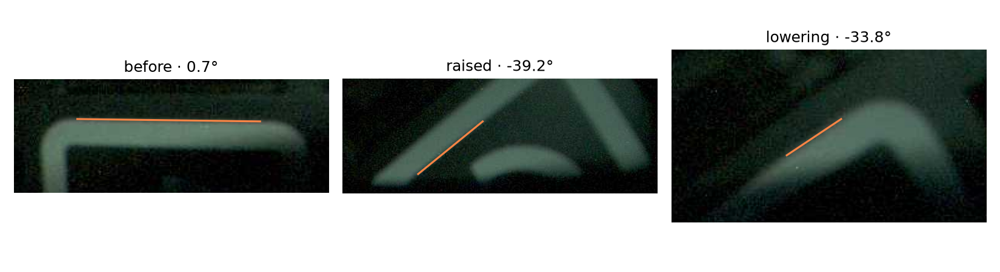

We projected a 23 mm front edge from each of the four previously reconstructed overhead poses through unit 3’s shelf-corrected camera transform. The raised frame was excluded from the pose fits. With the calibrated See3CAM lens and shelf support, the predicted angle was −36.43° (2.82° residual); the pinhole alternatives predicted about −19.8°. During lowering, the calibrated lens predicted −29.43° freely and −41.73° with shelf support; the pinhole alternatives predicted about −16°. The calibrated lens therefore matches this independent projected orientation better at both sampled poses. Angle agreement alone cannot validate cube translation, ground support or fork–rubber contact.

The physical angles come from the strongest Hough line in manually selected rectangular stripe regions of native onboard crops; the line slope is unconstrained. For time pairing we applied the earlier 0.232 s onboard receipt offset and chose the closest available overhead pick. Residual frame-time differences were 118 ms raised and 69 ms lowering. Motion during those intervals limits the precision of this comparison.

Run `python front_edge.py ../.. /tmp/unit3-fork.xml`. [Onboard measurements, overhead times and projection variants](front-edge/angles.csv)

## Absolute position of the front stripe

The favorable projected angle does not carry over to stripe position. With the calibrated See3CAM and shelf constraint, the median distance from the measured outer edge to the projected 23 mm segment is **5.05 px before lifting, 197.67 px raised and 77.12 px while lowering**. All four overhead solutions miss the raised stripe by at least 164 px. The outer edge is picked from a manually selected rectangular region using only dark-to-bright transitions toward increasing image row. No stripe intercept or translation is fitted for this comparison. The measured segment projects within the modeled segment's length in both moving views for all four solutions.

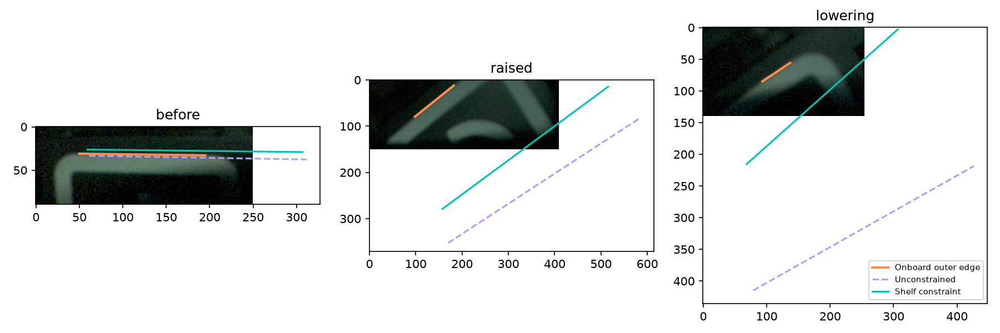

Holding the horizontal position and orientation fixed and moving the cube vertically to minimize the front-edge error takes another 10.0–14.7 mm of height in the raised view. That is a sensitivity check, not a height measurement: depth, lateral translation, proximity to the camera and exposure timing all affect this residual. The ±millimetre fork clearances calculated from overhead alone should not be used to select a contact surface. The onboard marker position must also be reproduced at a common time.

Run `python stripe_position.py ../.. /tmp/unit3-fork.xml`. [All variants and finite-segment errors](front-edge/position.csv)

## Two-camera pose with a reserved edge

For the raised pair we fitted a single rigid cube pose to four overhead top-marker corners and the onboard front marker's upper edge. The perpendicular right border of the front marker was excluded from every fit. Its physical picks use the falling brightness gradient along native image rows 25–85, with a manually selected search region clear of the rounded corner. Both fitted and reserved front-edge residuals use finite 23 mm segments. Pose initialization, camera mounts, robot telemetry, marker dimensions and exposure pairing are the same as in the previous position check.

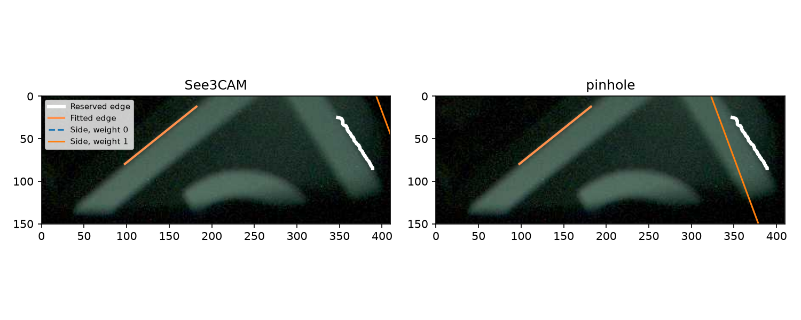

With calibrated optics, adding the onboard upper edge at equal pixel weight reduced median error on the reserved right edge from 216.5 to 41.3 px. Overhead corner RMS rose from 1.53 to 15.69 px. Weighting the upper edge four times as heavily drove its own RMS below 0.4 px but worsened the reserved error to 63.8 px. The pinhole sensitivity model at equal weight missed the reserved edge by 24.5 px. The cameras have different pixel scales and noise, so these weights are sensitivity checks, not inferred observation variances.

At equal weight both reconstructions put the lowest corner of the bounding box above the shelf (10.0 and 14.5 mm). The held-out errors and the residual 118 ms frame-time difference preclude treating that as a measured clearance or using the compromise pose to tune a contact. Source frames independently show the tilt. A single rigid pose under this registration fails to reproduce the lifted cube precisely in both views.

Run `python joint_marker.py ../.. /tmp/unit3-fork.xml`. [All weights, errors and inferred translations](front-edge/joint.csv)

### Does camera timing explain the raised stripe?

Two overhead exposures at 5.264 and 5.747 s contain a readable top glyph missed by the original detector. The latter halves the bracket around the raised onboard exposure from 500 to 249 ms. Straight-line intersections on the outer white border give different corners from the original detector. Applying the per-corner difference measured at 5.498 s reproduced all four original picks at a reserved 5.998 s exposure within 0.36 px. The 5.264 s frame has visible motion blur, so that precision applies only to the control.

| Raised-stripe comparison | Median distance to observed edge |
|---|---:|
| Nearest original overhead frame, receipt timing | 197.6 px |
| Original frames, device capture intervals and interpolated pose | 195.7 px |
| Recovered frames, outer-line intersections | 180.9 px |
| Recovered frames, corners adjusted to detector convention | 196.8 px |

On trials 1–2 the approach fit gives a 232 ms lag from host receipt times and 236 ms from device capture intervals. Held-out approach RMS errors for trials 3–5 change from 0.94/3.00/0.89 mm to 1.22/2.78/0.57 mm. Neither clock consistently wins. The overhead timestamps still use the host request midpoint, so absolute shutter sync remains unknown. This timing change and the extra exposure leave the raised pose unresolved. Using this frame to fit rubber friction would confound projection and contact errors.

[Recovered crops and controls](front-edge/recovered-marker.png) · [Stripe errors](front-edge/clock.png) · [All position scores](front-edge/clock-position.csv) · [Approach scores](front-edge/clock-travel.csv). Reproduce with the same arguments as front_edge.py using capture_clock.py.

### Checking a second cube face within each overhead exposure

The overhead camera also sees a white border on the vertical face away from the robot. We fit the four top glyph corners, then projected the upper border of the adjacent face through the same lens at the same exposure. No adjacent-face picks enter the pose fit. The measurement uses the dark-to-white gradient along the central straight section, rejecting picks more than 2 px from a robust line. The modeled edge is sampled at 25 points before lens distortion.

| Median distance to reserved border, native overhead pixels | 5.498 s | 5.998 s |
|---|---:|---:|
| Calibrated lens, free pose | 3.2 | 4.3 |
| Calibrated lens, lowest corner constrained to shelf | 6.8 | 15.4 |
| Pinhole, free pose | 27.3 | 30.8 |
| Pinhole, shelf constraint | 27.5 | 38.3 |

The free calibrated pose transfers across cube faces within a few overhead pixels in both exposures. Forcing the bounding box onto the initial shelf plane worsens the second-face prediction, especially during lowering. This evidence favors the free pose for interpreting these overhead frames. It cannot independently establish world height or isolate the onboard camera mount error. The opposing camera sees a different face, at a different scale and exposure time.

[Image overlays](front-edge/adjacent-face.png) · [Per-frame results](front-edge/adjacent-face.csv). Run `python adjacent_face.py ../.. /tmp/unit3-fork.xml`.

### Can the lift links catch the tilted cube?

We added all four moving rails to the printed-fork replay. They follow the photo-derived web link surfaces, split into 14 convex sections per rail, with separate upper and lower rear pivots driving the parallelogram. The bearing caps at the rear are omitted. Odometry, lift telemetry, starting pose, cube and fork properties are identical in paired runs. An independent collision check deliberately puts the cube into the lower rail and verifies MuJoCo registers contact.

Across five free-cube trials, the added rails made zero cube contacts at the 1 ms simulation step. Trial 1 still produced 0.40 mm rightward travel and 2.29° peak tilt. The hardware endpoint was 26.72 mm right. The other four simulated endpoints also reproduced the fork-only values.

Placing the cube at its independently reconstructed trial 1 pose reveals a different situation. Positive values below mean clearance and negative values mean overlap. Units are millimetres.

| Exposure | Lower link, free optical pose | Lower link, shelf-constrained pose | Upper link, free optical pose |
|---|---:|---:|---:|
| 5.498 s, raised | −0.21 | +2.97 | +6.16 |
| 5.998 s, lowering | −1.21 | +7.25 | −0.13 |

In the free reconstruction, the forward tip of the lower right rail lies at the right rubber corner while raised and at the shell during lowering. The modeled head, chassis and treads are each at least 10 mm clear in both exposures and both pose fits. The earlier same-exposure second-face check favors the free pose but does not establish absolute height precisely. The lower link is a candidate for supporting an already tilted cube. The observed-pose check imposes that tilt, and the free replay still misses its onset.

[Observed-pose gaps](body-clearance.png) · [All distances and closest pieces](body-clearance.csv) · [Simulated and recorded endpoints](link-contact.png) · [All five paired runs](link-contact.csv). After installing the web SDK assets and Node dependencies, run body_clearance.py and link_contact.py with the same arguments as evaluate.py.

### Does the simulated lowering match the next image?

Start the cube at rest in each raised pose at 5.498 s and replay the measured lift and chassis motion for 0.5 s. Project the simulated side-face glyph into the archived See3CAM crop. Across 58 columns of its upper border, median distance to the prediction is 44.8 pixels from the free start and 35.2 pixels from the shelf-constrained start. For comparison, fitting the top marker in the lowering exposure itself predicts that side border to 4.3 and 15.4 pixels, respectively. The side border is reserved in both fits. This single event establishes an image-space discrepancy independently of choosing a reconstructed endpoint height. The two starts inherit initial intersections with the collision model, and neither measures the instantaneous velocity.

[Lowering overlay](restart-pixels.png) · [Scores](restart-pixels.csv). Reproduce with `python restart_pixels.py ../.. /tmp/unit3-fork.xml` using the same fixture as evaluate.py.

The two collision-cleared, zero-speed restarts lose tilt while the recorded lift is still high. The final samples above 5° occur at 136 and 152 ms, with encoder heights of 63.0 and 62.5 mm (65.5 mm initially). Summing world-vertical contact forces on the cube each millisecond gives zero upward support from either the printed fork or the links in both runs. The free optical start briefly receives downward fork force peaking at 0.395 N. The shelf supplies the upward load. These are simulated forces conditional on the reconstructed poses, grid clearance shifts and zero initial velocity. The encoder measures lift height only. [Load histories](support-load.png) · [1 ms samples](support-load.csv) · [Replay](support_load.py).

### Can a stationary raised fork support the observed attitude?

Freeze the wrist and link targets at the raised exposure, keep the free optical rotation, and release the cube from rest at 405 translations. The horizontal offsets are −8 to +8 mm and the upward offsets are 4 to 12 mm, all at 2 mm spacing. Of these, 129 pass the initial nonpenetration check. Every one settles to within 0.006° of flat by 250 ms, with zero mean vertical robot load over the last 50 ms. Commanded lowering is therefore unnecessary to reproduce the loss in this fixture. This grid samples one attitude at zero initial velocity.

The placement closest to the reserved side stripe misses it by just 0.65 pixel, yet its top-marker corners miss by 14.12 pixels RMS. The smallest top-marker error on the grid is 5.44 pixels and that placement misses the side stripe by 10.47 pixels. A single edge gives weak position constraints here. [Grid results](support-neighborhood.csv) · [Optical and tilt comparison](support-neighborhood.png) · [Reproduction](support_neighborhood.py).

### Do the photographed side openings explain the lost grip?

We registered the supplied cube photograph on the outer white glyph, using the replay's 23 mm glyph width and fitting the straight portions before intersecting the four lines. Four hand-picked inner aperture corners lie 13.59–14.43 mm from the center horizontally. Their heights span about 18.0 mm on each side, close to the 17.63 mm center band in the collision fixture. These are face-plane estimates conditional on marker scale. The single view cannot measure interior pocket depth.

As a sensitivity test, widen the central web at midheight by mapping ±12.47 mm to ±14 mm along both horizontal axes while preserving the ±22 mm outer faces. This symmetric extrapolation to other faces is an assumption. The same printed fork, pose, drive and link replay yields 1.95° peak tilt instead of 2.29° on trial 1. Endpoint error increases from 26.43 to 26.76 mm. The remaining four paired endpoints agree to better than 0.001 mm. The revised silhouette alone does not explain the missed engagement.

[Registered photo](cube-face-photo.png) · [Corner coordinates](cube-face-photo.csv) · [Paired trials](aperture-replay.csv). Run cube_face_check.py with the original 1920×1440 photo and aperture_replay.py with the same two fixture arguments as evaluate.py.

### Which cube face actually met the fork?

We rectified the upper glyph at four exposures during trial 1 and compared the center emblem with the six corrected SDK renders at all four quarter-turns. All four images select +Z up at zero image quarter-turn. Correlations for the three clearest frames are 0.89–0.91, versus 0.62–0.63 for the runner-up. In the +Z template the camera has +Y up, so image-right is original +X and image-down is original −Y. The corresponding corner ordering in optical_clearance.py puts image-down along the replay's forward axis. This selects original −Y forward and +Z up for the cube at the registered pose.

We rotated the box collision surfaces exactly through the 24 proper axis permutations in each of five pushes, keeping the isotropic inertia, center, shelf-relative marker heading, printed fork, and input trajectories fixed. With the image-selected orientation trial 1 gives 2.29° peak tilt and 0.40 mm rightward travel, compared with about 35° from the calibrated overhead fit and 26.72 mm rightward travel on hardware. Even the most tilted of all 24 runs only reaches 3.49°. Resolving the face ambiguity therefore leaves the anomalous engagement unexplained. The face ID applies to trial 1. The other four trial sweeps measure sensitivity only.

[Physical glyphs and best template](upper-face-match.png) · [Template scores](upper-face-match.csv) · [All orientation replays](face-orientation.png) · [120 results](face-orientation.csv). Run identify_upper_face.py and then face_orientation.py with the same two arguments as evaluate.py.

### Did the chassis pitch into the cube?

The paired log contains head angle and planar odometry. To estimate camera pitch independently, track distant room features in the onboard images against the 3.311 s reference. Match 25-pixel patches in two fixed upper/left reference regions, require normalized correlation above 0.80, reject displacements more than four pixels from the median, then fit a rotation to calibrated camera rays. Fits require four retained features spanning at least 170 horizontal pixels. Known ±2° synthetic rotations of the reference recover within 0.15°. Robot translation, residual lens error and head flex can also contribute to the apparent rotation.

During the lift the recorded head angle stays constant. The 5.430 s image gives −0.20° apparent camera pitch relative to the reference (34 features, 2.23 px reprojection RMS). At 6.160 s it is −0.19° (16 features, 0.96 px RMS). At the intervening 5.848 s exposure the cube occludes the room and no patches pass. Times here are host receipt times; encoder interpolation uses the existing 232 ms offset. This makes a sustained multi-degree chassis pitch unlikely across the two visible samples. A short excursion during the missing exposure remains unresolved.

[Measured pitch and missing exposure](background-pitch.png) · [Per-image quality and encoder values](background-pitch.csv). Run background_pitch.py with the repository root and the paired capture's onboard JPEG directory.
