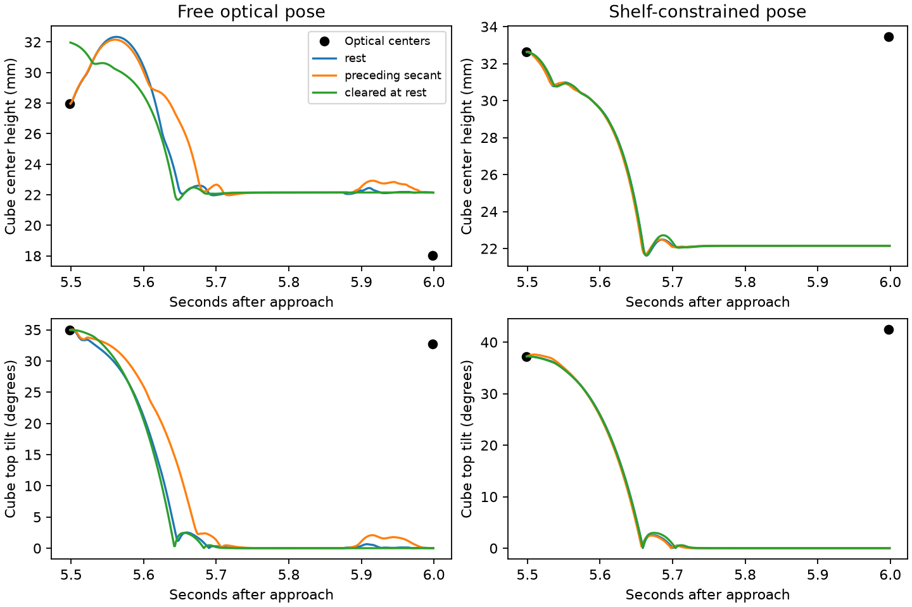

# Does the simulated fork retain the cube after the observed tilt?

We replayed the printed fork and four rails along the recorded trial 1 trajectory, then reset only the free cube to its optical pose at 5.498 s. The next scored camera exposure was 0.500 s later. Two initial velocities were tried: rest and the finite difference from the preceding optical pose. The second exposure entered neither initial condition. All six runs settled with the cube center at 22.14–22.15 mm, the height of a level cube on the shelf.

The unconstrained camera fit initially penetrated the collision model by 3.97 mm, and its next inferred center was only 18.02 mm high, inconsistent with a rigid 44 mm cube above the shelf. The shelf-constrained camera fit initially penetrated by 1.13 mm and predicted 33.45 mm at the next exposure. To test the importance of initial overlap, we repeated each zero-speed start at the nearest overlap-free translation on a 1 mm grid with attitude fixed. The shelf-constrained pose required 2 mm forward; its predicted center still settled to 22.15 mm, with 22.65 mm position and 42.59° orientation error at the next frame. The unconstrained start required 4 mm forward and 4 mm upward and likewise settled level.

Providing the observed tilt midway did not reproduce its continuation. Registration and the true contact state remain uncertain: clearing an overlap may also remove a legitimate support. The shelf-constrained height follows from the tilted cube touching the floor, and is not an independent height measurement. The outcome isolates a retention discrepancy under the modeled geometry without validating either initial grasp. [All restart conditions](raised-restart.csv) · [Script](raised_restart.py) · [Optical and collision references](README.md)
