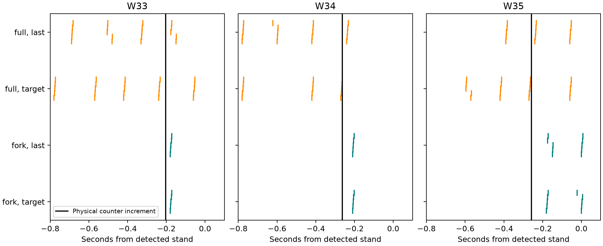
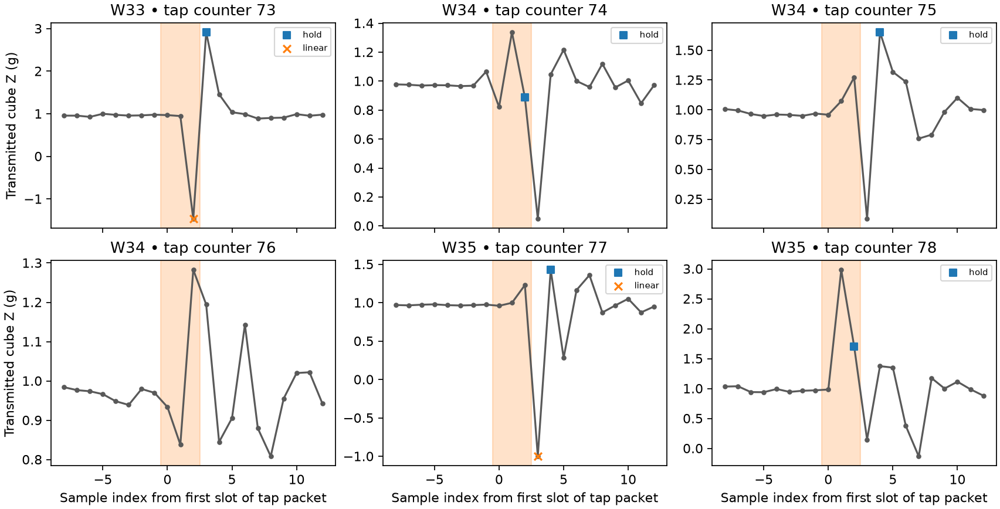
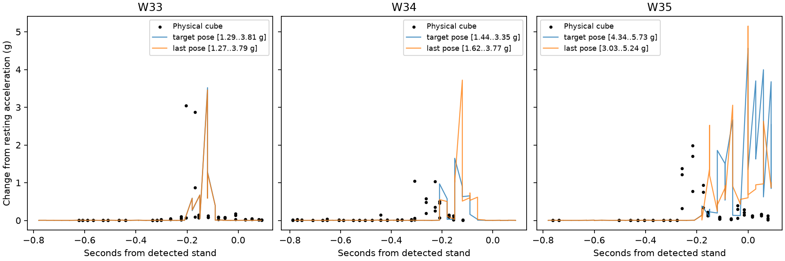
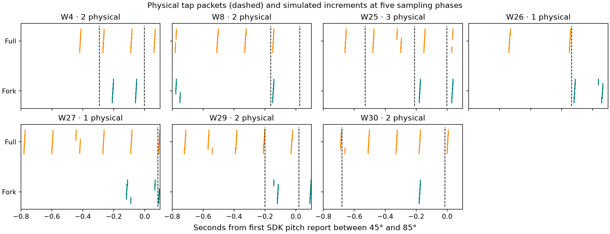

# What the cube felt during three wheelstands with a commanded spin

The physical cube recorded 18,702 three-axis samples in 6,234 Bluetooth packets across W33–W35. All three runs requested a 90° spin on the stand. To compare runs, subtract each run's median pre-mount acceleration vector (−7 to −5 seconds from stand detection) and take the magnitude of the remainder. Results are in g, using 8,192 counts/g. A change in this quantity can come from tilt, translation, or vibration.

| Run | Baseline RMS | Mount peak | Full spin peak | Interior spin RMS | SDK pitch at end-of-wait marker |
|---|---:|---:|---:|---:|---:|
| W33 | 0.0058 g | 3.04 g | 0.223 g | 0.035 g | 70.9° |
| W34 | 0.0043 g | 1.05 g | 1.106 g | 0.041 g | 71.3° |
| W35 | 0.0044 g | 1.98 g | 0.085 g | 0.023 g | 71.6° |

The mount window starts 0.8 s before stand detection and ends at spin start. W35 waited about 1.49 s after stand detection before spinning. The other two began within 0.15 s. The largest packet assigned to each spin arrived within 62 ms of its end. W34's 1.106 g packet arrived just 19 ms before the spin-end marker. Trimming 100 ms from both spin boundaries reduces the largest W34 interior sample to 0.143 g. Keep that boundary impact separate when scoring sustained rotation. Robot pitch remained above 70° at all three log entries named “landed,” and the picked-up flag was set. These labels identify when the runner stopped waiting; they do not establish a physical landing.

The canonical cube sensor at rest produced 0.00394–0.00433 g RMS over 16 seeds, using the same median-centering convention with fixed vertical gravity and 2 s sampling windows. Physical interior-spin RMS was 5–10 times the simulated rest level. The stationary sensor comparison checks the noise floor only. The measured dynamic packet streams are targets for wheelstand contact replay.

Robot and cube times are host receipt/event times relative to stand detection. Three ordered acceleration slots share each packet's timestamp. The plot marks spin command intervals in orange and recorded dismount-step completions with dotted vertical lines. For W34 and W35 the later pulse attempts also produced measurable transients, with late-window peaks of 0.604 and 0.138 g. These data cannot measure fork force or uniquely identify the impact surface.

[Physical packets](cube.csv.gz) · [Robot pitch and gyro](robot.csv.gz) · [Events](events.csv) · [Phase measurements](phase-scores.csv) · [Spin interior](spin-core.csv) · [Simulated rest](sim-rest.csv). Reproduce with python analyze.py and node rest.mjs from this directory with the web dependencies installed.

## Do the recorded cube packets reproduce the reported taps?

The canonical web listener consumed all 6,234 notifications in capture order with a fresh listener for each trial. It emitted one, three and two tap candidates on W33, W34 and W35, respectively. The physical SDK reported the same six events in order. Each matches within 29 ms after applying the earlier **145.906 ms** packet-receipt to callback-receipt estimate. There were no unmatched callbacks or listener candidates within the recorded packet windows. Pairing used order within trial and a ±100 ms gate around that frozen estimate.

On the receiving host, the six SDK callbacks arrived 127–175 ms after the corresponding cube packet. Adding the frozen delay gave 16.1 ms mean absolute timing error. On the robot clock, SDK event stamps were −19 to +36 ms from the corresponding notification's logged robot uptime. Uptime was recorded to 10 ms precision. These clock comparisons describe different stages of event delivery. Applying a 146 ms offset to the robot event stamp would introduce timing error. No delay was fitted on W33–W35.

The replay takes both the measured acceleration slots and the physical cube firmware's tap counter as input. It checks the listener and delivery timing conditional on those inputs. It does not establish that simulated fork contact would generate the same counter transitions. W35's second tap is about 29 seconds after stand detection, outside the commanded spin.

[SDK taps](sdk-taps.csv) · [Radio packet clock pairs](counter-uptime.csv) · [Listener output](replayed-taps.csv) · [Earlier delay evaluation](../unit3-wheelstand/R8/README.md). Run `node listener_replay.mjs > replayed-taps.csv` and `python tap_timing.py` in this directory to reproduce the comparison.

## Can acceleration alone regenerate the physical tap counter?

Withhold the physical tap counter and feed the transmitted XYZ words to the canonical CubeSensor tap detector. The detector normally sees five 2 ms sensor frames per 10 ms app tick. Only the last frame of a tick is available in these radio samples. Two reconstructions preserve every transmitted endpoint. The hold case repeats the previous endpoint for four frames, then injects the new endpoint. The linear case interpolates in five equal steps. Neither reconstruction fits any parameter. Each run initializes previous Z from its first observed slot and assumes an idle detector. Missed notifications and exact chip acquisition times are unknown.

| Missing-frame assumption | Matched physical taps | Extra predictions |
|---|---:|---:|
| Hold | 5 of 6 | 0 |
| Linear interpolation | 2 of 6 | 0 |

Matching admits the physical counter-change packet and one neighboring packet on either side. The largest matched receipt-time difference was 42 ms. The orange band marks the physical counter-change packet. The horizontal axis counts retained samples and does not assign chip acquisition times.

Both reconstructions miss W34 counter 76. The retained Z values rise from 6,865 to 10,509 counts (+3,644), opening the positive-first branch in the hold case. The following retained steps are −724 and −2,864 counts. Neither reaches the required reversal below −2,880. The physical cube nevertheless incremented its counter. This illustrates why evaluating simulated impacts requires scoring both the transmitted acceleration and the generated counter. The missing high-rate waveform cannot be inferred uniquely from these three-slot packets. Keep the detector threshold fixed.

[Replay events](accel-only-taps.csv) · [Per-event matches](accel-only-scores.csv). Reproduce with `node accel_only.mjs > accel-only-taps.csv` and `python accel_only_plot.py` in this directory.

## Fork contact during the wheelstand mount

Each physical cube reported one tap between 0.8 s before and 0.1 s after the robot detected a stand. The peak change from rest was 3.04 g in W33, 1.05 g in W34 and 1.98 g in W35. Driving the fork as a zero-velocity `mocap` body originally kept `data.cvel == 0` and compressed packets down to 0.22–0.40 g (`sim_tap_delta > 0` only in W35). Two model fixes close the gap: (1) replacing `mocap` with a velocity-driven `freejoint` (`0.170 kg`, canonical `chassis_inertia`, differentiated in MuJoCo's body frame via `mj_differentiatePos`) plus 5-phase `CubeSensor` evaluation across each 10 ms tick, and (2) setting explicit `solref="0.004 1"` (`contact_time_constant_ms`) on `cube_shell_*` geoms in `simulacrum/mjcf.py` instead of leaving them at MuJoCo's implicit 20 ms default (`0.02 1`). First fork contact times remain unchanged (`-0.201`, `-0.222`, and `-0.205` s):

| Trial | Physical peak / tap | `freejoint` (`shell=0.02` Stage 1) `[5-phase]` (taps) | `freejoint` (`shell=0.004` Stage 2) `[5-phase]` (taps) |
|---|---:|---:|---:|
| W33 (`target` / `last`) | 3.04 g / 1 | 0.85 / 1.04 g `[0.55..1.96]` / `[0.63..2.08]` (5/5, 5/5) | 3.52 / 3.46 g `[1.29..3.81]` / `[1.27..3.79]` (5/5, 5/5) |
| W34 (`target` / `last`) | 1.05 g / 1 | 2.61 / 3.22 g `[0.69..3.31]` / `[0.77..3.22]` (0/5, 0/5) | 1.65 / 3.72 g `[1.44..3.35]` / `[1.62..3.77]` (5/5, 5/5) |
| W35 (`target` / `last`) | 1.98 g / 1 | 4.13 / 4.15 g `[3.11..6.19]` / `[3.14..5.15]` (5/5, 5/5) | 4.56 / 5.15 g `[4.34..5.73]` / `[3.03..5.24]` (5/5, 5/5) |

Across all six Stage 2 replay cases, every 2 ms sampling phase detects at least one tap (`5 of 5`), though individual peak amplitudes still span up to a 3.0x subsampling ratio (W33 `last`, `1.27–3.79 g`) because each 10 ms `CubeSensor` tick retains one of five 2 ms frames. Physical W34 and W35 also show horizontal impacts at `-0.308` s (`1.05 g`) and `-0.258` s (`1.22–1.38 g`) before first fork contact while the lift is still above 82 mm. The `--contact full` option exposes canonical chassis and tread contact geoms for comparison, but `--contact fork` remains the default because replaying raw uncompliant SDK poses with chassis contact starts pre-pushing the cube at `-1.05` to `-0.42` s in the absence of simulated robot recoil.

[SDK trajectory](path.csv.gz) · [Visual cube observations](observations.csv) · [Impact scores](mount-scores.csv). With the web dependencies installed, Python MuJoCo 4.0.1, NumPy and Matplotlib, run `python mount_replay.py` from this directory (or pass `--drive mocap` / `--contact full` to compare ablation modes).

## Timing of the first cube tap

The physical cube counter incremented once in each mount window. We compared the first counter increment and total increments from −0.8 to +0.1 seconds relative to stand detection. Each configuration used both recorded cube placements and five sensor sampling phases. The colored marks are increments. The five rows within each placement are successive 2 ms phase offsets.

| Run | Physical tap relative to stand | Fork only, first tap | Fork only, count | Chassis, wheels and fork, first tap | Chassis, wheels and fork, count |
|---|---:|---:|---:|---:|---:|
| W33 | −204 ms | 24–32 ms late | 1 | 479–577 ms early | 4–5 |
| W34 | −262 ms | 53–61 ms late | 1 | 510–518 ms early | 3–4 |
| W35 | −258 ms | 78–112 ms late | 2 | 124–338 ms early | 3–4 |

The sign of the discrepancy persists across every tested sensor phase and both placements. W35 still produces an extra tap in every fork-only replay. The physical timestamps measure packet receipt and the simulated timestamps measure packet publication. Unknown transport delay limits interpretation of the absolute offsets. The recorded chassis trajectory drives both models, so neither comparison identifies the part that hit the physical cube. All three mounts contributed to earlier model development.

[Per-phase event times and counts](tap-timing.csv). Run `python tap_timing.py` using the dependencies above. Evaluated at revision `5c36f0b`.

## Transfer to seven earlier physical mounts

We froze the velocity-driven model used for W33–35 and applied it to the seven earlier archived runs with a same-origin cube observation in the preceding 12 seconds and an SDK pitch report between 45° and 85°. Each replay used the latest qualifying cube pose and the recorded robot trajectory. No parameters were selected on these runs. Some recordings, especially W4, have informed earlier simulator development. These are additional mounts on the same robot and shelf.

| Trial | Physical increments | Fork only | Chassis, wheels and fork |
|---|---:|---:|---:|
| W4 | 2 | 2 | 4 |
| W8 | 2 | 2 | 3–4 |
| W25 | 3 | 2 | 4–5 |
| W26 | 1 | 2 | 2 |
| W27 | 1 | 2 | 6 |
| W29 | 2 | 2 | 5 |
| W30 | 2 | 1 | 5 |

The fork-only replay matched counts on 3/7 mounts at every sampling phase. A constant two-tap prediction matches 4/7 on this set. Enabling chassis and wheel contacts overcounted all seven. W8 shows why event timing matters even when counts match. The fork-only model's first increment preceded the first physical increment packet by 585–613 ms. W30 went the other way, with the first simulated increment 499–507 ms late. A common timing shift would move one of these two farther from the recording.

Each dashed line marks receipt of a packet with a newly incremented physical counter. The preceding packet arrived 7–49 ms before the first increment packet across runs. Receipt times include transport latency. The five rows per model show 2 ms sensor phase offsets. All runs use the same scoring window, −0.8 to +0.1 s from the first SDK pitch report between 45° and 85°. That reference is sampled at the robot state cadence. The observed cube pose precedes that reference by 0.76–4.93 s, so unobserved cube motion and robot localization error remain possible.

[Per-phase predictions and measured events](earlier-timing.csv) · [SDK trajectories](earlier-path.csv.gz) · [Cube placements](earlier-pose.csv.gz) · [Physical radio counters](earlier-packets.csv.gz). Reproduce with `python earlier_replay.py`. To extract the published inputs again, run `python earlier_inputs.py RAW_DIRECTORY` on the original SDK and BLE logs.
