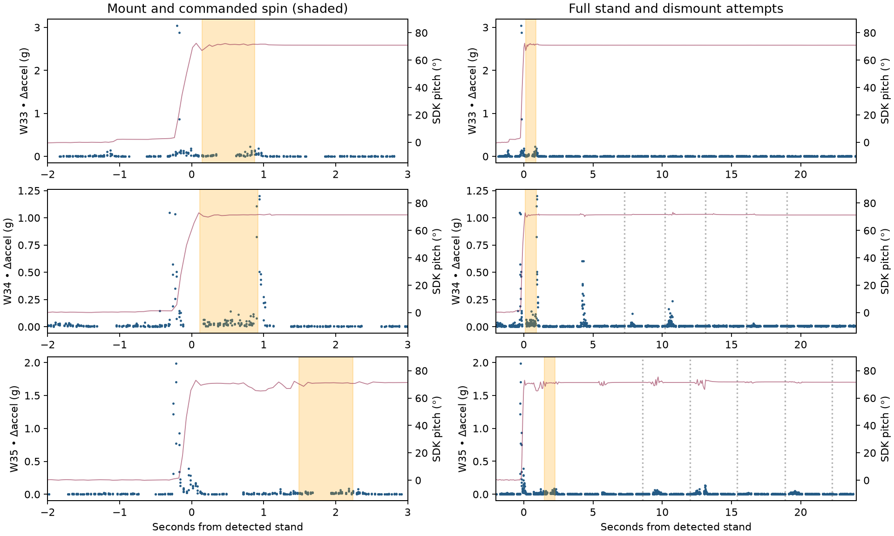

# What the cube felt during three wheelstands with a commanded spin

The physical cube recorded 18,702 three-axis samples in 6,234 Bluetooth packets across W33–W35. All three runs requested a 90° spin on the stand. To compare runs, subtract each run's median pre-mount acceleration vector (−7 to −5 seconds from stand detection) and take the magnitude of the remainder. Results are in g, using 8,192 counts/g. A change in this quantity can come from tilt, translation, or vibration.

| Run | Baseline RMS | Mount peak | Full spin peak | Interior spin RMS | SDK pitch at end-of-wait marker |
|---|---:|---:|---:|---:|---:|
| W33 | 0.0058 g | 3.04 g | 0.223 g | 0.035 g | 70.9° |
| W34 | 0.0043 g | 1.05 g | 1.106 g | 0.041 g | 71.3° |
| W35 | 0.0044 g | 1.98 g | 0.085 g | 0.023 g | 71.6° |

The mount window starts 0.8 s before stand detection and ends at spin start. W35 waited about 1.49 s after stand detection before spinning. The other two began within 0.15 s. The largest packet assigned to each spin arrived within 62 ms of its end. W34's 1.106 g packet arrived just 19 ms before the spin-end marker. Trimming 100 ms from both spin boundaries reduces the largest W34 interior sample to 0.143 g. Keep that boundary impact separate when scoring sustained rotation. Robot pitch remained above 70° at all three log entries named “landed,” and the picked-up flag was set. These labels identify when the runner stopped waiting; they do not establish a physical landing.

The canonical cube sensor at rest produced 0.00394–0.00433 g RMS over 16 seeds, using the same median-centering convention with fixed vertical gravity and 2 s sampling windows. Physical interior-spin RMS was 5–10 times the simulated rest level. The stationary sensor comparison checks the noise floor only. The measured dynamic packet streams are targets for wheelstand contact replay.

Robot and cube times are host receipt/event times relative to stand detection. Three ordered acceleration slots share each packet's timestamp. The plot marks spin command intervals in orange and recorded dismount-step completions with dotted vertical lines. For W34 and W35 the later pulse attempts also produced measurable transients, with late-window peaks of 0.604 and 0.138 g. These data cannot measure fork force or uniquely identify the impact surface.

[Physical packets](cube.csv.gz) · [Robot pitch and gyro](robot.csv.gz) · [Events](events.csv) · [Phase measurements](phase-scores.csv) · [Spin interior](spin-core.csv) · [Simulated rest](sim-rest.csv). Reproduce with python analyze.py and node rest.mjs from this directory with the web dependencies installed.
