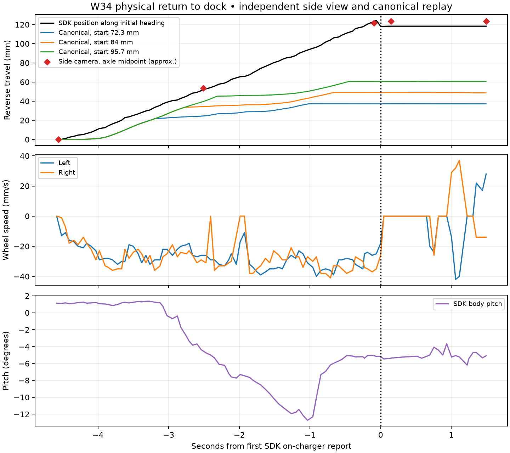
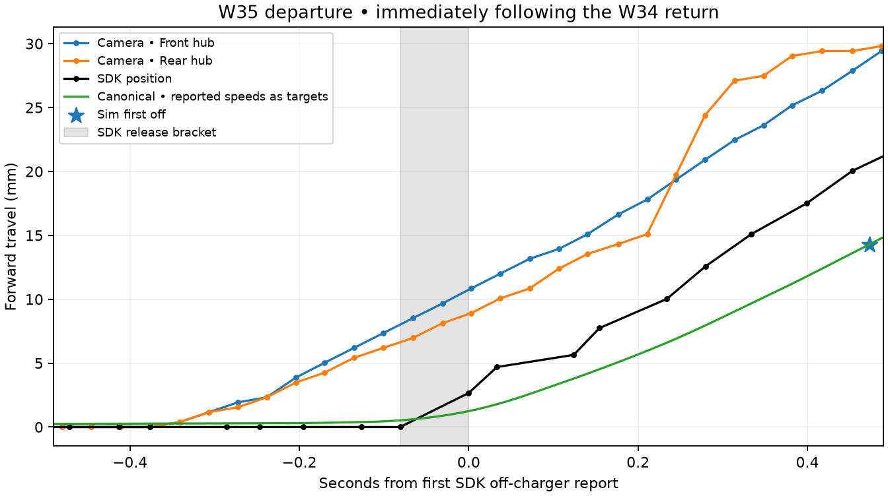
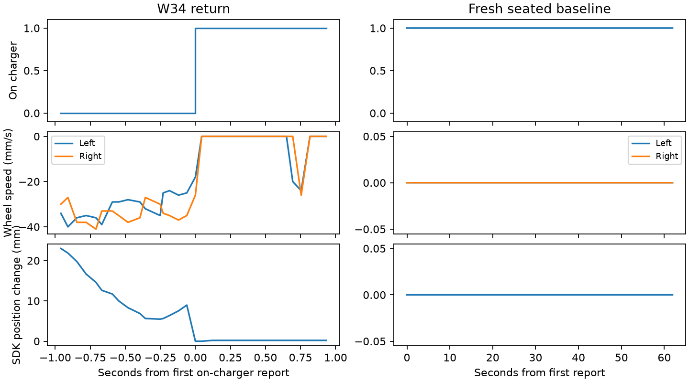

# Physical dock return and next departure on Vector 2.0

On November 23, 2026, a passive SDK listener recorded the end of the W34 trial, a return to the charger, and W35's subsequent departure. The two recordings contain 1,033 and 2,331 robot-state reports, respectively, with about 0.93 s of overlap. Each file has its own monotonic time origin and UTC receipt stamps. The optical measurements come from the same shelf-side See3CAM footage recorded independently. W34 included a pose-origin change before the final approach. All reported approach measurements use origin 5. These observations are one paired return and departure.

The last off-charger report was at 17:58:52.302 UTC and the first on-charger report at 17:58:52.363. SDK reverse travel along the initial heading reached 124.2 mm before the flag and fell to 118.1 mm at the flag. The full 2D pose step was 9.0 mm. The wheels still reported reverse speeds of 18 and 26 mm/s at first contact. Both reported zero 45 ms later. The two camera picks bracketing contact (−97 to +146 ms) show approximately 1.7 mm of continued reverse travel. The discrepancy is consistent with an SDK pose correction at docking. Physical travel from the start of the approach through contact was roughly 122–123 mm in this camera.

The canonical model was replayed with the observed wheel speeds as motor targets, initializing on the centerline at three distances spanning the observed A–E starting depths. It backed 37.3, 49.0 and 60.7 mm by the physical contact time, and never asserted contact during the replay. W34's absolute start pose relative to the charger was unavailable. Initial yaw and lateral offset were set to zero. This sweep tests sensitivity to approach depth alone.

On the next departure the charger flag cleared between 17:59:51.984 and 17:59:52.065 UTC. SDK position stayed fixed through the last on-charger report. After subtracting motion of a fixed dock reference, the front hub had already moved about 8.0 mm at last on and 10.7 mm by first off. The rear hub gave 6.6 and 8.8 mm, respectively. From the canonical seated pose and the observed initial head and lift posture, a wheel-target replay released at 14.3 mm, 473 ms after the physical first-off report. Motor-target replay includes the simulator controller response. That time difference is not a direct measurement of electrical latency.

The effective physical release occurred with less travel than the canonical default in this pair. The footage constrains travel, but without registration to the charger pin geometry it cannot distinguish a shallower initial seat from a different contact or release threshold. The two-hub spread is an indication of optical sensitivity, not a confidence interval. Camera exposure and SDK acquisition latency are unknown.

## Measurements and reproduction

- [W34 SDK](states.csv.gz) and [W35 continuation](continuation.csv.gz) include pose origin, unmodified status bitmask, wheels, head, lift, gyro, acceleration and image clock.
- [W34 camera picks](hubs.csv) give hand-picked hub centers in the established 1000 × 440 corrected shelf view. Reverse travel uses their horizontal midpoint, converted with 48 mm divided by the median projected horizontal axle spacing. Perspective and ramp pitch affect this approximation.
- [W35 camera tracks](departure-hubs.csv) give normalized correlation scores for two hub patches and a static dock patch. Tracks use the established shelf correction, limited per-frame search, horizontal displacement relative to the dock patch and the 124 px initial hub separation. Camera times use V4L2 frame PTS plus the median offset from the capture host's monotonic-to-UTC clock samples, then subtract the SDK receipt time at the flag edge.
- With web dependencies installed and NumPy and Matplotlib available, run python analyze.py in this directory to regenerate both plots and the [departure replay](departure-replay.csv). The canonical MuJoCo web model used for this analysis was main at 31e04c2. No model parameter was fitted.

## Independent seated baseline

A fresh 61.92 s physical recording contains 1,033 SDK reports. All asserted the on-charger flag. Both wheel speeds were zero throughout, with no change in reported XY. The stable seated interval provides a control for spontaneous flag transitions and odometry jitter. The W34 position jump occurred during entry. This baseline supplies no independent contact-on depth because the robot stayed seated throughout.

[Fresh physical SDK reports](rest.csv.gz) · [Reproduce the comparison](rest_check.py).
