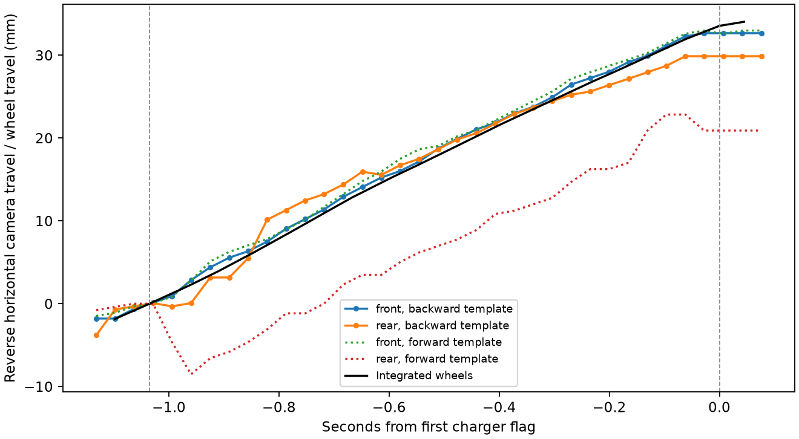
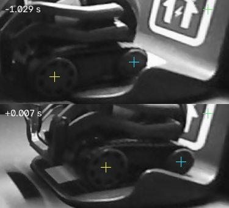

# Camera travel from peak pitch to charger contact

Thirty corrected side-camera frames fall between the SDK peak nose-down pitch and first on-charger packet in W34 (1.035 s). The axle midpoint moved **31.27 mm horizontally** relative to a stationary patch on the dock. Integrated wheel travel over exactly the same interval was **33.54 mm**. The front hub gave 32.66 mm and the rear hub 29.88 mm. These distances show that most of the reported travel in this return was physical chassis motion.

The lower image is 7 ms after the flag, and the upper is 6 ms after peak pitch. Each measurement uses interpolation at the SDK receipt time between adjacent camera frames. We subtract the horizontal displacement of the fixed patch before applying the archived scale of 48 mm per 124 horizontal pixels. The midpoint incorporates both hubs as the chassis pitch changes.

## Tracker cross-checks

Fixed templates independently followed the front hub forward from frame 319 and backward from frame 396. They returned 32.67 and 32.66 mm respectively. The rear template from frame 319 drifted onto a nearby feature and gave 20.90 mm. At held-out frame 389 its center missed the previous manual pick by 15 px horizontally and 13 px vertically. The rear template from frame 396 missed by 1 and 2 px, respectively. We retain the failed track in the plot and CSV; the midpoint uses the backward tracks for both hubs. The dock patch stayed at the same horizontal pixel through the interval.

Scaling with the projected axle spacing at each endpoint separately gives midpoint estimates of 29.78 and 31.52 mm. Shifting both SDK landmarks by ±35 ms gives 31.00–31.85 mm using the archived scale. These are sensitivity checks. The camera measures a horizontal projection; it does not directly measure arc length or establish pin compression or contact voltage.

The earlier interpolation between widely spaced manual picks estimated 27.09 mm after the peak. The dense measurement supersedes that estimate. The two first-generation simulated driven-roller returns covered 18.1–18.3 mm of reported wheel travel after peak pitch. The shelf robot is a Vector 2.0, and those simulations used different starting poses and hardware geometry. The W34 optical result independently corroborates the physical travel scale without calibrating a model parameter across units.

Run python dense_score.py to reproduce the graph from the supplied track CSV and archived SDK states. To regenerate the tracks from the original recording, run python dense_hubs.py CAPTURE_DIRECTORY with the camera B NUT file, clocks.csv, OpenCV, SciPy and ffprobe. It uses the repository's shelf correction before examining pixels. [W34 original sparse reference and synchronization](README.md) · [Workshop and replay comparison](../workshop-spins/return-contact/climb.md)
