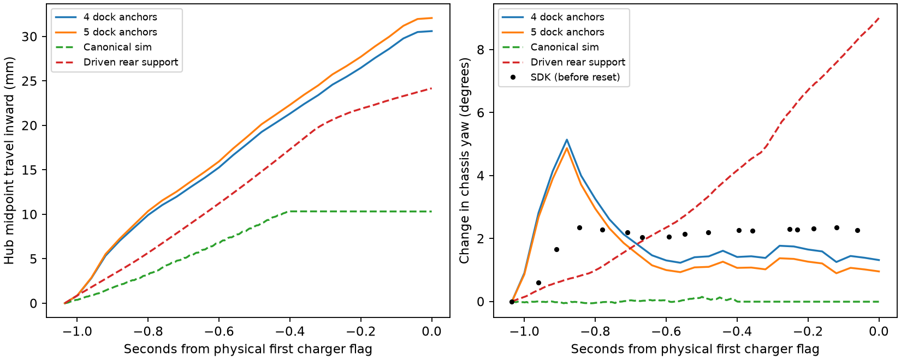
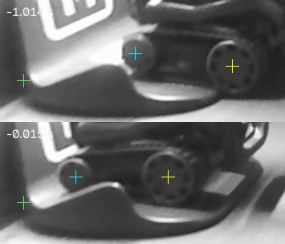

# Unit 3 W34 dock return seen from both sides

From the deepest nose-down pitch until the first charger flag, the midpoint between the four visible hub faces moved 30.0–32.7 mm inward across six camera registrations. This is one physical return. The second view confirms that the large inward displacement in the first camera is present at the center of the robot.

For the registration using the four glyph corners and the dock lip, with the visible hub planes 30 mm either side of center, the measured center advanced 32.08 mm. The canonical Vector 2.0 simulation advanced 10.32 mm. The experimental driven rear support advanced 24.18 mm and still missed electrical seating. Neither simulation was refitted.

The two corrected cameras face opposite lateral hub faces. Fixed-template tracking backward from the settled pose preserves all four centers through the interval. Tracking forward independently loses camera A’s rear hub and is retained as a diagnostic in the CSV. Each camera uses its packet presentation times and the capture clock offset. We interpolate each track at the same physical times, correct for stationary-patch jitter and fit one rigid pose per timestamp. The physical axle separation is 48 mm. The assumed height difference is 3.75 mm and the lateral distance to each visible face is varied over 27, 30 and 33 mm.

The camera fits imply roughly one degree of yaw, but cannot resolve its magnitude precisely. Holding out one hub center and predicting it from the other three at each endpoint gives 5.3–11.0 pixels of error at the nominal width. Absolute pose, lens registration, hub-center selection and timestamp uncertainty remain in the measurement. The range across registrations is a sensitivity check, not a confidence interval. SDK yaw ends before the localization jump at contact.

The centerline replay traces come from running registered_replay.py. Run opposed_pose.py to regenerate the fits, plot and withheld-landmark errors from the CSVs.
