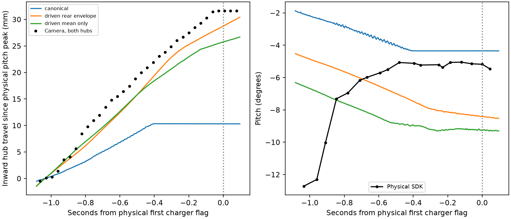

# Vector 2.0 dock replay with a camera-derived start depth

During W34 the camera's first hand-picked hub position preceded the final backing motion closely: that frame was 23 ms after the last stationary SDK packet. We reconstructed the front axle from that frame with the two existing dock registrations (four glyph corners, or glyph plus lip) and three plausible visible-hub planes. This gives an initial robot origin 94.4–99.2 mm in front of the dock lip with initial heading and lateral offset set to zero. The subsequent dense camera trace and first charger flag were withheld from the depth calculation. This is one physical return under alternative registrations, not six physical trials.

Each replay uses the first stationary SDK head and lift pose and the Vector 2.0 free-dock scene. We replayed both signed measured wheel reports as motor targets on their original host-receipt timeline. From the physical peak-pitch packet to the physical first charger flag, we compare inward travel of the two visible hub faces' midpoint. The simulation measurement uses chassis world position and rotation, 48 mm axle spacing and the same side of the robot visible to the camera. Its CSV also gives the axle midpoint on the chassis centerline, which can move differently during yaw.

| Six centered starts | Physical camera travel | Simulated visible-hub travel | Replays reaching contact |
|---|---:|---:|---:|
| Canonical Vector 2.0 | 29.9–32.3 mm | 8.6–10.6 mm | 0/6 |
| Driven rear support | same frames | 27.5–29.0 mm | 0/6 |
| Driven support with signed wheel speeds averaged | same frames | 22.8–32.5 mm | 2/6 |

For the glyph-plus-lip registration at 30 mm lateral, physical travel was 31.64 mm, compared with 10.32 mm canonical and 28.74 mm driven. The driven centerline moved 24.18 mm; chassis rotation contributed 4.56 mm at the visible side. Equalizing the wheel targets changes the observed steering input and is diagnostic only. Contact was monitored until 0.6 s after the physical flag.

## Heading and lateral sensitivity

We also used the difference between the SDK start and first-on headings in the same SDK origin (−2.05°), treating the first-on heading as the outward dock axis, and tested lateral starts of −3, 0 and +3 mm. We adjusted the assumed origin depth for projecting the visible axle at that heading. These are sensitivity tests, since there is no independent initial lateral measurement. The driven visible hubs moved 29.6–33.4 mm, yet all three missed electrical contact. At the most oblique simulated finish, nearly 10 mm of visible-side motion came from rotation about the chassis centerline. Agreement of a single side-view displacement is insufficient to validate the approach heading or electrical seating.

The camera reconstruction assumes a parallel plane for the observed hubs. Yaw, lens registration, and SDK acquisition delay limit the comparison. Replaying measured speed reports as commands also includes the simulated motor controller. The result identifies a large canonical travel deficit on the same robot generation; it does not establish which track contact or motor parameter to adopt.

Run python registered_replay.py with OpenCV, NumPy, Matplotlib and the web dependencies installed. The camera reference is [the W34 dense track](dense-travel.md) and the [opposed-view dock registration](../unit3-dock-side-registration/README.md).
