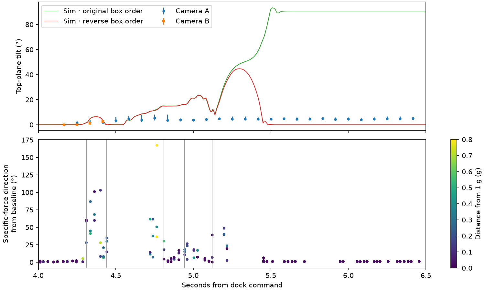
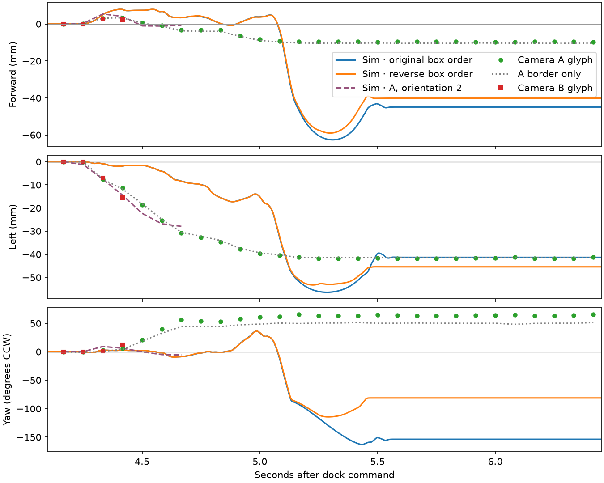
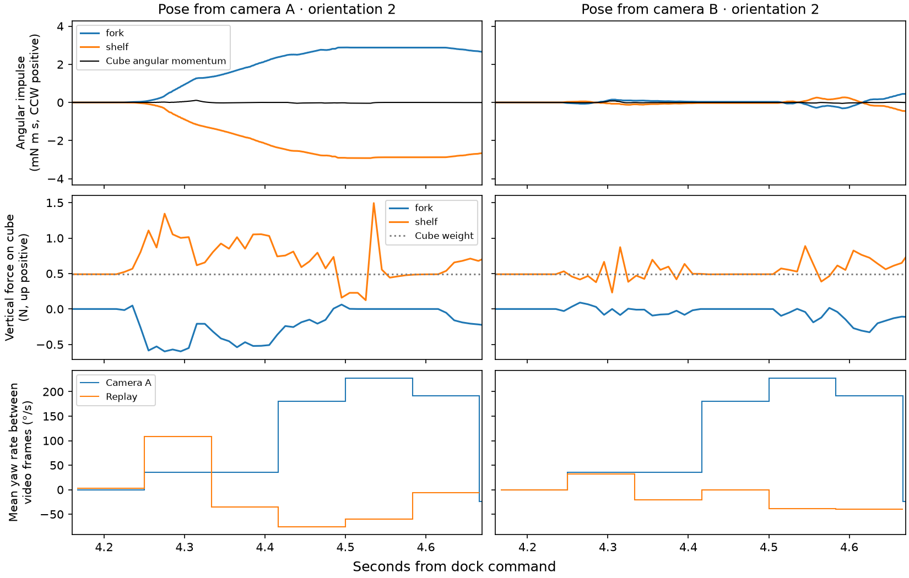

# Cube displaced during the return to dock

This is a physical contact recording with a Vector 2.0 and the shelf cube. The native undock completed. The active cube connected over BLE, but the visual search ended without a recent cube sighting. No roll command was issued. During the autonomous return to dock, both cameras show the turning robot hit the cube. Its position and visible side marking changed. The BLE disconnect had returned REQUEST_PROCESSING; the monitor continued receiving cube data during contact.

The cube tap counter incremented five times between 4.31 and 5.12 s after the dock command. In the first 24 s after that command the measured magnitude ranged from 0.055 to 1.779 g. From 6 to 7 s, the mean gravity vector was within 1.02° of its pre-command direction. This records displacement with nearly the same final up direction. Gravity alone cannot resolve yaw. There were 7,137 accelerometer slots and 2,056 robot states across the full recording. Docking completed.

[Corrected twin-camera clip](paired.mp4) · [Cube and robot traces](contact.png) · [Cube samples](cube.csv.gz) · [SDK poses](poses.csv.gz) · [Robot states](state.csv.gz) · [Command log](actions.csv) · [SDK events](events.csv). The clip uses the original camera presentation times, local clock pairs and nearest frames at 12 fps. Roll and dock command times refer to host receipt. The clip ends 16.83 s after the dock command when camera coverage ends.

### Cube displacement during docking

The two opposed corrected views independently place the settled top-glyph center **39.8 mm (A) and 42.9 mm (B)** from its pre-contact position. This is net displacement between endpoints. We used the nominal 23 mm outer glyph width, the rectified camera intrinsics scaled to the published clip, and a shared level plane for each pair of endpoints. The fits use eight manually identified corner intersections per camera. Coordinate reprojection RMS was 0.24 and 0.36 pixels respectively. The endpoint orientations differ by 25° and 19° modulo 90°; the square outline cannot distinguish quarter turns.

Adding independent Gaussian corner perturbations of 0.75 preview pixels gave 5th–95th percentile displacements of 37.7–42.3 mm and 31.6–47.1 mm. Those ranges describe pick sensitivity only. Common scale, lens calibration and any endpoint tilt remain systematic uncertainties. The shallower, smaller marker in camera B gives weaker depth resolution. The approximately 41 mm slide provides a physical holdout for chassis-to-cube contact even though final gravity changed by only about one degree.

[Endpoint overlays](planar-slide.png) · [Per-view estimates](planar-slide.csv) · [Reproduce and inspect corner picks](planar_slide.py)

### Direction of the collision turn

Eight consecutive camera A frames show the original near face swinging toward image right, with the adjacent face emerging on the left and taking its place. This selects a counterclockwise turn viewed from above. Applying that quarter-turn correspondence to the two settled top-glyph fits gives 64.8° (A) and 70.9° (B). The perturbation ranges, 62.5–66.8° and 68.7–82.3°, exclude shared calibration and endpoint tilt errors and do not agree at their closest edges. Treat the result as an approximate signed turn. In addition to the roughly 41 mm displacement, this gives the simulator a rotational endpoint to reproduce. The face change is visible by +4.67 s, before the last three tap-counter increments. The timestamps label camera frames and packet receipt; taps do not mark equal increments of rotation.

[Frame sequence and accelerometer](collision-turn.png) · [Angular estimates](collision-turn.csv) · [Reproduce](collision_turn.py)

### Where the cube was before contact

At +4.25 s the two views independently locate the cube center 38.7 and 41.4 mm forward of the front axle, and 47.7 and 48.3 mm to the robot's right. Cube edges were oriented −20.9° and −23.9° relative to forward, modulo 90°. The last visible stationary cube pose and both axle centers locate the initial condition without using the eventual cube displacement, tap times or SDK endpoint.

We fitted camera pose using top and side 23 mm markings on a nominal upright 44 mm cube. The picks are from the stationary pre-contact image. In frame 75 the visible hub center rays were intersected at 14.5 mm (front) and 10.75 mm (rear) above the shelf. The visible hub plane was assumed 28 mm off center; true cap extension, tread compression and chassis attitude are sources of systematic error. As an independent scale check the recovered axle spans were 47.3 mm (A) and 45.3 mm (B), versus 48 mm nominal. The CSV includes perturbations of marker and axle picks and a 28–30 mm hub offset. This approximate starting pose is suitable for replay sensitivity tests.

[Hub and glyph picks](hub-registration.png) · [Both camera estimates](hub-registration.csv) · [Reproduce](hub_registration.py)

### Frozen contact replay

We put each optical registration into the SDK frame at +4.25 s, then replayed the measured robot XY, yaw, pitch, lift and right wheel speed. We used the R8 printed fork, torque-limited arm, front-right tread proxy, chassis collision and shelf support. Starting at +4.25 s already penetrates the fork by 4.36 mm (A) or 0.76 mm (B). The primary replay starts at +3.75 s with the same stationary cube position. First contact now occurs at +4.22 or +4.24 s with less than 0.011 mm penetration.

At a 0.25 ms timestep, net travel was 44.2 and 37.0 mm, bracketing the two physical estimates. Both predictions turn clockwise (60.4° and 61.7°), opposite the physical counterclockwise turn. They produce four and three tap increments versus five observed. At 0.50 ms, camera A changes to 71.4 mm travel and 168.9° clockwise, showing strong numerical sensitivity. This maneuver fails the signed-yaw comparison. The fixture represents only one tread and drives the chassis along SDK odometry. Which surface supplied the incorrect moment remains unresolved.

[Replay curves and physical endpoint bands](dock-replay.png) · [Early-start results](dock-replay.csv) · [Late-start diagnostic](dock-late-start.csv) · [Replay script](dock_replay.py). Run with the R8 fork XML fixture; optional second argument 4.25 reproduces the late start.

### Test of the recorded chassis trajectory

In seven successive camera A frames (+4.25 through +4.75 s), we picked the right-side front and rear hub centers, intersected their rays at nominal axle heights using the pre-contact camera registration, and transferred the front hub to the axle midpoint. In the robot's initial axes, the camera gives 9.3 mm forward and 30.7 mm right. SDK odometry gives 10.3 mm forward and 50.0 mm right. Clockwise chassis heading changes were 63.1° from camera A, 79.7° from odometry, and 74.2° integrating head gyro Z at host receipt times. The gyro is head mounted. The optical path is sensitive to pick error, occlusion, pitch, camera latency and the level-shelf assumption; reconstructed axle length varied from 46.0 to 48.9 mm.

We replaced SDK XY and heading within that interval with the optical path. Before the interval we retained SDK motion, and afterward we continued its relative motion from the corrected endpoint. The recorded lift, wheel speeds, chassis pitch, pre-contact cube registrations, and collision parameters remained fixed. At 0.25 ms, A predicts 52.8 mm travel and 65.1° clockwise, B predicts 39.2 mm and 50.2° clockwise. Both predict six taps. The physical cube turned about 65–71° counterclockwise and advanced its tap counter five times. The measured path discrepancy does not resolve the reversed contact moment in this test.

[Hub picks](chassis-picks.png) · [Optical path, odometry and gyro](chassis-path.png) · [Trajectory samples](chassis-path.csv) · [Replay plot](camera-path-replay.png) · [Per-model results](camera-path-replay.csv). Run chassis_path.py, then dock_replay.py with the fork XML followed by 3.75 --camera-path.

### Which contact turns the cube?

With the optical chassis path and original cube fixture, removing either tread or chassis contact alone reproduced all complete-model endpoints at both timesteps. Removing the fork reduced the 0.25 ms clockwise rotation from 65.1° to 8.0° (A) and 50.2° to 8.4° (B), and delayed first contact by 0.34–0.35 s. Disabling all three left the cube stationary within 0.00002 mm. This isolates the fork as the dominant simulated contributor in the full-contact run. It does not identify the contacting surface on the physical robot.

The legacy replay XML has 62 cube colliders. Replacing these with the current 74-box SDK-derived cube surface while retaining the same robot contacts, drive path and material settings produced different outcomes. At 0.25 ms camera A still gave 63.5° clockwise and 48.0 mm. Camera B now gave 28.2° **counterclockwise** and 10.0 mm. Its result at 0.50 ms was 28.6° counterclockwise and 10.0 mm. The physical band is 64.8–70.9° counterclockwise with 39.8–42.9 mm of displacement. The B sign is repeatable across timesteps, but the cube travels only about one quarter of the observed distance. This comparison makes the fork–cube contact location a higher priority than adjusting uniform friction.

[Contact ablations](contact-ablation.png) · [All 20 comparisons](contact-ablation.csv) · [Current cube surface replay](current-surface.png) · [Current surface results](current-surface.csv). Use dock_replay.py with the fork XML and 3.75 --ablation or 3.75 --camera-path --current-surface.

### Does identifying the upward face resolve the docking impact?

The two side glyphs and camera A's top glyph were scored against the six rendered SDK faces at four quarter turns. Only the 24 right-handed rigid orientations were considered. The four highest joint scores all put the SDK mesh's −Z face upwards. Their mean fit correlations were 0.636, 0.608, 0.595 and 0.581. Camera B's withheld pre-impact top crop preferred +X at 0.465, narrowly above −Y at 0.463. Both post-impact crops favored −Z after rectification, but preferred different quarter turns. The mesh axis is distinct from the accelerometer's axis convention. The observations leave the initial quarter turn unresolved.

We replayed all four shortlisted orientations plus the previous upright control, under each camera registration, with the measured chassis path, 74 cube boxes, printed fork, and unchanged material parameters. No physical endpoint entered the optical ranking. At a 0.25 ms step, the best jointly scored orientation gave 26.8 mm and 12.4° clockwise from A, versus 31.3 mm and 32.5° counterclockwise from B. Physically the cube traveled 39.8–42.9 mm and rotated 64.8–70.9° counterclockwise. None of the shortlisted orientations met both endpoint bands at either step size. In all four, the first simulated fork contact hit a rubber corner from A and a shell box from B. That distinction is a simulation prediction; the footage does not resolve the contact material.

For a numerical control we reversed the XML declaration order of the same cube colliders. Dimensions, world pose, inertia, trajectory, and friction stayed fixed. The B rank-four prediction shifted from 75.4 to 62.8 mm and from 128.6° to 96.7° clockwise. The B rank-one result shifted by under 0.2 mm and 0.2°. The size of this sensitivity depends on the contact. These data do not support choosing a cube friction coefficient from this impact.

[All 24 rigid orientations](rigid-faces.csv) · [Individual glyph correlations](face-match.csv) · [Both integration steps](face-replay.csv) · [Reversed collider order](face-replay-reverse.csv)

To reproduce, generate the six corrected projections with the [optical mesh render](../../cube-optical-mesh/README.md). Run `face_match.py /path/to/projections` here, then `dock_replay.py /path/to/fork.xml 3.75 --face-test` with the R8 fixture. Repeat with `--reverse-box-order` appended, then run `face_endpoints.py`. The CSV records the first fork contact position in the simulated cube's local coordinates.

### Does tightening the contact solver stabilize the impact?

We selected the most order-sensitive case from the previous comparison (B, orientation 4). A with the same orientation tests transfer to the opposite camera registration; B with orientation 1 is the control that was previously nearly insensitive to box order. All three reuse the same physical docking impact.

The four runs per integration step cross original/reversed box order with default/tighter MuJoCo Newton solver settings. The default solver uses 100 maximum iterations and tolerance 1e-8, with 50 line-search iterations and tolerance 0.01. The tighter settings use 300 and 1e-12, with 100 and 1e-6 for line search. We test 0.25 and 0.125 ms steps. Integration step changes also change how often the kinematically prescribed robot trajectory is applied. All runs retain the same printed fork, measured arm/chassis path, cube geometry, and material properties.

[Default, original order](solver-default-original.csv) · [Default, reversed order](solver-default-reverse.csv) · [Tight, original order](solver-tight-original.csv) · [Tight, reversed order](solver-tight-reverse.csv). Run the face replay described above with `--solver-check`, optionally adding `--tight-solver` and/or `--reverse-box-order`; run `solver_plot.py` after all four. Solver iteration statistics record the maximum across islands at each step, summarized over the replay.

With tighter settings, the B4 order gap in final yaw was 0.8° at 0.25 ms, 17.3° at 0.125 ms, and **72.5° at 0.0625 ms**. At the finest step both first contacts fell on the same printed fork piece and the same cube shell patch at 0.4925 s. The two patch coordinates agreed to far below 0.001 mm. Both replays traveled about 61 mm and recorded seven simulated tap events, yet their peak tilts were 93.2° and 44.7°. Thus agreement on contact onset, displacement and taps can conceal a different tipping outcome. The physical estimate was 39.8–42.9 mm and 64.8–70.9° counterclockwise; both fine-step results turned clockwise. No solver run reached its iteration cap (at most nine iterations in all 26 replays).

Across the two main steps and both solver settings/orders, A4 varied by under 1.5° and B1 by under 1°. The default 0.25 ms runs exactly reproduced the previously published endpoint, first patch and tap counts. Tightening the solver failed to establish convergence for B4. Production settings are unchanged.

### Did the real cube tip during the docking impact?

Camera A keeps the same upper glyph in view through the turn. Its estimated plane normal moved at most **5.4° from the pre-impact reference across 28 sampled frames** (4.17–6.42 s). At 5.50 s the estimate was 4.6°; the settled camera estimates also sit around 4–5°, while the settled accelerometer gives about 1°. Small excursions are therefore difficult to distinguish from image measurement error. Camera B independently estimates 0–2.5° over four early frames before the robot occludes the marker.

We extracted a quadrilateral from the upper glyph over eleven intensity thresholds and used planar pose estimation with the corrected camera intrinsics. The visible upward direction of the vertical side edges distinguishes the two planar pose branches; the 25° acceptance cone applies to projected edge direction in the image. Reported medians and 10th–90th percentiles describe dependence on edge threshold only. Image blur, corners, intrinsics and the initial plane contribute further uncertainty. Video is sampled at 12 fps and could miss a short-lived tilt between frames. BLE slot timestamps are packet receipt times and can lag camera or solver events.

The two tight-solver B4 curves at 0.0625 ms still reach 92.2° and 43.1° after sampling at camera A's frame times. The original box order predicts 15 frames above 30° and the reversed order predicts two. Both predict much more tipping than camera A resolves. The strongest apparent rotation of the measured acceleration vector (167.2° at 4.764 s) comes from a sample of only 0.055 g. During this collision the chip measures specific force including translation; treating its instantaneous direction as gravity would give a spurious near-inversion.

[Glyph fits at selected frames](tilt-picks.jpg) · [Frame estimates](tilt-frames.csv) · [Original-order trace](tilt-original.csv) · [Reverse-order trace](tilt-reverse.csv). Run `tilt_frames.py`, then the tight solver comparison with `--tilt-trace` once for each box order, and `tilt_overlay.py`.

### When does the cube's path depart from the recordings?

The two rectified camera views independently recover the earliest displacement. The coordinate frame is fixed at the robot's pre-impact heading, with positive X forward and positive Y left. We project the upper glyph onto the nominal 44 mm plane using the earlier stationary two-face and hub registration. Each camera uses its own stationary glyph as a texture template. Translation and yaw follow its correlation peak within a search window centered on the thresholded border. We search ±25° from the preceding frame in 1° steps. The top plane is assumed level over the sequence. Small real inclination, foreshortening, lighting, the registration and host clocks limit accuracy. Camera B loses sight of the complete upper glyph after +4.42 s.

At +4.33 s A gives 3.2 mm forward, 7.5 mm right, and B gives 2.9 mm forward, 6.9 mm right. At +4.42 s the rightward estimates are 11.3 and 15.5 mm. The two fine-step B4 replays each give 0.9 and 1.8 mm right at those times. By +4.58 s camera A gives 40° CCW and 25.3 mm right; both replays give approximately 2° clockwise and 4.1 mm right. They agree closely with one another through this interval. Their later solver-order sensitivity cannot explain this early path discrepancy.

At +6.42 s the A template gives 42.3 mm net displacement and 66° CCW, near the earlier manual endpoint fits. Following only the outer border gives 51° at that frame. Threshold spreads in the CSV describe that border method only. The earlier manual fits and this reconstruction share the physical clip. Camera B supplies the independent early view. Exact first contact remains unresolved between frames.

[Camera trajectories and template correlations](impact-path-camera.csv) · [Original solver order](impact-path-original.csv) · [Reversed solver order](impact-path-reverse.csv) · [Shortlisted orientations and upright controls](impact-path-candidates.csv). The existing tight solver `--tilt-trace` commands now also export XY and yaw. Run the face replay with `--face-test --early-path` for the 0.25 ms candidate comparison, then run `impact_path.py`.

Across ten 0.25 ms replays (two registrations, four shortlisted orientations plus the upright control), A orientation 2 comes close to the translation at +4.58 s: 1.1 mm backward and 26.8 mm right, versus 0.8 mm backward and 25.3 mm right in camera A. Yet it predicts 5.1° clockwise against the observed 40° counterclockwise. The other nine yaw predictions at that frame also fall outside the physical turn (all ten range from 9.1° clockwise to 5.4° CCW). This isolates a case with comparable translation but a substantially different turn and makes the line of action of the contact force a testable candidate. The trajectory alone does not identify a unique force or contact point.

### Which contact turns the cube?

For orientation 2 we integrated every solver contact wrench on the cube about its center of mass, including the contact couple, at 0.25 ms. The signed sum matches simulated world-Z angular momentum on both registrations (maximum residual below 2e-17 N m s). The fixture has isotropic inertia and starts at rest. The CSV also records linear impulse in world coordinates. Forces are model outputs; the cameras supply position and interval yaw rate.

* In A, the pose that matched displacement at +4.58 s, the fork had delivered **+2.877 mN m s** of counterclockwise angular impulse by then. The shelf delivered **−2.877 mN m s**. Between +4.25 and +4.42 s the fork pressed down with 0.47 N mean force, comparable to the 50 g cube's 0.49 N weight. The mean upward shelf reaction was 0.95 N.
* Between +4.50 and +4.58 s, A's mean horizontal fork force was only 0.003 N. The camera-tracked cube continued from 21° to 40° CCW during that interval. The simulation had already lost almost all fork loading. The camera alone cannot determine whether the real cube was still driven or coasting.
* In B the fork impulse instead totaled −0.227 mN m s and the shelf +0.192 mN m s at +4.58 s. The same physical footage underlies both registrations. Neither tread nor chassis delivered measurable yaw impulse in these replays. Thus reducing shelf friction based solely on cancellation in A would leave the fork's opposite torque in B unexplained.

[View A wrenches integrated through time](impact-impulse-A.csv.gz) · [View B](impact-impulse-B.csv.gz). Add `--impact-impulse` to the `--face-test --early-path` replay and run `impulse_plot.py`.

### Can the camera registration error explain the turn?

We held the cube's orientation at optical candidate 2 and simulated nine initial translations for each camera registration. The grid offsets are −2, 0, +2 mm forward and −3, 0, +3 mm left, each within the corresponding published marginal 5th–95th percentile range from perturbed image picks. Those ranges do not define a joint probability distribution. Shape, contact materials, measured robot trajectory, registration-specific edge yaw, solver settings and the 0.25 ms step were fixed.

For each candidate we compared displacement and yaw at frames 76 and 77 against **both cameras**. The score is the RMS planar displacement error of the four corresponding corners of a centered 23 mm square. This puts rotation and translation in millimeters without fitting weights. We selected the lowest early score across all 18 cases and evaluated it on subsequent camera A frames. Frames 78–84 cover the main movement; frames 78–101 also include settling. These are withheld times from a single impact. Optical orientation 2 was chosen after earlier work on the same recording.

[Selected trajectory and controls](pose-grid.png) · [All per-frame predictions](pose-grid.csv) · [Selection and later errors](pose-grid-scores.csv). Run the R10 fork replay with `3.75 --face-test --early-path --pose-grid`, followed by `pose_grid.py`.

The original A pose (zero adjustment) won on the two early frames, with 3.09 mm RMS corner error. Its translation RMS error over the next seven moving frames was 3.44 mm, but its yaw RMS error there was 61.1°. At +4.58 s **all 18 cases** lay between 17.7° clockwise and 4.7° counterclockwise, versus 40° counterclockwise in camera A. Across all 24 held-out times the selected pose gave 41.7 mm RMS corner error. The lowest corner error available in hindsight on those 24 frames was 19.8 mm; using it would leak the held-out observations. Both zero-offset controls exactly reproduced all previously published early frame predictions.

Position uncertainty matters to the final outcome, but these translations within the two registration ranges do not explain the observed early turn for orientation 2. No fitted offset was applied to the simulator.
