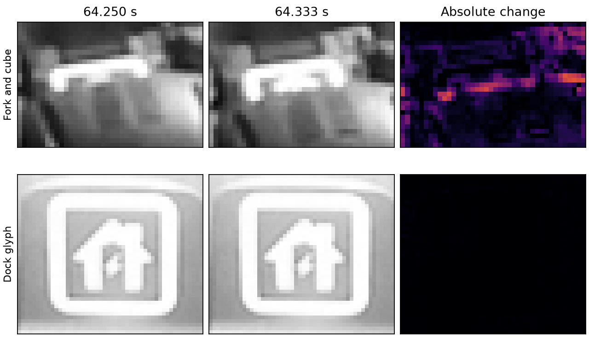

# Autonomous cube roll on the shelf

After a native undock Unit 3 acquired a cube glyph at 95.4 mm and issued roll_cube with zero retries. The previous approach (R7) missed the glyph and made no contact. R7 supplies a search-only comparison.

The SDK reported taps at 3.285 and 4.059 seconds after the roll command. Cube acceleration magnitude peaked at 1.43 g. The first reported cliff flag arrived at 4.363 seconds with SDK pitch at 10.1°. Pitch reached 31.3°. The guard interrupted the action before an SDK result arrived.

The 69 cube samples in the last 0.9 seconds before command averaged (0.016, −0.018, 0.971) g. A separate docked recording starting 197 seconds after command yielded 834 samples over ten seconds averaging (0.009, 0.970, −0.009) g. The angle between mean gravity vectors is 91.58°, consistent with settling on an adjacent face. The gap includes redocking, so the two rest windows alone cannot establish the instant the cube changed face. A gravity reading also leaves yaw undetermined.

[Contact video](roll.mp4) · [Sensor overlay](roll-traces.png) · [Post-roll gravity samples](settled.csv.gz)

Time is in seconds from the undock command on the receiving host. Three cube samples share each notification arrival time and retain their packet order in the slot column. Accelerometer axes are signed counts at 8192 counts/g. The cropped overhead clip spans the approach, contact and release. The plot shows SDK wheel speeds, lift, pitch and raw cube acceleration on the receiver clock. No simulator parameters were fitted.

### Held-out event timing

Replaying the recorded packets through the frozen listeners yields two tap candidates. Applying the 145.906 ms receiver delay estimated in earlier experiments predicts the SDK tap reports 11.0 ms early and 8.1 ms late. Movement onset is 24.7 ms early. Both replay and SDK report zero up-axis changes during the captured roll interval. The last recorded packet arrived 5.266 s after the command, while the replay filter still classified +Z as up. The separate rest sample establishes +Y up later.

This tests the packet-to-event path given measured acceleration and the physical firmware tap counter. It does not test whether simulated fork contact generates those accelerations or increments that counter. Times use host receipt; samples in a packet share one timestamp.

[Event timing overlay](event-replay.png) · [Timing table](event-replay.csv) · [Reproduce the replay](replay_events.py)

### Does the printed fork generate a roll?

The free-cube MuJoCo replay uses the first pre-command SDK cube pose for horizontal position and yaw, places the cube flat on the shelf and drives the printed wrist from observed chassis translation, yaw, pitch and lift. The SDK poses share one odometry origin. The 16 mm pitch pivot height is assumed. The measured pitch is an input, so this isolates fork–cube geometry without predicting chassis pitch from the contact forces.

| Frozen geometry, same initial pose | First fork contact | Maximum cube tilt | Tilt at last chassis sample |
|---|---:|---:|---:|
| Measured pitch | 3.991 s | 91.53° | 90.00° |
| Chassis held level | 3.994 s | 6.20° | <0.01° |

The physical cube tap counter first changed at 3.128 s. Modeled fork contact begins 0.863 s later. The pitched replay crosses 45° at 4.598 s and tips toward the robot (top-face normal ends 11.5° from the horizontal cube-to-robot bearing). The physical packet replay still reports +Z at 5.266 s and the later rest measurement gives +Y. A matching adjacent-face endpoint leaves a discrepancy in the sequence. The source of the first real tap is unresolved. The fixture omits contact with chassis and arms. The prescribed rigid wrist also omits motor compliance. No contact or sensor parameter was fitted to this run.

[Measured pitch replay](contact-replay.png) · [Level control](contact-level.png) · [Recorded pose inputs](roll-poses.csv)

Build the fixture with evidence/unit3-printed-fork-contact/build_fixture.py and forks7.stl, then run replay_roll.py with the fixture XML path. Add --level for the control. The fixture used here had SHA-256 4867e81c8d8d92ad3abc621d920af9b550c001e5d8f81d8443d1e84a069b8230.

### What can reach the cube at the first tap?

With the cube fixed at each of four pre-contact SDK observations, the simulated front-right tipping cylinder overlaps the cube shell by 2.09–2.44 mm at the first transmitted counter change (3.128 s). This cylinder represents the tread near the actual axle. The inset wheel collision geometry is within 0.2 mm of touching in all four cases. At the same instant the chassis box is at least 5.7 mm clear, head 10.6 mm, lower links 28.6 mm and upper links 35.2 mm. These are signed distances at corresponding receiver times. The four observations share camera calibration and odometry errors; their spread is a sensitivity check.

Adding just the driven front-right cylinder to the free-cube fork replay yields first support contact at 3.086 s, 42 ms before the physical counter change. The fork follows at 3.987 s. The cube peaks at 43.18° and returns to its original face by the final chassis sample. The fork-only replay reached 90°. Thus the front-right tread offers a geometrically plausible source for the first disturbance, while the extra contact materially worsens the endpoint prediction. No firmware tap was predicted from that contact force and no physical contact point was identified in the video. Neither replay extends beyond the recorded chassis motion.

Run early_contact.py for the clearance plot (requires the viewer SDK assets and web dependencies used by replay_links.py). Pass --front-right to replay_roll.py for the free-cube experiment, using the same printed fixture as above.

[Part clearance](early-contact.png) · [Geometry and distances](early-contact.csv) · [Free cube with tread contact](front-right-replay.png)

### Does the tread surface speed explain the roll?

The paired replays use the same translating, pitching front-right tread cylinder, printed fork, cube, and contact material. A free joint is driven from consecutive axle poses with explicit linear and angular velocity. One replay locks the tread rotation relative to the chassis; the other applies measured right-wheel speed divided by cylinder radius. Both impose the trajectory every step. The proxy has assumed 180 g inertia mass and diagonal inertia of 0.0001 kg m² per axis. This change of driving method matters: the stationary-rotation control now also rolls the cube. Comparing these two cases isolates the effect of rotation within this fixture.

At 0.25 ms the control reaches 170.3° peak tilt and the rolling tread reaches 154.8°. Both end at 90° by the last recorded chassis pose. At 0.5 ms the peaks are 170.1° and 155.2°. The rolling case first touches the cube at 3.086 s across all three step sizes. It predicts four packet counter changes at the two finer steps versus two observed from 2.5 s onward. Its packet acceleration magnitude peaks at 5.39 g at the finest step versus 1.43 g measured in the common interval; individual axes can saturate. Packet peak magnitude is timestep sensitive. At the final simulated packet the rolling case reports −Y up, while the physical receiver still reports +Z and the later physical rest window measures +Y up. The comparison uses the model's nominal sensor mounting and assumes the SDK cube yaw registers the same sensor frame.

The replay uses the existing accelerometer, packet format, and filter on the MuJoCo cube chip site with a fixed seed. The robot's pose and fork motion remain prescribed. The several-fold acceleration error and different indicated face argue against adopting this driver as a calibrated model.

[Tread-speed overlay](tread-speed.png) · [All six runs](tread-speed.csv) · [Reproduce with printed fixture XML](tread_speed.py)

### Recovering the settling time from the overhead camera

The shelf recording continues after the receiver stops. At 65.25 s on the camera clock the visible cube top is still changing. At 65.333 s its normalized patch correlation with the exposed post-withdrawal cube reaches 0.955, then 0.987 at 65.417 s. Every remaining frame of the published 74 s crop stays above 0.98 from 65.417 s onward, including the robot backing away. The patch covers the far two corners and upper portion of the top glyph. The near face is partly occluded until the robot withdraws. This measures the time at which the visible portion matches the later resting pose; it does not determine a continuous 3D angle or first crossing of 45°.

Two motion onsets provide an independent clock check. First visible lift motion at camera 60.167 s corresponds to receiver +0.413 s. First visible chassis drive at 61.667 s corresponds to +1.791 s. The two offsets place command zero at camera 59.754–59.875 s. Combining those offsets with the two correlation thresholds gives an approximate **+5.46 to +5.66 s** for the first persistent match to the later appearance, about **0.19–0.40 s after the last cube packet**. These bounds describe threshold and landmark sensitivity, not statistical confidence. Video sampling is 12 Hz and SDK timing uses message receipt. The later gravity observation supplies the +Y face identification.

The prescribed chassis trajectory ends at +5.208 s, before this visual endpoint. A replay stopped there cannot be scored as a final-face failure solely because it has yet to settle; discrepancies in earlier impact, sensor response, and timing remain measurable.

[Settling frames and correlation](optical-settle.png) · [Frame scores](optical-settle.csv) · [Losslessly cropped camera sequence](cube-settling.mkv) · [Reproduce the measurement](optical_settle.py)

### What generates the excess impact?

The prescribed-fork replay squeezes the cube between fork and shelf. At 4.19425 s the two resultant loads reach 2,063.0 and 2,063.5 N respectively; they largely cancel and the simulated raw chip reads 1.05 g. The largest raw acceleration occurs later at 4.78125 s. Only the shelf contacts the cube then, with a resultant force of 7.91 N and raw chip magnitude of 16.13 g. The sampled and filtered simulation peaks at 5.32 g in the packet timestamped 4.83 s. Physical packets peak at 1.11 g over 4.5–5.0 s. These are simulated forces. There is no physical load cell in this recording.

The control uses the simulator's hinged 66 mm lift, level-wrist constraint, printed collision geometry and nominal 30 mN·m torque limit. Chassis motion and right tread speed are still supplied from the recording. The observed lift angle is a servo target here; in the prescribed-fork baseline it directly places the fork. Both use the shelf cube's candidate sensor frame and gain. The physical motor target, current, and actual available torque under load were not recorded.

| At 0.25 ms | Peak fork force | Peak packet magnitude | Tap changes after 2.5 s | Peak cube tilt |
|---|---:|---:|---:|---:|
| Prescribed fork, roll | 2,063 N | 5.32 g | 4 | 154.85° |
| Articulated lift, roll | 1.35 N | 1.87 g | 3 | 0.14° |
| Physical roll | unmeasured | 1.43 g | 2 | adjacent face at rest |
| Articulated lift, failed approach | 0 N | 0.98 g | 0 | <0.001° |

The servo misses the recorded roll height by as much as 17.47 mm relative to its joint-limited target. At 0.5 ms it likewise misses the roll, with two tap changes and 1.80 g peak. Improving acceleration while losing the measured maneuver is insufficient to select this replay. This points to a joint check of fork registration, chassis motion and loaded lift tracking before fitting contact softness.

[Contact partners and packets](impact-loads.png) · [Force samples](impact-loads.csv.gz) · [Window peaks](impact-windows.csv) · [Servo comparison](servo-load.png) · [Both timesteps and held-out approach](servo-load.csv)

### Can an upright cube sliding across the shelf explain the late accelerometer signal?

Three overhead frames spaced 0.25 s apart show the same far rubber corner. Under a fixed upright attitude, that point stays at a constant height. Its shelf-plane trajectory then has the same curvature as the chip's. We compare the middle position with the average of the two endpoints. This cancels unknown initial position and constant sliding velocity. We use the existing top glyph as a local 23 mm planar reference.

The visible corner deviates **1.9 mm** from the endpoint average. Perturbing each corner pick by up to 2 px per coordinate and the glyph picks by up to 1 px gives a 5th–95th percentile range of **0.9–8.2 mm**. This is a sensitivity check. Camera distortion, point height and registration contribute additional systematic uncertainty.

If the cube had kept its starting attitude, its changing Y specific force would have to be linear acceleration along that fixed axis. Double integration of the packet means, after subtracting the pre-command resting baseline and applying the existing gain, requires **110–127 mm** of midpoint deviation along that axis alone across the two clock alignment limits and intermediate offsets. That is several cube widths and inconsistent with the frames. The equivalent baseline-subtracted signal in the held-out stationary approach gives less than 0.13 mm. The latter is a sensor control on a different starting face.

The result rules against sliding with constant attitude as the sole explanation. It does not identify the tip axis, instantaneous angle, angular acceleration or fork contact point. A rotating cube can also slide. Sensor timestamps are receiver times, with linear interpolation between packet means.

[Marked video frames](slide-check.png) · [Midpoint deviations](slide-check.csv) · [Reproduce](slide_check.py)

### What the camera resolves during the cube packet gap

The 272 ms gap between cube packet receipts covers camera frames at 64.250 and
64.333 s under the full previously estimated clock-offset range. Between those
frames the mean absolute grayscale change in the fork/cube crop is 24.30 counts
on an 8-bit scale, versus 0.49 on the fixed dock glyph. More of the bright top
marking becomes visible as the fork moves. The changing occlusion prevents a
cube-only angle measurement here. These frames therefore constrain the timing
of visible interaction but cannot supply a missing accelerometer sample or
establish when the cube completed its roll.

Reproduce with `python gap_frames.py`.

### Could clock phase hide the late shelf impact?

Replay the same prescribed printed fork, measured rolling tread and R8 trajectory at 0.25 ms. Hold physical forces, sensor orientation, gain and the noise realization fixed. Vary the chip frame phase across its 2 ms period and the app tick phase across its 10 ms period at 0.25 ms resolution. The shipped app keeps the latest available frame. For the 4.5–5.0 s packet window, all 320 phase pairs predict peaks of **4.44–6.93 g** (median 6.50 g); the nominal phase reproduces **5.32 g**. The recorded maximum is **1.11 g**. The analytic phase sweep was also checked against the ordinary byte-packet simulation at nominal and two nonzero phase pairs.

Free-running phase on this simulation grid cannot reconcile the late impact. The receipt immediately before the nominal 4.83 s peak arrived at 4.815 s and the next at 4.855 s. Receiver time is distinct from chip sampling time. This test does not establish the physical impulse or identify the correct rubber stiffness. The fork/chassis trajectory and shelf landing still need independent constraints.

[Phase map](impact-phase.png) · [All phases](impact-phase.csv) · [Reproduce with the same printed fork fixture as the tread-speed replay](impact_phase.py)

### Rubber response after release

Branch the simulated R8 replay at 4.765 s after roll command. All five trials have identical cube velocity at that step (vertical −0.590 m/s, angular speed 12.16 rad/s) and subsequently contact only the shelf. Changing the rubber geoms' MuJoCo contact time constant from 4 to 64 ms gave nominal-phase packet peaks from 4.11 to 6.58 g. The physical peak in the common window was 1.11 g. Increasing the time constant from 8 to 16 ms lowered the peak from 5.32 to 4.11 g while increasing maximum contact penetration from 1.95 to 3.67 mm. Still softer settings increased penetration and did not further improve the peak. All cases settled at 90° tilt by the replay endpoint. This sensitivity test does not measure the rubber's stiffness; no contact parameters were adopted.

[Five landing traces](landing-compliance.png) · [Release and landing metrics](landing-compliance.csv) · [Replay](landing_compliance.py)

### Does the physical cube unload before the simulated landing?

In the 4.600–4.78125 s interval before the simulated peak raw impact, 10–13 of the 18 simulated slots fell below 0.50 g for every one of the 320 frame/tick phase pairs. Even the phase with the highest minimum fell below 0.004 g. The physical recording delivered 21 slots in that receipt-time window. The lowest was 0.915 g. Across the entire 957-slot recording, including the approach and all available post-command samples, the lowest magnitude was 0.849 g. A separate R5 set-down provides a positive control for this recording path: six of its 762 slots fell below 0.50 g, with a minimum of 0.031 g.

The mismatch therefore precedes the simulated shelf impact. This favors testing how long the cube remains supported and the path it follows as it rolls. Hardware receipt time differs from chip time, and packet gaps can hide physical motion. The readings alone cannot identify a supporting contact or exclude a short unobserved airborne interval. No physical test was run for this comparison.

[Measured and simulated slots](unloading.png) · [All clock phases](unloading.csv) · [Reproduce](impact_phase.py)

### Does rotating an off-center accelerometer explain the unload?

The accelerometer site is assumed to be at the cube center. Repeated the identical trajectory at nominal clock phase with the site at the center and all eight vertices of the model's ±15 mm per-axis uncertainty box. The entire tilt trace was identical in every run. At the eight offsets the minimum pre-impact packet magnitudes ranged from 0.032 to 0.175 g; seven to fourteen of the eighteen slots fell below 0.5 g. Landing peaks ranged from 4.08 to 6.82 g. Physical pre-impact slots stayed above 0.914 g and the landing-window maximum was 1.11 g. These discrete positions test sensitivity; they do not bound every interior position or identify the physical mounting. The tested offsets leave the pre-impact discrepancy intact.

[Location sensitivity](chip-offset.png) · [Nine replay results](chip-offset.csv) · [Reproduce](chip_offset.py)

[Canonical packet-noise check on the settled face](rest-packets.md)

[Final packet directions and optical settling interval](final-direction.md)

[Free edge-release thresholds and timing](edge-release.md)
