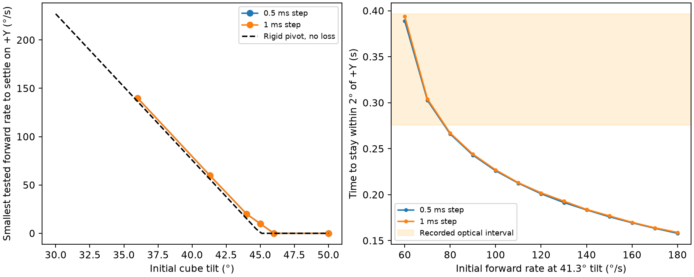

# Could a partially tilted cube finish the R8 roll under gravity?

In the canonical Vector 2.0 scene a cube released from rest at 41.3° falls back onto its starting face. At that same angle 50°/s of forward rotation also falls back, while 60°/s carries the cube onto +Y at both integration steps. At 46° the cube finishes from rest. The force direction at the last physical packet was 41.3°. Using that number as a hypothetical pose tests feasibility; it is not a measurement of cube attitude.

| Hypothetical starting tilt | Smallest successful tested rate | Settle time at 1 / 0.5 ms step |
|---|---:|---:|
| 36° | 140°/s | 0.413 / 0.401 s |
| 41.3° | 60°/s | 0.394 / 0.389 s |
| 44° | 20°/s | 0.373 / 0.372 s |
| 46° | 0°/s | 0.295 / 0.295 s |

At 41.3°, 70°/s settles in 0.304 / 0.303 s. Both 60 and 70°/s therefore give durations within the 0.276–0.397 s interval from the last packet to the persistent camera match. The two endpoints measure different things. The simulator requires the cube to remain within 2° of +Y for the rest of the 0.8 s replay, with at least 50 ms remaining. The camera criterion uses the visible upper patch. These observations admit multiple starting poses and rates, as well as continued fork support.

Each run initializes the unmodified 50 g cube with its lower rubber edge at shelf height, away from the robot and dock. The center velocity is tangential to that edge at the prescribed initial angular rate, so the edge initially has zero world velocity. After release only gravity and ordinary contact act on the cube. The grid covers seven tilts and 19 rates per tilt at two integration steps. The dashed curve gives the lossless rigid-pivot energy needed to raise the center of mass to the 45° balance point; the simulated scene uses compliant contacts. The thresholds are resolved only to the 10°/s sweep spacing. No supported robot motion, physical release rate or friction coefficient was fitted.

Run `node edge_release.mjs > edge-release.csv` and `python edge_release.py`. [All 266 outcomes](edge-release.csv) · [Physical terminal direction and camera timing](final-direction.md)
