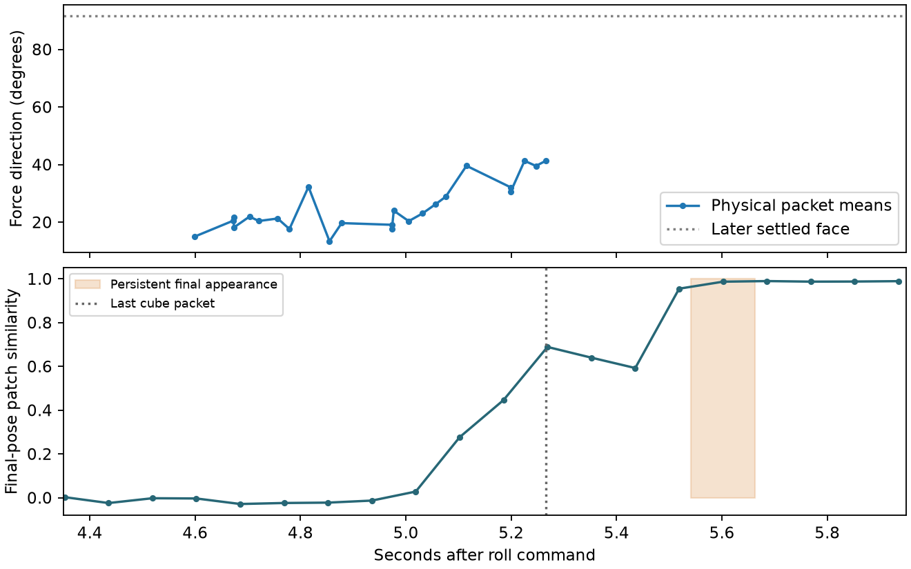

# The last observed cube packets still change direction

Across the final 13 packet receipts (4.973–5.266 s after the roll command), the median specific-force direction advances from 19.1° in the first three packets to 41.3° in the last three. The later resting face lies at 91.6° in the same coordinates. The final packet has magnitude 0.960 g. Its direction is still about 50° from the settled reading.

The visible cube patch first maintains 0.98 correlation with its final appearance 0.276–0.397 s after the last packet, across the previously measured camera clock offsets. The curve is plotted at the midpoint offset; the shaded interval shows offset sensitivity for the persistent match. This is an appearance threshold for the visible upper patch. It cannot resolve first contact with the shelf or the exact completion of the rotation.

We average the three signed XYZ slots per packet. The pre-roll mean unit vector defines zero; the settled mean unit vector defines the plane and positive direction. The signed angle is computed within that plane. Using two through five packets per endpoint gives 19.2–22.2° of change. Applying the same statistic to every consecutive 13-packet window in the later stationary recording gives at most 0.27° absolute change. No chip sampling times are inferred from bursty receipts.

A uniformly quiet intermediate sensor pose does not describe the final packet sequence. Dynamic acceleration can also rotate the measured force vector, so the 41° endpoint should not be used as an exact cube orientation. For validating release, the observed order is useful: the signal is still changing after the model’s nominal 4.83 s impact, the radio trace ends, and only then does the visible upper patch persistently match the settled face. The gap still prevents a physical impact-peak or release-time measurement there.

[Window-size and stationary controls](final-direction.csv) · [Camera registration and contact replay](README.md). Reproduce with `python final_direction.py`.
