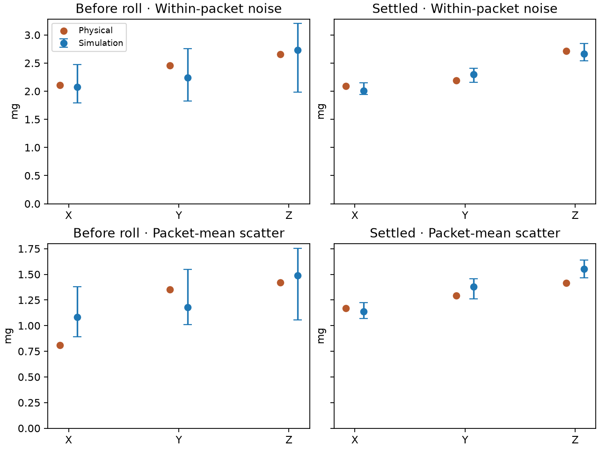

# How quiet is the cube after it settles on another face?

In 278 received packets after the R8 roll, physical within-packet noise was 2.09, 2.19 and 2.72 mg RMS on X, Y and Z. The canonical web cube sensor predicted 2.01, 2.30 and 2.67 mg at the median of 24 random seeds. All three observations fell inside the simulated seed ranges (2.5th–97.5th percentiles). The dominant gravity axis had changed from +Z to +Y. The existing noise parameters transfer reasonably well to this second orientation.

Averaging each packet’s three slots tests how its noise combines. On the settled face the recorded Z packet means had a standard deviation of 1.42 mg; simulation gave 1.55 mg, with a seed range of 1.46–1.64. In the 23-packet pre-roll window the physical X packet-mean scatter also fell below the seed range. These ranges describe model randomness for the observed sample count, rather than uncertainty over placements or devices.

For each window we infer the gravity direction from the recorded mean using the canonical scale and bias, normalize it to 1 g, then hold that direction constant. Only the direction and number of packets come from that window. Each realization exercises the normal web CubeSensor filter, noise source, quantizer and three-slot packetizer with a 1 ms integration step and 300 ms warmup. Within-packet noise is the RMS of adjacent-slot differences divided by √2. Packet-mean scatter uses the population standard deviation. Receipt gaps never enter the within-packet differences.

The 10-second settled recording starts about 197 seconds after the command. It tests the sensor at the endpoint; it cannot validate the landing impulse or the instant support changed. No parameters were fitted. Run `python rest_packets.py`. [All axis scores](rest-packets.csv) · [R8 physical evidence including the optical settling timeline](README.md)
