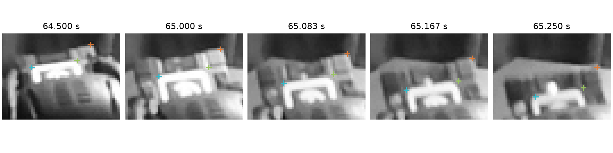

# Which release motions can the R8 crop distinguish?

The far-right rubber corner and two upper bends of the visible glyph move together across the overhead image between 64.500 and 65.250 s. Their mean shift is 6.7 px right and 11.7 px down. The glyph midpoint moves an additional 2.5 px down relative to the rubber crest. That smaller shift is too close to the point-picking uncertainty to locate a pivot.

Fitting a single image translation to the three endpoint displacements leaves 1.33 px RMS residual. A sensitivity control assumes exact common translation and perturbs each endpoint coordinate independently and uniformly. With ±1 px picks the 95th percentile residual is 1.40 px; at ±2 px it is 2.81 px. Under the broader perturbation the relative vertical glyph shift ranges from −0.82 to +5.76 px (5th to 95th percentiles). These ranges are sensitivity to assumed pick error rather than measured confidence intervals. The crest is blurred and its apparent silhouette can move as the cube tilts.

The shelf contact edge remains behind the robot. Roll about a fixed lower edge, translation of the entire cube and combinations of these motions can all shift the upper face in this view. The image translation fit is in pixels and does not demonstrate physical sliding. The separate [acceleration and camera midpoint test](README.md) gives evidence against pure fixed-attitude sliding; the final pivot and slip distance remain unresolved. For this clip the [timing of persistent final appearance](final-direction.md) is a stronger validation target than a reconstructed pivot.

[Frame coordinates](terminal-landmarks.csv). Reproduce with `python terminal_landmarks.py` using the lossless 12 fps crop.
