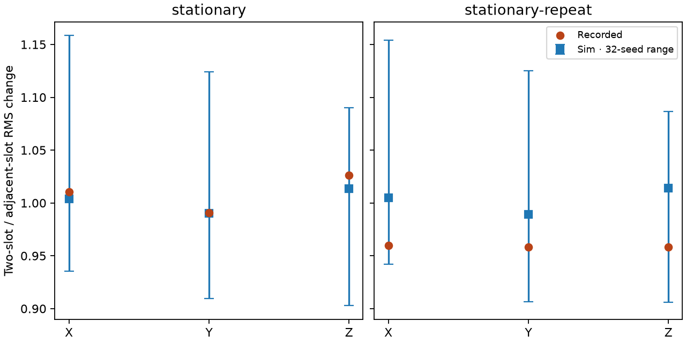

### unit 3 wheelstand series on the shelf

One Vector 2.0 with a printed fork and one retail light cube. In the docked baseline, the cube sent 828 acceleration samples during 10.016 seconds. Its median specific-force magnitude was 0.9703 g and the 5th–95th percentiles were 0.9655–0.9748 g. The tap counter held at 18. The individual samples in stationary.csv.gz share receipt times in groups of three.

**W1 stopped during undocking.** The Bluetooth connection succeeded and the native undock imperative started under continuous override. Both telemetry streams stopped about 8.4 seconds later. The last wheel reports were 33 and 30 mm/s. Robot uptime was 8,264 seconds immediately before telemetry loss and 84 seconds at the subsequent SSH check, establishing a reboot. Its cause remains undetermined. The wheelstand action never started and this attempt contributes zero wheelstand outcomes. There are 145 robot states, 729 individual cube samples and a [See3CAM recording](W1/undock.mp4). The [trace](W1/traces.png) and CSVs use seconds from the undock command.

### Held-out stationary sensor check

The 828 pre-wheelstand samples independently test the existing unit-3 cube sensor settings. With a level, upright cube and sixteen simulator seeds, mean specific-force magnitude is 1.00012 g in the frozen simulator and 0.97027 g on the shelf. Applying the common gain of 0.970709 estimated from the earlier resting.csv gives 0.97083 g, an absolute error of 0.57 mg. The new recording was used only for scoring. This pose gives little leverage for distinguishing a common gain from a Z-axis offset. The alternative gain was kept out of the production model.

The magnitude standard deviation was 2.88 mg on the shelf and 2.35 mg in simulation. Differences between successive samples within each three-sample packet gave physical RMS changes of 2.92, 3.18 and 3.99 mg along X, Y and Z, compared with 3.28, 3.38 and 3.32 mg in simulation. These comparisons use packet order, independent of host receipt jitter. [Overlay](rest-transfer.png) · [per-seed results](rest-transfer.csv) · [reproduction](rest_transfer.py).

**W1 reboot diagnosis.** A subsequent read of the current boot's [PMIC journal](W1/boot-reason.txt) identifies undervoltage lockout at power-off and a cold boot after sudden momentary power loss. This narrows the failure to the power supply dropping below the PMIC threshold during the undock sequence. Robot uptime ties this boot to W1. The wall clock changed across boot. The available journal contains only the current boot and pstore was empty. The readings do not distinguish the cell, its connections, the dock-to-battery transition, or another supply fault. No minimum loaded voltage was recorded.

### W2–W4 physical wheelstand retry

unit 3 was charging at 3.901 V before the tests. The cube stayed in its shelf placement. In W4 the native SDK PopAWheelie command started 22.330 s after the undock command. The overhead view shows the approach and tip-back. SDK chassis pitch peaked at 72.25° at +4.30 s relative to the wheelstand command. The cube's largest recorded specific-force magnitude was 4.50 g across three axes (−1.47, −2.30, +3.58 g). Its tap counter advanced from 19 to 21. W4 contains 2,247 cube samples and 782 robot state messages. Three cube samples share each packet receipt time. The reader guard interrupted the SDK action during tip-back, so the experiment records physical wheelstand contact without an SDK completion result. The raw metrics describe this single contact.

[Contact video](W4/wheelstand.mp4) · [Full overhead recording through redock](W4/overhead.mp4) · [Pitch and accelerometer overlay](W4/contact.png) · [Cube samples](W4/cube.csv.gz) · [Robot state](W4/state.csv.gz)

W2 produced 3,594 cube samples, but the recorder missed the valid zero-valued object ID in a JSON conversion and returned to dock before commanding a wheelstand. W3 returned to dock after two Bluetooth connection failures. For W4 the recorder read the protobuf ID directly and verified fresh accelerometer packets on the dock before undocking. After the maneuver, SDK pitch settled near 1.4° with cliff and pickup flags clear. 

### Held-out wheelstand tap timing

The packet listener maps the two W4 hardware counter changes to two events. With the 145.906 ms median receipt offset from the earlier pickup applied unchanged, the predictions were 10.3 ms late and 12.3 ms early relative to the two SDK tap receipts. These are pod receipt times, and the comparison starts with a counter computed by the physical cube. It checks downstream delivery timing only.

To test upstream observability, the same firmware counter implementation also ran on the retained physical Z readings without access to the transmitted counter. At the model's nominal five FIFO frames per reported sample, two alternative reconstructions filled the four missing frames by holding the previous reading or by linear interpolation. Both reproduced one tap over the whole recording and missed the second. The transmitted samples alone therefore provide a poor reference for reconstructing the high-rate shock waveform with these assumptions. A dynamic simulator can be scored directly against both observed counter changes and the reported acceleration. [Event overlay](W4/tap-transfer.png) · [times](W4/tap-transfer.csv) · [replay](wheelstand_taps.py).

### W4 cube displacement from overhead

The cube moved in two stages. The 5 fps overhead recording resolves a first shift near +4.1 s from the wheelstand command. From +5 to +8 s the template fit measured 10.1 mm displacement and 3° clockwise yaw (median across 11 frames with correlation above 0.7). A second shift appeared between +10.5 and +10.9 s, after robot and cube telemetry ended. From +24 to +32 s the fit measured 13.6 mm total and 5° clockwise (40 frames). Treat the first displacement as the wheelstand-contact target and the second as later movement. Camera sampling and receipt timestamps cannot resolve the movement of the cube at each individual tap.

A four-corner hand measurement on separate picks gave 9.5 mm / 3.7° clockwise after the first shift and 12.5 mm / 5.4° clockwise after the second. Both methods use a nominal 23 mm top glyph and assume it is level at the measured endpoints. They share perspective and scale error. Their differences are a method sensitivity check, not an absolute accuracy bound. [Displacement and yaw](W4/optical-travel.png) · [registration checks](W4/optical-checks.jpg) · [per-frame measurements](W4/optical-travel.csv).

### W4 free-cube replay with the printed fork

The fixed forks7 proxy was driven through the physical SDK approach, heading, lift height and chassis pitch in the existing MuJoCo free-cube fixture. The starting cube XY and yaw came from the sighting immediately before the command. The cube started upright on the shelf. Chassis pitch rotates the fork about the nominal rear axle, with its center held at axle height. Because odometry continues integrating as the treads unload, a second run froze planar translation once pitch exceeded 5°. Both runs hold the final measured pose after +4.836 s while the cube settles. Physics uses four substeps per cube sensor step. No W4 contact outcome was used to tune parameters.

| Input after tip-back begins | Top glyph travel | Yaw (CCW positive) | Reported peak | Taps |
|---|---:|---:|---:|---:|
| Physical first displacement | 9.5–10.1 mm | −3.0 to −3.7° | 4.50 g | 2 |
| SDK XY throughout | 1.57 mm | +2.49° | 1.75 g | 1 |
| Freeze XY at 5° | 0.78 mm | +2.25° | 1.60 g | 1 |

The replay underpredicts travel and shock and reverses the yaw direction in both cases. Measured chassis pitch is an input, so these runs cannot establish whether the model can lift the robot. They isolate fork contact, omit body and lift-arm contacts, and use SDK odometry without external fork-tip registration. The actual printed fork geometry is unconfirmed. These findings motivate checking fork position against the camera at first contact before changing cube friction. Reproduce with the XML generated by evidence/unit3-printed-fork-contact/build_fixture.py from forks7.stl and pass that XML path to [fork_replay.py](W4/fork_replay.py). [Physical and simulated overlay](W4/fork-replay.png) · [metrics](W4/fork-replay.csv).

### W4 fork and shelf force balance

The SDK-XY replay had one uninterrupted interval of loaded fork contacts, +4.052 to +4.160 s. The hardware cube delivered tap-counter changes at +3.983 and +4.274 s. The first lies within the coarse optical-motion bracket around +4 s. Packet receipt and camera time have different delays, and neither reveals the physical contact point.

The simulated contact positions, weighted by normal force over the interval, averaged (+2.8, −6.0, +18.3) mm from the simulated cube center in its body axes. This centroid can lie between separate contacts. The fixture produced **4.01 kN peak downward fork load** and almost the same upward shelf load. Integrated over contact, the opposing vertical impulses were −250.14 and +250.20 N s. The fork's positive yaw impulse (+0.14559 N m s) was almost entirely canceled by the shelf (−0.14559 N m s). These loads are simulator diagnostics. No force sensor measured them on unit 3.

Prescribing a moving fork against a cube backed by a rigid shelf lets the solver generate huge opposing reactions while the accelerometer reports only modest net acceleration. The resulting travel and yaw cannot identify real friction or available lift force. A finite-force lift with chassis recoil is a higher-priority physics check than a friction refit. [Load and impulse overlay](W4/contact-balance.png) · [summed forces](W4/contact-balance.csv) · [individual contacts](W4/contact-loads.csv.gz).

### Free chassis and torque-limited lift on W4

The full Vector 2 dynamics model starts from measured pre-contact XY and yaw with the lift raised, the cube independently located at its pre-command sighting and the forks7 proxy installed. After a short settling interval, wheels and planar speed initialize from the corresponding encoder observations. The chassis and cube are then free in all six degrees of freedom. The recorded wheel speeds and head/lift positions supply proxy controller targets. Original motor duty and firmware servo goals were not captured. The drive uses tread speed feedback and a fixed 3.92 V. The model holds the last recorded lift position and commands zero wheel speed after the telemetry ends. No W4 outcome was used to fit any parameter.

At the nominal assumed lift torque cap of 30 mN m, the two pre-contact starts (3.50 and 3.80 s) produced 27.2° and 14.8° peak pitch, 13.7 and 16.0 mm settled travel, 2.0° and 2.2° clockwise yaw, 2.84 and 3.38 g, and three and two taps respectively. Peak downward fork loads were about 2 N in both cases. The cube now turns clockwise, as seen in the recording. The chassis tips too little and the cube slides too far. The differing pitch predictions show substantial sensitivity to approach initialization.

At the 3.80 s start, the previously declared low/high torque bounds of 10 and 80 mN m gave 4.3° and 42.6° peak pitch. The 80 mN m case lands close to the first optical travel at 10.1 mm, but still falls short of the physical 72.3° pitch and 4.50 g peak and underpredicts clockwise yaw. This single contact cannot select an actuator limit. The real fork shape, approach velocity and controller demand remain uncertainties. [Measured and simulated traces](W4/free-chassis.png) · [all four evaluations](W4/free-chassis.csv) · [replay script](W4/free_chassis.py).

### Second docked cube recording

With unit 3 docked and the cube stationary on the same shelf after W4, a fresh Bluetooth connection delivered 828 samples in a 10.014 s window. The tap counter stayed at 23. Mean specific-force magnitude was 0.97036 g, within 0.00009 g of the earlier docked window. Standard deviation was 0.00266 g. The earlier recording gave 0.00288 g. This verifies repeatability of the upright reading across sessions on this cube. The 828 samples are one stationary trial and contribute no additional wheelstand outcomes. Run rest_transfer.py with --repeat for the independent score against the frozen sensor and earlier gain. [Recording](stationary-repeat.csv.gz) · [overlay](rest-transfer-repeat.png) · [metrics](rest-transfer-repeat.csv).

### W4 replay with firmware-derived targets

The public supervisor requests 150 mm/s on both wheels and a 32 mm lift height with limits of 10 rad/s and 200 rad/s². The wheelstand phase ends at 1.2 rad of estimated pitch or after 500 ms. W4 lacks the internal command timestamp. We tested two possible onsets 65 ms apart around the last raised-lift observations and the same two pre-contact initialization times used above. Each candidate starts its lowering profile at the observed lift height at onset, assuming zero initial lift speed. The simulation uses chassis pitch for the cutoff. This approximates the public controller and does not establish the firmware build on unit 3. [Action source](https://github.com/kercre123/victor/blob/669ec7499a7084640b57706a7937884a6568be50/robot/supervisor/src/pickAndPlaceController.cpp#L606-L614).

At the frozen 30 mN m lift limit, all four simulations reached the timeout. Peak pitch was 16.4–28.9° against 72.25° on the shelf. Cube travel was 15.4–17.8 mm against 9.5–10.1 mm for the physical first shift. Peak cube acceleration was 2.37–2.73 g against 4.50 g. All four reproduced the two tap increments. That agreement coexists with a large error in the underlying motion. These four cases are sensitivity tests on a single physical contact. To discriminate contact geometry from actuator response, the next physical replicate needs a side view resolving fork insertion and lift height at first cube motion. [Overlay including lift height](W4/firmware-drive.png) · [metrics](W4/firmware-drive.csv). Reproduce by adding --firmware to the free_chassis.py invocation.

### Does the overhead camera resolve fork seating in W4?

Five consecutive original See3CAM frames cover +3.603 to +4.661 s relative to the command. The crops preserve the captured pixels and use local luminance contrast enhancement. At +3.879 s the fork is still raised. At +4.143 s the fork overlaps the cube in projection and motion blur obscures its tip. The 264 ms between these frames spans a measured drop in lift height from 90.8 to 39.5 mm and a rise in chassis pitch from approximately 0 to 15° (nearest SDK samples). By the next frame at +4.392 s the chassis has already passed peak pitch. Frame labels are host capture midpoints; SDK and Bluetooth timestamps are host receipt times. This view establishes the order of the approach and tip-back. It cannot distinguish whether the fork seated below the lip or pressed on a corner, or determine insertion depth. [Five original capture times and crops](W4/contact-native-frames.jpg).

### Faster overhead recording for wheelstand repeats

With unit 3 on the dock, an eight-second shelf-camera test saved 160 distinct full-resolution JPEGs on the camera host (20.1 frames/s). The median gap between receipt times was 48 ms and the longest was 67 ms. W4's two frames bracketing the initial fork descent were 264 ms apart. The new recorder polls the existing snapshot endpoint locally, discards consecutive byte-identical images and saves the original JPEGs plus request/receipt times. Camera exposure times and offsets to the robot and cube clocks remain unmeasured. A faster overhead sequence can narrow the motion interval; the viewing angle still limits visibility beneath the cube lip. Invoke overhead_capture.py on the camera host with a new destination directory, --url for the live JPEG endpoint, and --seconds for the capture duration. [Test manifest](overhead-timing.csv) · [recorder](overhead_capture.py).

### Optical timing cross-check with three cube light pulses

unit 3 stayed on the dock while the SDK switched the connected cube's lights green and off three times. In the camera-host frames, a crop around the cube supplied the 99th percentile of green minus the larger of red and blue. We used the midpoint between the first off and on reference windows (6.25 levels) and recorded the previous and first changed frame for each edge. The first changed frame arrived 180–463 ms after the command began across the six edges. This measures the entire SDK, wireless light control, light response, image and detection path. It is threshold dependent, and cannot be used as an accelerometer time correction.

Immediately beforehand, 50 paired exchanges bracketed each remote clock against the same Mac clock. Assuming stable relative rates over the short test, the camera clock minus the pod recorder clock lay between −6.52 and +10.91 ms. This limits the contribution from host clock offset. Camera exposure and cube sampling still have their own unknown delays. The physical synchronization signal for a moving trial should be visible cube motion paired with accelerometer response. [Pulse trace](optical-sync.png) · [edge times](optical-sync-edges.csv) · [frame scores](optical-sync-frames.csv) · [clock exchanges](clock-brackets.csv).

### Does the rest-based packet cadence transfer across recordings?

Across six further shelf sessions with 6,672 received acceleration packets, assuming one packet per 30 ms shortened the reconstructed recording by 17.0–17.7%. Using the previously estimated normal interval, pause interval and pause period from resting.tsv brought endpoint errors to +0.18% through +1.60%. Each session starts at the first observed packet with phase zero. No timing parameters were estimated on these sessions. B, C, D and W3 contained no usable packets and have no score.

The largest within-session timing error was 0.92 s. For individual impacts use the actual packet receipt timestamps. Matching overall delivery rate does not establish the physical time of a particular sample or how many measurements the link may have omitted. This checks the timing of data available to the robot on this cube and pod; it does not score grip or impact dynamics. [All six overlays](cadence-holdout.png) · [per-session results](cadence-holdout.csv) · [reproduction](cadence_holdout.py).

### R5 inward transport, operator-observed improper engagement

The SDK sighted the cube at 113 mm and the native pickup raised it. The engagement was identified as improper during this run. The overhead view shows the cube clear of the shelf during transport. unit 3 commanded four 15 mm reverse moves and set the cube down farther inward. The 60 mm is commanded tread travel, not measured cube displacement. Placement returned VISUAL_OBSERVATION_FAILED although the overhead view shows the cube released. unit 3 returned to its dock.

During pickup the maximum reported cube acceleration was 2.01 g and the tap counter advanced three times. During reverse transport the peak was 1.58 g with zero increments. Set-down reached 4.02 g with two increments. These windows follow SDK action boundaries on the receiving pod. Exact fork seating remains unmeasured. [Carry video](R5/carry.mp4) · [sensor traces](R5/sensor-traces.png) · [cube packets](R5/cube.csv.gz) · [SDK actions](R5/actions.csv).

On retry W5, unit 3 undocked and searched but never obtained a recent cube glyph sighting. No wheelstand command was issued. [Search actions](W5/actions.csv).

The [four-stage photo and telemetry overlay](R5/rectified-carry.jpg) uses a local feed-annotator rectifier on the original 1920 × 1080 See3CAM frames. It uses the provisional equidistant lens and a 130° horizontal view tipped 10°. Time is seconds from the undock command. Lift comes from the closest SDK report, acceleration from the peak reported magnitude in the preceding 300 ms. No arena-anchor registration was available for this run.

### W8 wheelstand and wedged landing

After relocation and an unsuccessful close-range search, W6 lost its SDK event stream around undocking and W7 searched from a wider position without a fresh sighting. W8 acquired the native glyph, invoked the wheelstand under override and recorded 2,142 cube acceleration samples over the full session. Peak recorded chassis pitch was 72.50° against W4's 72.25°. Peak cube specific force was 3.06 g with three tap increments, against 4.50 g and two increments in W4. The two contacts have different starting placements. Unit 3 landed wedged on the cube in W8; basal behavior freed it once it came back online. The action stop guard fired, so there is no SDK action-success result.

After the maneuver, robot uptime reset from 3,641.47 s at the final packet to 98.91 s at the boot check. The new kernel recorded PMIC undervoltage lockout. This confirms a reboot; there is no voltage waveform across the landing to identify its cause. The last robot state is only 4.60 s after the action command. [Contact and landing video](W8/wheelstand.mp4) · [two physical pitch and cube traces](W8/physical-repeat.png) · [action and sensor data](W8/) · [boot check](W8/boot-check.txt).

### Held-out wheelstand replay on W8

We transferred W4's four firmware-command cases using W8's own SDK chassis trajectory and pre-command cube sighting. The start times retained their W4 offsets from the last raised-lift sample; the two possible command times are the last two samples before the rapid descent. Fork geometry, friction, torque limit (30 mN m), sensor seed and wheel commands stayed frozen. The cube started upright at the sighted XY and yaw. A measured camera displacement series is unavailable for this overlay.

**The initialization fails before the command.** At the two start times the sighting put the cube center 25–26 mm forward and 27–31 mm left in chassis axes. With the same initialization used on W4, a robot collider already penetrated the cube by 12.9–13.2 mm. The 200 ms settling phase displaced it by 19.2 or 38.6 mm. All four subsequent maneuvers missed downward fork contact, with peak simulated pitch below 0.01° and zero taps. W8 reached 72.50° and three tap increments. Any simulated acceleration or yaw after this artificial ejection depends on the invalid start state. These results cannot score the contact material or torque. Additional SDK sightings before lift descent stayed within about 1.3 mm of the first XY; selecting the most recent one would not fix this overlap. The next discriminating check is an independent camera registration of the chassis and cube before first contact.

[Initialization diagnostics](W8/initial-contact-check.csv) · [command replay](W8/firmware-drive.png) · [metrics](W8/firmware-drive.csv) · [SDK trajectory](W8/approach.csv). Run W4/free_chassis.py with the printed-fork fixture XML followed by --firmware --w8.

### W8 camera-based starting position

The native frame received 3.065 s after the command shows the raised fork before descent. We registered the four current dock-glyph corners to the published dock geometry with the provisional equidistant lens. The cube top marker center was intersected at 44 mm and the forward end of the fixed backpack lens at 65.5 mm. The transverse line through the raised fork ends supplies chassis heading, with the crown indicating the forward direction. The backpack reference is 36.3 mm behind the front axle. At the nominal picks the cube center lies **49.8 mm forward and 0.5 mm left** of the front axle. The SDK initialization near that instant gave 26.0 forward and 30.8 left. Changing focal length and landmark heights, or moving a single landmark by three pixels, gave 46.6–53.0 mm forward and −7.9 to +10.2 mm left. This sensitivity range is not an absolute accuracy bound. Glare on the backpack, fork endpoint identification, nominal elevations and host timestamp alignment remain uncertainties. [Marked frame](W8/camera-picks.jpg) · [sensitivities](W8/camera-pose.csv).

Using only the nominal relative XY from this precontact photo, we retained the SDK cube yaw and all four frozen W8 replay settings. Initial overlap was zero in all four and settling moved the cube less than 0.001 mm. The simulated fork now loaded the cube and the robot pitched 32.2–32.3°. The recording reached 72.5°. All four simulations produced two tap increments against three recorded; peak specific force was 2.36–2.75 g against 3.06 g. This corrects a demonstrable initialization fault while leaving a large pitch deficit. The physical landing wedge has not been reproduced. [Replay overlay](W8/camera-xy-drive.png) · [metrics](W8/camera-xy-drive.csv) · [initialization checks](W8/camera-xy-contact-check.csv). Run W8/camera_pose.py then the W8 replay with --camera-xy.

### Chassis pitch at matched lift heights

On the first lift descent through 55 mm, the real chassis was pitched 7.3° in W4 and 7.4° in W8. This happened 80 and 72 ms after the last raised-lift sample. At the nominal 30 mN m torque cap, the simulations reached that height only after 1.71 and 1.20 s, with pitch already at 14.7° and 14.6°. The lift slows severely while the real mechanism is still descending quickly. A constant timing shift alone would leave the pitch-at-height discrepancy.

The previously specified upper bound of 80 mN m brings the simulated 35 mm crossing to 253 and 302 ms versus 151 and 157 ms physically. Pitch at that height agrees more closely (32.1° and 32.8° simulated versus 31.7° and 35.0° measured), but peak pitch reaches only 41.6° and 45.5° versus 72.3° and 72.5°. Torque capacity influences loaded descent; this does not establish a new torque setting. W4 uses SDK initialization, W8 the independent camera XY. Both use the earlier release and later command onset from their original four cases. Crossings are linearly interpolated between samples. SDK timestamps are receipt times and internal command onset is unknown. [W4 overlay](W4/lift-phase.png) · [W8 overlay](W8/lift-phase.png) · [W4 crossings](W4/lift-phase.csv) · [W8 crossings](W8/lift-phase.csv). Append --lift-phase to the firmware replay invocation.

### How much of the simulated lift delay comes from cube contact?

Each nominal 30 mN m replay was paired with the same run with the cube moved 300 mm laterally out of reach. Both used the earlier release and tested both command onset estimates. With the cube aside, the fork crossed 55 mm in 107–108 ms on W4 and 110 ms on W8. In place, it took 1.61–1.71 s on W4 and 0.99–1.20 s on W8. Within matched pairs the cube added 1.51–1.60 s and 0.88–1.09 s respectively. Peak downward fork load was zero in all four clear runs.

Relative to the two assumed command times, the real loaded crossing lies at 80–145 ms on W4 and 72–133 ms on W8. The simulated unloaded crossing falls inside both ranges. This narrows the discrepancy to the modeled loaded interaction under the tested onset assumptions. It does not distinguish available motor torque from the effective leverage, contact geometry, or support under the tracks. No unloaded physical wheelstand command was recorded. [W4 control](W4/clear-cube.png) · [W8 control](W8/clear-cube.png) · [W4 values](W4/clear-cube.csv) · [W8 values](W8/clear-cube.csv). Add --clear-cube to the firmware replay command.

### Is there unused lift torque during the early loaded descent?

The public hardware supervisor accumulates lift-angle error while tracking, limits that sum, and clips its final motor-power request. The simulated position servo has proportional position and velocity feedback with a torque limit. Motor power is a duty request; its physical shaft torque under load was not recorded. [Hardware controller](https://github.com/kercre123/victor/blob/669ec7499a7084640b57706a7937884a6568be50/robot/supervisor/src/liftController.cpp#L831-L912).

We logged actual simulated actuator force and downward fork-on-cube load for the existing early-release cases, with both possible command times. Within the first 160 ms after each assumed command, selecting samples with downward fork load above 0.05 N, the 30 mN m servo was already at 99% or more of maximum lowering torque on 97–99% of loaded samples. Mean lowering torque was 29.36–29.90 mN m. At the 80 mN m upper prior the same fraction was 94–95%. The first threshold crossing occurred 78–82 ms after command onset. An integral term could affect the approach or the short unsaturated intervals, but has little torque headroom during this measured phase under the existing cap. This is a simulator saturation diagnosis, not a measurement of stock lift torque. [W4 effort](W4/lift-effort.png) · [W8 effort](W8/lift-effort.png) · [W4 counts](W4/lift-effort.csv) · [W8 counts](W8/lift-effort.csv). Append --effort to the firmware replay command.

### Attitude of the improperly engaged cube in R5

With both reported wheel speeds zero, the cube's mean specific-force vector gave 31.78° apparent tilt before the reverse sequence and 31.51° afterward. The full gravity directions differed by 0.84°. After release the cube settled at 0.84° from upright. The two elevated windows contain 207 and 129 samples. This is a target for simulated grip retention across four reverse commands; matching the endpoint directions alone cannot exclude transient rocking, yaw about gravity, or translation on the fork. [Tilt and wheel-speed trace](R5/carry-attitude.png) · [selected windows](R5/carry-attitude.csv).

This hold tilted predominantly toward sensor +X, while the earlier independent tilted pickup pointed predominantly toward −Y. Transferring the earlier upright-only calibrations to R5 without refitting gave pre-reverse gravity magnitude errors of −15.3 mg nominal, +14.4 mg for common gain, +9.7 mg for Z offset and +6.2 mg for Z gain. The latter also gave the smallest absolute error in the post-reverse hold. These two windows belong to one pickup. This tests gravity magnitude in another direction; it does not measure absolute attitude or validate a dynamic sensor correction. [Frozen candidate scores](R5/gravity-transfer.csv) · [reproduction](R5/carry_attitude.py).

**R5 stationary grip check.** The physical cube stayed tilted 31.78° in the 2.5 s pre-reverse hold. At that measured lift height and cube-frame gravity direction, all 72 free releases in the printed-fork and rail fixture touched the table within 0.099–0.902 s. The sweep used eight world headings and nine horizontal offsets within ±3 mm per axis of the nominal carry position. Six starts were clear there and hit the table at 0.099 s. The other 66 needed an upward shift (up to 43.8 mm) to clear overlap, so those runs test settling from above. The exact physical seating and yaw are unresolved. This tests the sampled placements only. [Per-release results](R5/static-support.csv) · [Replay with the printed-fork XML fixture](R5/static_support.py).

**R5 pickup from the shelf.** Starting clear at the last pre-command glyph XY and yaw, the replay drove the printed fork and links through the measured planar pose, pitch and lift. Simulated robot contact first appears at +1.99 s in the 10 ms output. By +1.91 s the camera already estimated a 4.5 mm cube-center shift from its pre-command position. Changing camera pose can affect that estimate. Simulated tilt peaked at 4.98° and cube-center height at 24.83 mm. During the physical 31.78° pre-reverse hold the simulated cube was level on the shelf, clear of the fork. The mismatch starts during acquisition. The trace uses apparent tilt from acceleration during motion, so the stationary interval is the direct attitude comparison. This isolated fixture omits the head and chassis. [Three-panel overlay](R5/pickup-replay.png) · [simulated trace](R5/pickup-replay.csv) · [input pose](R5/approach.csv) · [camera estimates](R5/sightings.csv) · [replay](R5/pickup_replay.py).

**Pickup timing from the cube itself.** We measured each packet's largest three-axis departure from its pre-command median gravity vector and required two consecutive distinct packets over threshold. R5's strongest pre-command packet in the one-second baseline was 0.009 g. A small sustained excursion crossed 0.03 g at +1.275 s, ahead of the camera's +1.645 s sighting shift. Both 0.05 and 0.10 g thresholds first crossed at +2.002 s, close to first simulated contact at +1.990 s. A weak vibration can travel through the shelf. Its timing alone does not establish early fork contact. For the earlier pickup, all three thresholds first crossed at +2.442 s after a 0.296 s packet gap that spans first simulated contact (+2.170 s). Times are receiver timestamps for three-sample packets. Together these observations give no consistent timing correction to apply. R5's missed lift remains despite the close timing of its larger disturbance. [Overlay](R5/pickup-onset.png) · [threshold sensitivity and adjacent packet times](R5/pickup-onset.csv) · [analysis](R5/pickup_onset.py).

**Does the R5 fork support the cube during the raise?** Across the recorded +2.559 to +3.266 s rise, the shelf supplied 79%, 87% and 93% of one cube weight on average at 1, 0.5 and 0.25 ms solver steps. The respective lift contributions were 20%, 13% and 7%. In the finest replay, some loaded contacts did have upward-pointing normals (48% of normal impulse had vertical component above 0.5). Those contacts did not keep the cube supported as the fork rose. All three replays lost contact and finished with the cube on the shelf. The two finer steps gave nearly identical peak tilt (9.69° and 9.70°) but different mean lift loads. The nominal step gave 4.98° peak tilt and 36.48 N s summed normal impulse during the raise versus 0.22–0.24 N s at finer steps. Maximum fork–cube penetration was 2.58–2.98 mm across the contact window. Treat the detailed force partition as sensitive to the imposed trajectory and numerical contact solver. These force values come from simulation only. [Step-size comparison](R5/support-convergence.csv) · [finest-step contact map and loads](R5/substeps-4/contact-load.png) · [signed impulses by phase](R5/substeps-4/contact-impulse.csv). Run pickup_replay.py with the printed-fork XML and `--substeps 1`, `2` or `4` to generate the per-step traces.

**R5 reverse transport, conditional on a rigid grip.** We replayed the four recorded wheel-speed pulses with a 50 g cube carried at the SDK offset and the initial measured head and lift pose. The pre-reverse gravity vector sets cube tilt. The first two moves select among four possible yaw angles (180° won with nominal gain). Moves three and four were held out. All comparisons use three-sample packet means on receiver clocks with no fitted delay. The previously fitted shelf Z gain (0.97070) was applied with the same physical pose. On the two held-out moves it changed vector RMS error from 0.1132 to 0.1131 g and from 0.1058 to 0.1034 g. Simply retaining the measured pre-reverse mean gave 0.0460 and 0.0618 g. Even after removing each move's mean, the nominal replay had 0.1113 and 0.1042 g error. Simulated vector scatter was 0.0988 and 0.0820 g against 0.0449 and 0.0611 g measured. This test isolates packet predictions once carrying is assumed. It does not validate the SDK carry offset, constant lift pose, actual yaw, or the grip itself. [Three-axis overlay](R5/reverse-packets.png) · [packet scores](R5/reverse-packets.csv) · [replay](R5/reverse_packets.py).

**R5 timing sensitivity.** With the nominal sensor and the previously selected carry orientation, we shifted the original simulated packet series over ±300 ms in 5 ms increments. The same physical packets contributed at every delay. Pooled error on moves 1–2 favored advancing the simulated series 265 ms. Frozen on moves 3–4, that reduced vector RMS error from 0.1132 to 0.1059 g and from 0.1058 to 0.1027 g. Even the most favorable separate shifts within the sweep gave 0.0855 and 0.0843 g, above the pre-motion constant at 0.0460 and 0.0618 g. Move 3 favored the opposite boundary of the sweep. The relative pod receipt minus robot packet-receipt uptime had median shifts of only +0.7 and +1.4 ms on the held-out moves versus the pre-motion baseline. That comparison measures variation in delivery after receipt by the robot and leaves absolute sensing latency unknown. The fitted advance is an alignment sensitivity, not a measured delay. [Error against timing offset](R5/reverse-lag.png) · [per-move scores and timing variation](R5/reverse-lag.csv).

**R5 head gyro cross-check.** We sampled the head-site gyro from the same tilted rigid-load wheel replay at the physical SDK state times, using the model's IMU filter and subtracting each series' pre-motion mean. The synthetic trace includes no added noise. Held-out moves 3 and 4 gave physical pitch-axis (Y) RMS of 2.46 and 3.43°/s, against 0.106 and 0.103°/s simulated. The physical pre-motion Y scatter was 0.041°/s. The reported head and lift encoders held constant throughout both commands, while SDK chassis pitch spanned 0.30° and 0.51°. On move 1 the lift did dip 4.68 mm and recover, a motion omitted by the fixed-height replay. These results rule against excess simulated head pitch rate as a simple explanation for the excess simulated cube acceleration on moves 3–4. Head gyro does not measure linear acceleration, and the two sensors occupy different locations. [Head gyro overlay](R5/reverse-gyro.png) · [per-axis comparison](R5/reverse-gyro.csv) · [replay](R5/reverse_gyro.py).

**R6 attempted autonomous cube roll.** The cube connected and returned 699 individual acceleration samples. The native undock started under continuous behavior override. SDK state delivery stopped 8.434 s into undocking with wheel reports of 31 and 26 mm/s. The 488 robot states cover connection and undock. The overhead recording shows the robot still at the dock lip afterward. The roll imperative was never reached; this run provides zero physical cube flips. No boot cause was measured for this attempt. [Undock clip](R6/undock.mp4) · [SDK actions and sensor recordings](R6/).

### Stationary noise across the three samples in a packet

Each of two held-out recordings contains 276 three-sample packets. For each
axis, divide the RMS difference between the outer two samples by the RMS
difference between adjacent samples in the same packet. A value near one
means that doubling the separation barely changes the RMS difference. This
comparison avoids receiver timestamp jitter. The simulation uses the frozen
Vector 2 profile with the resting direction estimated separately for each
capture, 276 packets per trial and 32 seeds.

The first recording gives X/Y/Z ratios of 1.011/0.991/1.026. On the repeat
they drop together to 0.960/0.958/0.958. All six values fall within the
corresponding simulated seed ranges. The Z ratio on the repeat is 5.8%
above the observation in the simulation mean. The ranges describe
Monte Carlo variability and are not confidence limits on hardware behavior.
These stationary recordings alone provide little basis for changing the
filter during contact.

Reproduce with `python rest_lags.py`. Full values are in [rest-lags.csv](rest-lags.csv).

**R5 seating depth at full lift.** [Depth and height map](R5/static-depth.png) · [All poses and deepest contacting pieces](R5/static-depth.csv). Starting at the recorded static inclination, we tested 504 centered placements on the intact printed fork. The grid samples eight yaw angles, seven fore–aft offsets from nominal to 18 mm toward the wrist, and nine vertical offsets from −12 to +12 mm. All 432 inward-shifted placements started in penetration. Six nominal-depth placements started clear, and each reached the table within 0.13 s after release. Across all 498 rejected placements, the deepest contact paired the rigid cube shell with the fork mesh in 427 cases, rubber with the fork in 61, and a cube piece with a rail in 10. These counts characterize the grid, not probabilities of physical contact. This rules out the sampled deeper placements as an explanation in this fixture. Openings between samples, lateral offset, physical part geometry and the approach path remain unresolved. Reproduce with R5/static_support.py FIXTURE --depth-sweep and R5/plot_static_depth.py using the 58-piece printed-fork fixture with SHA-256 4867e81c8d8d92ad3abc621d920af9b550c001e5d8f81d8443d1e84a069b8230.

**Which part meets the cube first?** [First-contact plot and front projection on the printed fork](R5/entry-scan.png) · [72 contact brackets](R5/entry-scan.csv). With the same centered, measured carry attitude, we moved the free cube kinematically toward the raised fork from 50 mm ahead of nominal, sampling the horizontal path every 0.25 mm and bisecting the first detected penetration to under 0.001 mm. In 66 of 72 yaw/height combinations, contact began ahead of the nominal center. The first contacting fork mesh met a rubber corner in 48 cases and rigid shell in 24. This differs from the predominance of shell in deep overlaps. All 72 first contacts were on the printed fork. The earliest geometric constraint can therefore involve rubber even where the eventual deep intersection involves rigid plastic. Points mark the deepest contact at the first intersecting sample; simultaneous contacts can occur. Numerical bracket width describes the fixture alone. The straight path holds tilt fixed and does not reconstruct how a cube rotates onto the fork. Run R5/static_support.py FIXTURE --entry-scan with the fixture identified above.

**Could yielding corners alone clear the nominal carry center?** [Paired clearance curves](R5/shell-entry.png) · [Rigid-shell stops](R5/shell-entry.csv). We repeated the 72 full-lift entry paths with the rubber collision pieces removed, preserving the rigid shell, printed fork, rails and prescribed poses. This provides a geometric upper bound on travel from corner deformation along each fixed path. The 48 rubber-first paths gained 0.034–5.656 mm (median 1.646 mm). The 24 shell-first paths reproduced the original stop within the scan resolution. Rigid contact still began ahead of nominal on exactly the same 66 paths. The remaining six already passed nominal with the rubber present. Corner deformation could affect rolling or force transmission during the moving lift; this check constrains only horizontal translation at fixed attitude. Run R5/static_support.py FIXTURE --entry-scan and then --shell-entry with the same fixture.

**When does the pickup discrepancy appear?** [First-motion and lift-height overlays](R5/raise-angle.png) · [Height bins, coverage and force magnitude](R5/raise-angle.csv). Both runs already diverge by the 60–75 mm wrist-height interval. Each has five distinct cube packets there, with median apparent inclination of 32.0° and 34.3° respectively, while both free-cube replays lie flat. Median packet force magnitude is 0.969 g and 0.977 g. During motion, acceleration and gravity both contribute to the apparent inclination; near-unit magnitude alone cannot prove geometric attitude. The later stationary holds independently confirm about 32° of tilt. The 45–60 mm interval has no R5 packet and four earlier-run packets with a median magnitude of only 0.724 g. It cannot establish the exact angle or height of engagement.

R5/raise_angle.py uses the interpolated first 1 mm rise above the initial encoder height. The bracketing robot samples are 56 and 66 ms apart respectively. Shading marks that interval. Cube samples are aligned by host receipt and consecutive identical payloads are collapsed. The simulator uses its geometric inclination at the same packet times; the lower plots include only the initial raise through the first 90 mm encoder sample.

**The shelf retains the load during the missed pickup.** [Vertical forces versus measured wrist height](R5/raise-support.png) · [10 ms window summaries](R5/raise-support.csv). At 32–45 mm the earlier free-cube replay pushes down with 8.2% of cube weight on average; R5 supplies 21.7% upward, with nine of 21 windows above half a cube weight. By 60–75 mm both simulations place the entire weight on the shelf with zero lift-assembly vertical force, while the two physical cubes give median apparent inclinations of 32.0° and 34.3°. Thus R5 generates upward force early but loses it before the measured carry inclination appears. These forces are solver outputs. The physical cube has no logged contact force, and its accelerometer is sensitive to translation during the raise.

The earlier before-command replay uses its archived 10 ms window means; R5 uses the 0.25 ms solver run averaged over 10 ms. Group by end-of-window encoder height. Reproduce with R5/pickup_replay.py FIXTURE --substeps 4 --output DIR then R5/raise_support.py DIR; the R5 phase impulse CSV reproduces the archived four-substep result byte for byte.

**Does chassis retreat unload the fork?** [Controlled R5 overlays](R5/chassis-hold.png) · [Load and settled pose](R5/chassis-hold.csv). Across the first 1 mm rise through near-full lift, recorded planar odometry changes by 24.2 mm net, yaw by +0.52° and pitch by −0.36°. We replayed the measured approach and lift trajectory at 0.25 ms solver steps, freezing selected chassis coordinates when the wrist first rose 1 mm. All pre-rise load samples matched exactly. With planar pose fixed, mean upward force through the raise increased from 6.5% to 18.0% of cube weight, and the last half-weight sample moved from 38.8 to 43.6 mm wrist height. Fixing pitch alone gave 8.1%; freezing both gave 20.0%. In every run the cube ended flat on the shelf throughout the scored hold. Recorded retreat therefore contributes to early unloading in this fixture; eliminating it does not reproduce the physical carry. Planar pose is odometry, and the control freezes translation and yaw together. No chassis behavior was changed in the runtime.

Run R5/pickup_replay.py FIXTURE --substeps 4 --output DIR for baseline and repeat with --freeze-at-raise planar, pitch and both in separate directories. Pass those four directories in that order to R5/chassis_hold.py.

**Did R5 actually command motion consistent with retreat?** [Pose versus integrated wheel reports](R5/wheel-retreat.png) · [Two-raise comparison](R5/wheel-retreat.csv). Over the encoder rise from 1 mm above baseline to 1 mm below the observed peak, R5 SDK pose travels −24.05 mm along the initial heading and its wheel reports integrate to −26.68 mm. In the earlier successful pickup those numbers are +0.98 and +0.58 mm. We integrate the average reported wheel speed in the measured heading on the command-relative host clock. The two streams share onboard sensing, so this checks internal consistency; actual ground slip requires an external reference. The largest forward discrepancies within the rises are 2.63 and 0.40 mm respectively. Timing and odometry scaling can contribute.

Replacing only R5 planar translation after first rise with the integrated wheel path at the fine 0.25 ms solver step raises mean upward lift force from 6.5% to 10.5% of cube weight. The last half-weight sample occurs at 39.60 mm instead of 38.80 mm. The cube still rests flat on the shelf for the entire scored hold. Both physical pickups end tilted although their retreat distances differ markedly. Run R5/wheel_retreat.py for the paired trace and R5/pickup_replay.py FIXTURE --substeps 4 --wheel-translation --output DIR for this control.

**R5 optical coverage of the actual raise.** [Eight rectified frames with encoder heights](R5/raise-video.jpg) · [Registration on four archived timed stills](R5/video-registration.csv). The archived 960 × 540 video uses variable frame intervals. R5/raise_video.py matches its moving foreground to the four rectified reference stills and uses each frame's decoded presentation timestamp. The inferred offsets span 21.61–21.63 s on the undock clock; the two stills bracketing the raise agree at 21.63 s. This spread checks video registration to the archived panel, not absolute camera exposure to encoder synchronization. Frames use the earlier provisional equidistant rectification, a crop, mild denoising and sharpening.

At approximately 26.31 s (44 mm wrist height) the left image boundary still cuts through the cube and the fork–cube interface is obscured. Across 26.47–26.79 s (63–89 mm) the lit cube moves upward in the image with the arms, while the backpack moves back across the shelf. At 26.79 s the cube is clear enough to distinguish its underside. This gives independent visual evidence of transport during the raise, including in the interval where the simulated cube stays on the shelf. Perspective, blur, and a single sightline preclude a tooth seating-depth measurement or a metric trajectory from these frames alone.

**Both cube lights are visible at the transition.** [Reprojected pickup sequence](R5/raise-side.jpg) · [Lamp centroids in the fixed virtual camera](R5/raise-lights.csv). The cube was clipped by our earlier perspective crop. The archived fisheye clip contains both the red and cyan corner lights throughout the selected frames. We redirected the virtual camera 49° left and tipped it down 24° before applying mild denoising and sharpening. Circles mark color-component centroids. At 38.6 and 44.3 mm of interpolated wrist height, the red lamp moves 8.4 pixels upward while the cyan halo shifts only 0.1 pixel upward. By 63.3 mm both have moved upward (28.9 and 18.8 pixels relative to the 38.6 mm frame). This supplies a two-landmark image constraint while the fork is losing simulated support. Relative image motion can reflect cube rotation, changing perspective or blur. The light centroids are projected halo positions, and the interface behind the lit corner remains occluded.

**Rigid-face check at loss of support.** [Picked top-glyph borders](R5/glyph-raise.jpg) · [Corner coordinates and sensitivity](R5/glyph-raise.csv). Fitting the square printed border in the fixed cube-facing reprojection gives a top-face normal change from the shelf reference of 1.4° at 38.6 mm wrist height and 12.5° at 44.3 mm. The R5 fine-step free-cube replay at the registered frame times gives 2.89° and 0.02° respectively. The physical face begins to tip while the simulated face returns toward level. Two intervening later frames were too blurred for reliable border picks. At 44.3 mm, perturbing every reference and target corner coordinate by an independent uniform ±1 pixel gave a 5th–95th percentile range of 8.7–17.7° over 500 draws. This describes pick sensitivity under the provisional camera calibration, not a confidence interval. The 89 mm fit switches pose branches in some perturbations; late precision should come from the settled accelerometer. None of these fits recovers the occluded fork contact. Run R5/glyph_raise.py on the registered image sheet.

**Can camera placement variation recover engagement?** [Four restarts versus the overhead glyph](R5/sighting-transfer.png) · [Pose and tilt at each scored frame](R5/sighting-transfer.csv). The two pre-command cube sightings differ by 0.32 mm in the shelf plane. Holding the recorded robot trajectory fixed, both start poses give less than 0.03° of simulated tilt by the 44.3 mm wrist frame. Two later restarts, at +1.64 and +1.91 s from pickup, use the updated sighting at its receipt time. The last moves the initial center 4.51 mm from the last pre-command estimate. All four start without penetration, briefly tip to different degrees, then settle on the shelf throughout the physical carry window. The overhead glyph changes its normal by about 12.5° relative to the pre-rise reference at the 44.3 mm frame. Simulated tilt is absolute relative to the level shelf; the camera reference assumes the physical cube started level. These trials use measured planar position and yaw with a level, stationary cube on the shelf. Later restarts cannot recover earlier contact history or unknown velocities. The four sightings share a localization system and do not test a systematic camera-to-fork offset.

Reproduce with R5/pickup_replay.py FIXTURE --substeps 4 --output DIR, adding --sighting 0, 6 or 7 for the alternate poses. Pass the four directories to R5/sighting_transfer.py as 0=DIR0 1=BASELINE 6=DIR6 7=DIR7.

**Did the lower edge clear the shelf during early tipping?** [Center rise and lowest-corner clearance](R5/glyph-clearance.png) · [Estimates and sensitivities](R5/glyph-clearance.csv). We reconstructed the top border pose using the existing provisional camera intrinsics and nominal 23 mm marker, treating the picked border centerline as that width. Frame 85 sets the shelf normal and elevation under the assumption that the cube initially rests level. Projecting the center and all eight corners of a 44 mm envelope onto that normal gives a 6.6 mm center rise and 1.4 mm lowest-corner clearance at the 44.3 mm wrist frame. Independent ±1 pixel pick perturbations give a middle 90% clearance range from −4.5 to +8.1 mm. An edge still resting on the shelf is compatible with this frame. By the 90.8 mm wrist frame the estimated clearance is 53.0 mm (47.6–58.8 mm under the same pick perturbations). As a scale sensitivity only, assuming a 20 mm picked square instead gives 45.3 mm clearance at full lift. The fine-step simulated center stays at its settled shelf baseline at full lift. The physical shelf plane, glyph width, glyph-to-envelope offset and camera calibration are sources of systematic error outside the perturbation ranges. Run R5/glyph_clearance.py DIR with the baseline four-substep replay directory.

**Can a fixed shelf edge explain the early tip?** [Fixed-edge errors](R5/fixed-edge.png) · [Fixed pivots](R5/fixed-edge.csv) · [Sliding edges and held-out lights](R5/sliding-edge.csv). Starting from frame 85's glyph pose and a 44 mm cube envelope, we projected each of four bottom-edge rotations onto the observed glyph corners, fitting one angle with the opposite edge allowed to rise. At frame 94 (44.3 mm wrist), the best fixed pivot leaves 4.02 pixels RMS error across four corners, versus 5.48 pixels for an unmoved glyph. Allowing two additional translations in the initial shelf plane gives 1.20 pixels for the near edge, with 15.5° tilt and 11.1 mm of fitted translation. The other sliding edges give at least 3.57 pixels. Near and far denote sides of the marked top face as seen in frame 85. The near-edge sliding fit also has the lowest error on the two unfit light centroids (3.96 pixels versus 5.82–5.99). That check approximates the corner lights as coplanar with the glyph. The exact corner geometry, halo centroids, initial level pose and effective printed-border width remain uncertain. Extra fitted freedom and a single camera prevent treating the slide distance as a measurement of tread or rubber slip. This is a candidate path for a free-contact replay. Run R5/fixed_edge.py to reproduce.

**Does shelf friction explain the sliding-edge observation?** [Floor-only friction overlays](R5/shelf-friction.png) · [Free-cube scores](R5/shelf-friction.csv). We split the table collision surface of each cube piece from its robot-facing surface in the R5 prescribed-motion replay. At the original sliding coefficients this reproduced the fine-step cube trajectory CSV byte for byte. We multiplied shelf sliding friction for both rigid and rubber pieces by 0.25, 0.5 and 2, preserving fork contact properties, cube inertia, and the measured robot path. At the 44.3 mm wrist frame every run had less than 0.44° simulated tilt; the observed glyph normal had changed 12.5° from its pre-rise orientation. Simulated planar center displacement since frame 85 ranged from 2.71 to 4.24 mm. That displacement refers to the center, whereas the optical sliding-edge fit estimates translation of a candidate lower edge. Every replay left the cube on the shelf through the hold. The coefficients are sensitivity cases, with no inferred physical friction value. Reproduce using pickup_replay.py with --substeps 4 and --shelf-friction-scale, then pass output directories to shelf_friction.py in original, split 1, 0.25, 0.5 and 2 order.

**Lift-link registration check.** The viewer applies the SDK rear-pin spacing to the configured upper shoulder. The printed-fork replay exporter formerly mixed an absolute SDK lower pivot with the configured upper shoulder. Both now use the viewer's relative spacing. With the Vector 2 shoulder at (−41, 45) mm the replay lower pivot moves from (−40.347, 32.7) to (−41.1, 33.0) mm in fore–aft and vertical coordinates. The two links remain equal length in this rig, so the correction translates the lower rail without inducing fork pitch. This establishes agreement between the modeled linkages; physical bearing play and fork mounting angle remain unmeasured. At 0.25 ms steps R5's full pickup-replay.csv and contact-load.csv reproduce the pre-correction output byte for byte. The rail registration error therefore did not cause the failed pickup on this trajectory.

**Does the collision approximation discard the grip?** [R5 optical tilt and vertical load](R5/fork-resolution.png) · [Frame and hold scores](R5/fork-resolution.csv). We replayed the same measured robot path with two convex decompositions of forks7.stl. The canonical fixture XML matches after stripping the fork mesh assets and their contact geoms. The earlier [forward silhouette check](../unit3-cube-accelerometer/README.md) found less protrusion past the source STL for 173 pieces than for 58. At a 0.25 ms step the finer geometry increases mean lift support during the raise from 6.5% to 27.2% of cube weight and reduces peak raise penetration from 1.83 to 1.21 mm. At 44.3 mm wrist height the predicted inclination increases from 0.02° to 2.36°, still short of the physical glyph's 12.5° shelf-relative change. The finer mesh still tips back toward the shelf between the 38.6 and 44.3 mm frames. Halving its step to 0.125 ms gives 2.34° at 44.3 mm and 30.9% mean support. Neither geometry maintains a carry. Angular agreement across those two fine-mesh steps does not establish convergence of contact force. Use R5/pickup_replay.py with the two fixtures and --substeps 4, then the finer fixture with --substeps 8; pass those output directories in that order to R5/fork_resolution.py.
