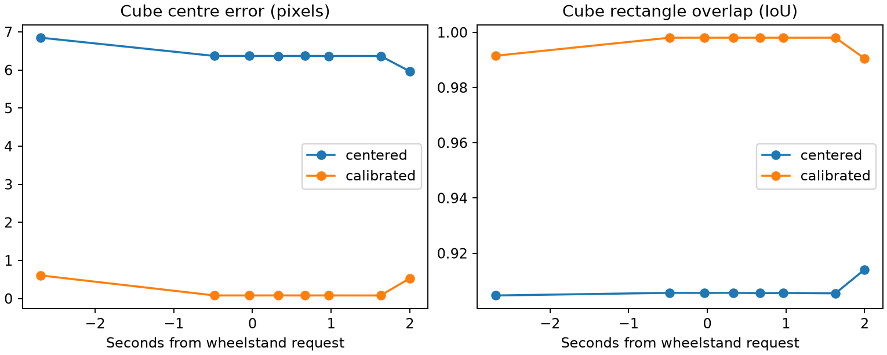

# W12 onboard camera transfer

Unit 3 reported eight cube rectangles with a robot state carrying the same image timestamp and localization origin. The samples span 2.69 s before the wheelstand request to 2.00 s after it. They cover acquisition and approach. These records predate this camera change and were held out of the calibration.

The native MuJoCo head camera now takes both focal lengths and the principal point from unit 3's SDK camera configuration for the 800 × 600 stream. The old camera used vertical field of view and a centred optical axis. With the SDK pose quaternion and head encoder, changing the intrinsics reduced mean projected cube-centre error from 6.38 to 0.20 pixels. Mean intersection over union rose from 0.9065 to 0.9963. Mean absolute width error changed from 0.29 to 0.42 pixels; height error stayed at 0.25 pixels. Adding the separate pose-pitch field to the quaternion reduced mean calibrated overlap to 0.8792.

The separate segmentation-render check places five targets across the moving camera's field, with robot visuals hidden for this instrument check. Worst image-centre error at those targets was 6.88 pixels before calibration and 0.31 pixels after calibration. Both checks address projection. The reported cube rectangles and cube poses originate in the same firmware vision pipeline, so their agreement does not establish independent optical accuracy, detection under shadow, fork occlusion, or contact dynamics.

Reproduce with `python evidence/unit3-wheelstand/W12/check_camera.py` and `python evidence/unit3-wheelstand/W12/render_optics.py` after exporting the models. The aligned observations, all pitch and projection variants, and segmentation measurements are in this directory.
