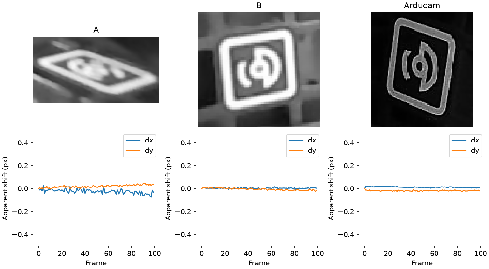

# Stationary cube glyph repeatability

A fresh passive capture of the docked robot and cube produced 100 images each from the two See3CAMs and the Arducam. The C270 recorded 30 packets in YUYV mode. Eighteen contained a full 614400-byte frame and twelve were empty. Its view clips the cube.

The three complete streams each use the first processed frame as a fixed reference. A tracks the top glyph, B and Arducam a side glyph. The tracker searches ±8 pixels and interpolates the horizontal and vertical correlation peaks separately. Over the subsequent 99 frames, the 95th percentile radial shift is 0.069 px for A, 0.020 px for B and 0.028 px for Arducam. The minimum normalized correlations are 0.997, 0.997 and 0.953. Median frame intervals are 54.8, 40.3 and 51.3 ms respectively. Rectification for the twins uses the existing shelf lens estimate. The Arducam view is rotated, color corrected, filtered and cropped. These repeatability measurements apply to a stationary target at this location. They do not measure accuracy during motion or establish metric scale or inter-camera alignment.

Run `python track.py` to reproduce the [per-frame offsets](glyph-offsets.csv) from the [lossless processed grayscale patches](glyph-crops.npz). The optional argument is the directory of original camera containers. Reprocessing the crops produced byte-identical CSV output. [Camera delivery measurements](streams.csv).
