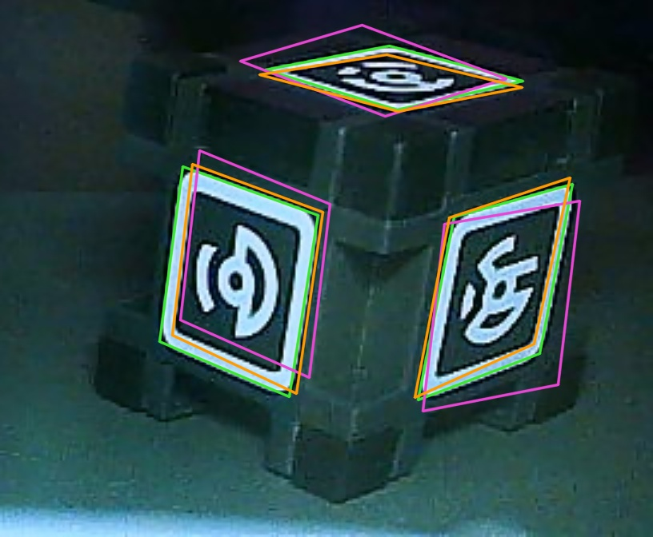

# Three-face check on the restored Arducam

We used the processed stationary image from the four-camera run. The outer glyph borders were modeled as centered 23 mm squares on perpendicular faces of a nominal 44 mm cube. The rounded printed corners were extrapolated by intersecting robust line fits to the middle 60% of each straight edge. Each fit used eight corners on two faces. All four corners on the remaining face were reserved for prediction.

At grayscale threshold 145, a square-pixel pinhole with centered principal point and estimated focal length had held-out corner RMS errors of 10.06 px (top), 10.35 px (left), and 9.11 px (right). Allowing the distance between opposite glyph planes to vary produced 10.41, 12.05 and 11.75 px respectively. The fitted distances ranged from 42.32 to 47.86 mm. A general projective camera with nominal cube geometry gave 2.74, 4.27 and 3.05 px. This last camera has eleven independent parameters estimated from just eight points on one cube pose. It is only a local diagnostic.

The image alone cannot distinguish lens distortion, principal point or pixel scaling from cube face recess, printed glyph spacing or contour localization. Fitting these corners does not justify resizing the cube or claiming a metric calibration across the shelf. The observed stationary subpixel tracking scatter addresses another question.

[All three edge thresholds and fit errors](face-transfer.csv) · [processed source crop](source.png) · [reproduce with Python, SciPy and OpenCV](check.py).
